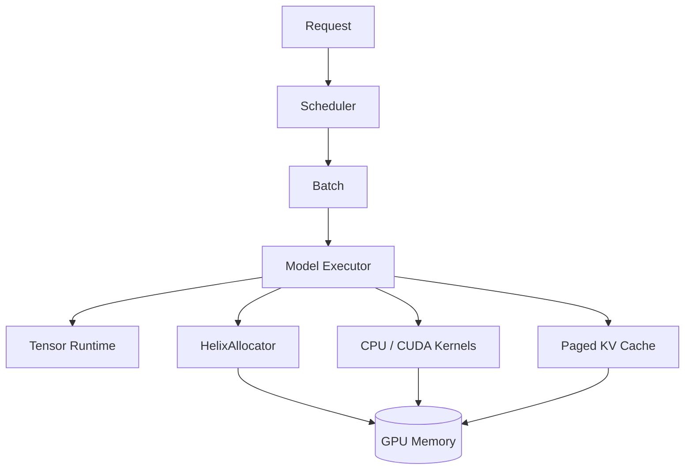

# Helix

**A C++/CUDA LLM inference runtime built from first principles.**

Helix explores the systems underneath modern decoder-only LLM inference: explicit
tensor/storage ownership, CPU correctness kernels, manually implemented CUDA
kernels, GPU allocation and asynchronous lifetime, paged KV cache, attention, and
continuous request batching.

The project is developed in correctness and measurement gates. Features are listed
as complete only after their applicable tests pass; optimization claims require
reproducible benchmark evidence.

## Current status

Milestones 0 and 1 are implemented and CPU-validated. The repository contains the
CPU-first build foundation and a checked contiguous tensor core with aligned CPU
storage, shape/stride metadata, scalar and zero-sized tensors, deterministic
initialization, safe reshape/views, deep copy, and guarded device transfer. On
2026-08-20, Apple Clang 17 built the project on macOS arm64 with warnings as errors;
29/29 tests passed in both the normal and ASan/UBSan configurations, and the
formatting check passed.

CUDA is optional at configure time. The current Apple Silicon development host has
no NVIDIA GPU or CUDA toolkit, so no CUDA execution or performance claim is made.

## Architecture



The full dependency, ownership, request-lifecycle, and memory designs are in
[`docs/ARCHITECTURE.md`](docs/ARCHITECTURE.md).

## Build

Dependencies are discovered from the system first. When GoogleTest or Google
Benchmark is missing, CMake fetches the pinned source release by default. Set
`HELIX_FETCH_DEPENDENCIES=OFF` for fully offline/system-package builds.

### CPU-only

```bash
cmake -S . -B build -DHELIX_ENABLE_CUDA=OFF
cmake --build build -j
ctest --test-dir build --output-on-failure
```

Or run the complete local CPU validation:

```bash
./scripts/run_cpu_validation.sh
```

### CUDA

On a machine with a CUDA compiler and toolkit:

```bash
cmake -S . -B build-cuda -DHELIX_ENABLE_CUDA=ON
cmake --build build-cuda -j
ctest --test-dir build-cuda --output-on-failure
```

At present this performs a real CUDA translation-unit compile but does not claim a
completed CUDA runtime or GPU-tested kernels.

### Sanitizers and analysis

```bash
cmake -S . -B build-sanitize \
  -DHELIX_ENABLE_CUDA=OFF \
  -DHELIX_ENABLE_SANITIZERS=ON
cmake --build build-sanitize -j
ctest --test-dir build-sanitize --output-on-failure

cmake --build build --target format-check
```

`HELIX_ENABLE_CLANG_TIDY=ON` requires `clang-tidy` in `PATH` and applies it only to
Helix targets.

## Benchmarks

```bash
cmake -S . -B build-release \
  -DCMAKE_BUILD_TYPE=Release \
  -DHELIX_ENABLE_CUDA=OFF
cmake --build build-release -j
./build-release/benchmarks/helix_benchmarks
```

The first release-mode `Tensor::zeros` baseline is recorded without an optimization
claim. Methodology and future measured experiments live in
[`docs/PERFORMANCE.md`](docs/PERFORMANCE.md).

## Tensor runtime

`helix::Tensor` is a shallow-copy handle over shared RAII storage. It tracks a
signed 64-bit shape and canonical row-major strides, dtype, device, logical bytes,
storage bytes, and byte offset. Size multiplication is checked before allocation.
`reshape`/`view` share storage only when safe; `clone` and same-device `to` create
independent storage. Float32 is executable, while Float16 currently supports only
metadata, allocation, zeroing, and bytewise copy.

```bash
cmake --build build --target helix_tensor_demo
./build/examples/helix_tensor_demo
```

## Supported hardware

- CPU foundation: validated with Apple Clang 17 on macOS arm64; Linux GCC/Clang
  validation is configured in CI.
- CUDA backend: requires a compatible NVIDIA CUDA toolkit; runtime hardware
  validation is pending and excluded from CPU CI.
- NCCL/multi-GPU: not implemented.

## Limitations

Mathematical kernels, CUDA runtime, allocator, attention, KV cache, scheduler,
model execution, and generation are roadmap work and are not represented as
complete. Float16 has no arithmetic path yet. Tensor execution is contiguous-only;
broadcasting, slicing, and general strided kernels are intentionally deferred.

## Engineering notes

- [Architecture](docs/ARCHITECTURE.md)
- [Roadmap and validation gates](docs/ROADMAP.md)
- [Performance methodology](docs/PERFORMANCE.md)
- [Contributor/agent rules](AGENTS.md)

Helix is independently implemented. Design inspiration may come from CUDA
documentation and public inference-system literature, but external source code is
not copied into the runtime.
