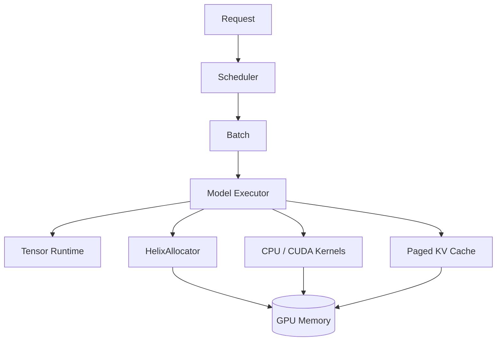

# Helix

**A C++/CUDA LLM inference runtime built from first principles.**

Helix explores the systems underneath modern decoder-only LLM inference: explicit
tensor/storage ownership, CPU correctness kernels, manually implemented CUDA
kernels, GPU allocation and asynchronous lifetime, paged KV cache, attention, and
continuous request batching.

The project is developed in correctness and measurement gates. Features are listed
as complete only after their applicable tests pass; optimization claims require
reproducible benchmark evidence.

## Current status

Milestones 0–2, the host-testable portions of Milestones 7–8, the CPU paths of
Milestones 9–10, the M11–M12 KV caches, the M13 direct paged-attention CPU path,
the M14–M16 request and continuous-batching scheduler, the M17 narrow Llama-style
CPU prefill runtime, the M18 single-sequence cached generation path, and the M19
synchronous multi-request CPU execution engine are implemented and CPU-validated.
The repository
contains the CPU-first build foundation, a checked contiguous tensor core,
Float32 reference kernels for elementwise math, reductions, stable softmax,
matrix multiplication, RMSNorm, SwiGLU, adjacent-pair RoPE, linear projection, and
causal scaled dot-product attention, plus a caching allocator, completion-aware deferred
reclamation, and layer-aware contiguous/paged KV histories with checked capacity
accounting and copy-free block-table attention traversal. The model composes those
primitives into embedding, pre-norm attention/MLP blocks, RoPE, SwiGLU, residuals,
final normalization, and an untied LM head, loads a checksummed versioned native
weight format, performs greedy generation through a contiguous KV cache, and
executes scheduler batches against a shared paged KV pool. On
2026-08-23, Apple Clang 17 built the project on macOS arm64 with warnings as
errors; 148/148 CPU tests passed in Debug, Release, and ASan/UBSan configurations.

CUDA is optional at configure time. The current Apple Silicon development host has
no NVIDIA GPU or native CUDA toolkit, so no CUDA execution or performance claim is
made. The M3 runtime layer, M4 manual Float32 elementwise kernels, M5 selectable
reduction/stable-softmax baselines, and M6 naive/tiled SGEMM are separately
compile-validated in an ARM64 CUDA 12.6 development container without a
driver/device. The M8 stream-ordered allocator and M9 block-reduced RMSNorm,
grid-stride SwiGLU, adjacent-pair RoPE, and projection adapter are also
compile-validated, as is the M10 three-stage contiguous attention baseline. None is
runtime-validated on a GPU. The CUDA-on build passes the same 148 hardware-
independent tests and registers 57 GPU tests that cannot run without a driver and
device.

## Architecture



The M19 CPU engine implements the scheduler/model/paged-cache path in this diagram.
The allocator-to-GPU-memory and CUDA-executor branches remain separately validated
lower layers, not yet an end-to-end GPU engine.

The full dependency, ownership, request-lifecycle, and memory designs are in
[`docs/ARCHITECTURE.md`](docs/ARCHITECTURE.md).

## Build

Dependencies are discovered from the system first. When GoogleTest or Google
Benchmark is missing, CMake fetches the pinned source release by default. Set
`HELIX_FETCH_DEPENDENCIES=OFF` for fully offline/system-package builds.

### CPU-only

```bash
cmake -S . -B build -DHELIX_ENABLE_CUDA=OFF
cmake --build build -j
ctest --test-dir build --output-on-failure
```

Or run the complete local CPU validation:

```bash
./scripts/run_cpu_validation.sh
```

### CUDA

On a machine with a CUDA compiler and toolkit:

```bash
cmake -S . -B build-cuda -DHELIX_ENABLE_CUDA=ON
cmake --build build-cuda -j
ctest --test-dir build-cuda --output-on-failure
```

The CUDA-on build contains checked device, stream, event, allocation, copy, and
Tensor-storage paths, manual elementwise kernels, CUDA-event benchmarks, and
hardware-gated correctness tests. Reduction includes naive, shared-memory, and
warp-shuffle paths; softmax includes naive and shared-memory paths; SGEMM includes
one-output-per-thread and 16x16 tiled paths. Transformer primitives add custom
RMSNorm, SwiGLU, and RoPE kernels while projection delegates to the selectable
custom SGEMM. The build is compile-validated, but those tests and benchmarks have
not executed on a physical NVIDIA GPU.

### Sanitizers and analysis

```bash
cmake -S . -B build-sanitize \
  -DHELIX_ENABLE_CUDA=OFF \
  -DHELIX_ENABLE_SANITIZERS=ON
cmake --build build-sanitize -j
ctest --test-dir build-sanitize --output-on-failure

cmake --build build --target format-check
```

`HELIX_ENABLE_CLANG_TIDY=ON` requires `clang-tidy` in `PATH` and applies it only to
Helix targets.

## Benchmarks

```bash
cmake -S . -B build-release \
  -DCMAKE_BUILD_TYPE=Release \
  -DHELIX_ENABLE_CUDA=OFF
cmake --build build-release -j
./build-release/benchmarks/helix_benchmarks
```

The first release-mode `Tensor::zeros` baseline is recorded without an optimization
claim. Allocation-free CPU reference-kernel baselines are also recorded, including
odd-width softmax, odd-dimension/standard-square matmul, SwiGLU, and decode/prefill-
shaped RoPE. Attention fixtures retain dimension-major baselines, measure a common
32-coordinate value tile, and compare direct block traversal against contiguous
storage. Contiguous-versus-paged KV lifecycle/layer-copy fixtures keep their actual
CPU costs and unfavorable results. A paired decode-staging fixture measures the
removal of an intermediate K/V snapshot, while complete next-position fixtures
compare cached decode with full-prefix recomputation. Scheduler traces separate
measured host-policy cost from a declared synthetic static-versus-continuous model;
neither is labeled as inference throughput. Complete CPU model prefill and checked
in-memory weight loading have three disclosed synthetic-model baselines; they are
reference-path measurements, not production inference claims. Paired end-to-end
CPU runtime traces retain sequential-token and full-prompt prefill modes; the
measured default reduced median trace CPU time by 15.8%–51.3% across three
disclosed tiny workloads. Methodology and measurements live in
[`docs/PERFORMANCE.md`](docs/PERFORMANCE.md).

## Tensor runtime

`helix::Tensor` is a shallow-copy handle over shared RAII storage. It tracks a
signed 64-bit shape and canonical row-major strides, dtype, device, logical bytes,
storage bytes, and byte offset. Size multiplication is checked before allocation.
`reshape`/`view` share storage only when safe; `clone` and same-device `to` create
independent storage. Float32 is executable, while Float16 currently supports only
metadata, allocation, zeroing, and bytewise copy.

```bash
cmake --build build --target helix_tensor_demo
./build/examples/helix_tensor_demo
```

## CPU reference kernels

The `helix::cpu` backend provides add, multiply, ReLU, SiLU, full and last-axis
sum, row-wise softmax, rank-two matmul, RMSNorm, SwiGLU, adjacent-pair RoPE, and a
model-layout linear wrapper. Each operation has a convenient allocating form and a
preallocated `_out` form used for benchmarking and GPU-oracle comparisons.
Broadcasting is deliberately rejected.

Reductions, GEMM, softmax denominators, and RMS statistics use wider accumulation
where helpful. Softmax subtracts the row maximum and explicitly defines NaN,
positive-infinity, and all-negative-infinity behavior.

```bash
cmake --build build --target helix_cpu_kernels_demo
./build/examples/helix_cpu_kernels_demo
```

## Caching allocator

`helix::memory::HelixAllocator` is a backend-neutral, mutex-protected best-fit
segment cache with alignment rounding, exact block splitting, adjacent coalescing,
allocator-instance and generation-tagged handles, reservation limits, explicit
trimming, and internal/external fragmentation statistics. `DeferredAllocator`
keeps logically freed allocations active until a completion object reports ready;
`StreamOrderedAllocator` implements that completion with timing-disabled CUDA
events recorded on an explicit release stream. The allocator/deferred metadata
passes 18 focused CPU and sanitizer tests. CUDA adapters and native-CUDA comparison
fixtures compile, but have not run on a GPU.

The allocator is not yet used by Tensor CUDA storage. Tensor does not yet record
every stream that uses its storage, so it cannot prove that a chosen release event
orders after all outstanding work. Design, measured host baselines, stream-ordering
contract, and limitations are in
[`docs/MEMORY_ALLOCATOR.md`](docs/MEMORY_ALLOCATOR.md).

## Attention

The M10 baseline implements causal scaled dot-product attention over equal Q/K/V
head counts. It exposes a reusable Float32 `[heads, queries, kv_tokens]` workspace,
supports both prefill and decode through an explicit query-position offset, and
keeps score, stable softmax, and probability-times-V stages visible. Its default
CPU value path uses a measured 32-coordinate stack tile; the original dimension-
major loop remains benchmarkable. The M13 CPU path reads written K/V spans directly
through a paged cache read lease without compacting history. CPU paths are tested,
sanitized, and benchmarked; only contiguous CUDA attention is compile-validated.
See [`docs/ATTENTION.md`](docs/ATTENTION.md).

## KV cache

The M11 CPU baseline owns per-sequence Float32 key/value tensors with explicit
layer, KV-head, capacity, and head-dimension axes. It appends one complete token,
retrieves compact layer histories compatible with contiguous attention, copies a
validated history prefix directly into larger decode buffers, rejects capacity
exhaustion transactionally, and reports exact active/peak bytes and token counts.
Cache-tagged sequence handles prevent foreign or released handles from freeing
storage. Six focused tests include cached-decode equivalence, direct-prefix-copy
bounds, and concurrent callers; lifecycle and preallocated layer-copy baselines
are measured.

The M12 paged path replaces per-sequence maximum-capacity allocations with a
fixed-token physical pool and logical block tables. A deterministic allocation-
free FIFO manages free blocks; append-on-boundary and release are transactional,
cache-tagged handles reject foreign/stale ownership, and statistics expose block,
byte, token-slot, reuse, and tail-slack behavior. Tests cover exhaustion, reuse,
concurrency, bulk layer-major prompt append, and a concrete contiguous capacity
comparison. The bulk path reserves the entire block-table extension before
ownership changes, then copies across partial and complete pages without
per-token Tensor packing. Benchmarks keep the faster steady-state lifecycle and
slower large-history compaction results. See
[`docs/KV_CACHE.md`](docs/KV_CACHE.md).

The paged cache also exposes a move-only layer read lease that pins pool/table
lifetime and excludes append/release while attention holds raw spans. This coarse
cache-wide lock is the current correctness boundary and a documented concurrency
limitation, not an asynchronous GPU lifetime mechanism.

## Request lifecycle and continuous batching

The M14 host-only `Request` uses strong request/token IDs and a move-only state
owner. It supports positive chunked prefill progress, decode token recording,
automatic length completion, EOS, cancellation, and failure with an exhaustive
waiting/prefill/decoding/terminal transition matrix. Explicit monotonic
`steady_clock` event times make wait, TTFT, and token-timing behavior deterministic
in tests. The M15 single-thread-owned scheduler owns requests, preserves waiting and
running FIFO order, separates chunked prefill from one-token decode work, and
enforces per-iteration token, running-request, and caller-supplied KV-block limits.
One checked batch may be in flight; ordered completion validates all results before
mutating any request and reports blocks to release on finish, failure, or
cancellation. Finished slots admit waiting work in the next iteration without a
static-cohort barrier. Metrics aggregate successful request rate, token rate, wait,
TTFT, request latency, and inter-token distributions at an explicit observation
boundary. A predictable final length-limited token consumes execution budget but
does not reserve a K/V block because it is selected from existing logits and never
fed back through the model. See
[`docs/SCHEDULER.md`](docs/SCHEDULER.md).

## Minimal transformer runtime

`helix::model::CpuLlamaModel` implements full causal prefill for one precisely
bounded Float32 Llama-style architecture: equal Q/K/V heads, full adjacent-pair
RoPE, bias-free row-major projections, pre-attention/pre-MLP RMSNorm, residuals,
SwiGLU, final norm, and an explicit untied LM head. A diagnostic trace exposes each
post-layer state; deterministic tests compare every layer and the final logits
with an independent vector oracle.

The little-endian `HELIXLM1` weight container has a versioned fixed header, exact
tensor-role/shape directory, 64-byte payload alignment, checked nonoverlapping
offsets, zero padding, finite Float32 validation, and metadata/per-payload FNV-1a
checksums. FNV is corruption detection, not authentication. The loader rejects
truncated, trailing, corrupted, noncanonical, or incompatible files before
returning a model. Exact layouts, ownership, validation, measured CPU baselines,
and compatibility boundaries are in
[`docs/MODEL_SUPPORT.md`](docs/MODEL_SUPPORT.md).

## Autoregressive generation

`helix::model::CpuLlamaGenerator` owns one `CpuLlamaModel`, one fixed-capacity
contiguous KV cache, and one sequence handle. Prefill captures each layer's
RoPE-transformed keys and values, then populates the cache only after model
execution succeeds. Each decode step validates the expected cache position,
computes one token, reads prior K/V directly into the final attention buffers,
and appends the new K/V only after the complete step succeeds. Greedy selection
uses the last logits row, rejects non-finite values, and chooses the lowest token
ID on a tie. Maximum-new-token, optional EOS, and context-capacity stops are
explicitly reported.

The minimal CLI deliberately accepts token IDs because Helix does not yet ship a
tokenizer or claim a public-checkpoint mapping:

```bash
cmake --build build --target helix_generate
./build/examples/helix_generate \
  --model ./models/example.helix \
  --max-new-tokens 16 \
  1 42 17
```

This CLI path remains single-sequence CPU Float32. The separate M19 engine below
uses the same model semantics for multiple scheduled requests. Correctness and
measured CPU decode baselines are in
[`docs/MODEL_SUPPORT.md`](docs/MODEL_SUPPORT.md) and
[`docs/PERFORMANCE.md`](docs/PERFORMANCE.md).

## CPU runtime engine

`helix::runtime::CpuRuntimeEngine` owns one model, one FIFO scheduler, one global
paged KV pool, and one session per live request. Each synchronous iteration reads
actual free-block capacity, schedules a mixed batch, executes genuine prefill or
cached-decode model work, reports ordered completions, and reclaims terminal K/V
blocks before returning. Deterministic tests cover continuous refill, token/KV
budgets, exact-boundary exhaustion, reuse, EOS, cancellation, and injected model
failure.

The default full-prompt path executes an admitted prompt in one causal model call
and transactionally bulk-appends layer-major K/V. A retained sequential-token mode
handles chunked prompts and provides the paired benchmark baseline. Work items are
still executed serially on the CPU; this is a correctness engine, not fused GPU
batch execution. Ownership, protocol, measurements, and limitations are in
[`docs/RUNTIME.md`](docs/RUNTIME.md).

## Supported hardware

- CPU foundation: validated with Apple Clang 17 on macOS arm64; Linux GCC/Clang
  validation is configured in CI.
- CUDA backend: requires a compatible NVIDIA CUDA toolkit; runtime hardware
  validation is pending and excluded from CPU CI.
- NCCL/multi-GPU: not implemented.

## Limitations

The CUDA runtime, M4–M6/M9–M10 kernels, and M7–M8 CUDA allocator adapters are
compile-validated only; physical GPU correctness, timing, and resource validation
remain pending. KV caches, paged attention, and continuous batching are host-only;
the CPU engine integrates the scheduler with physical paged-KV capacity and model
execution, but scheduled work items run serially and no tensor batch is formed.
Transformer execution currently supports CPU Float32 prefill, contiguous-KV
single-sequence generation, and paged-KV multi-request orchestration; tokenization,
public checkpoint conversion, GPU-resident paged KV, and CUDA model dispatch
remain roadmap work. Tensor
allocator integration is also pending. Float16 has no arithmetic path yet. Tensor
execution is contiguous-only; broadcasting, slicing, and general strided kernels are intentionally
deferred. CPU kernels are reference implementations, not optimized BLAS
replacements.

## Engineering notes

- [Architecture](docs/ARCHITECTURE.md)
- [Roadmap and validation gates](docs/ROADMAP.md)
- [CUDA runtime ownership and validation](docs/CUDA_RUNTIME.md)
- [CUDA kernel design and validation](docs/CUDA_KERNELS.md)
- [Contiguous and paged attention design](docs/ATTENTION.md)
- [KV-cache design and accounting](docs/KV_CACHE.md)
- [Request and scheduler design](docs/SCHEDULER.md)
- [CPU runtime execution engine](docs/RUNTIME.md)
- [Model architecture and native weight format](docs/MODEL_SUPPORT.md)
- [Caching allocator design and fragmentation](docs/MEMORY_ALLOCATOR.md)
- [Performance methodology](docs/PERFORMANCE.md)
- [Interview guide](docs/INTERVIEW_GUIDE.md)
- [Resume notes](docs/RESUME.md)
- [Contributor/agent rules](AGENTS.md)

Helix is independently implemented. Design inspiration may come from CUDA
documentation and public inference-system literature, but external source code is
not copied into the runtime.
