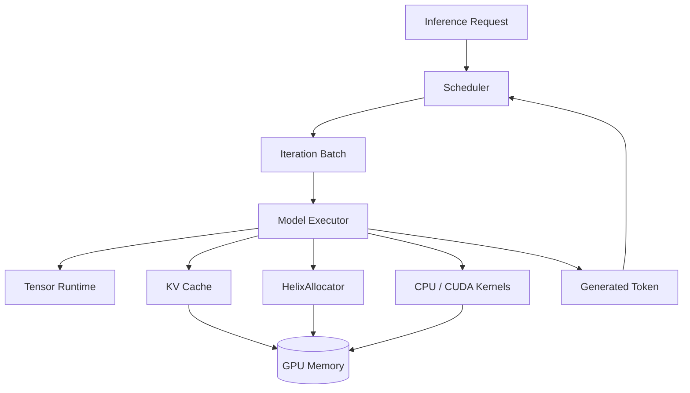
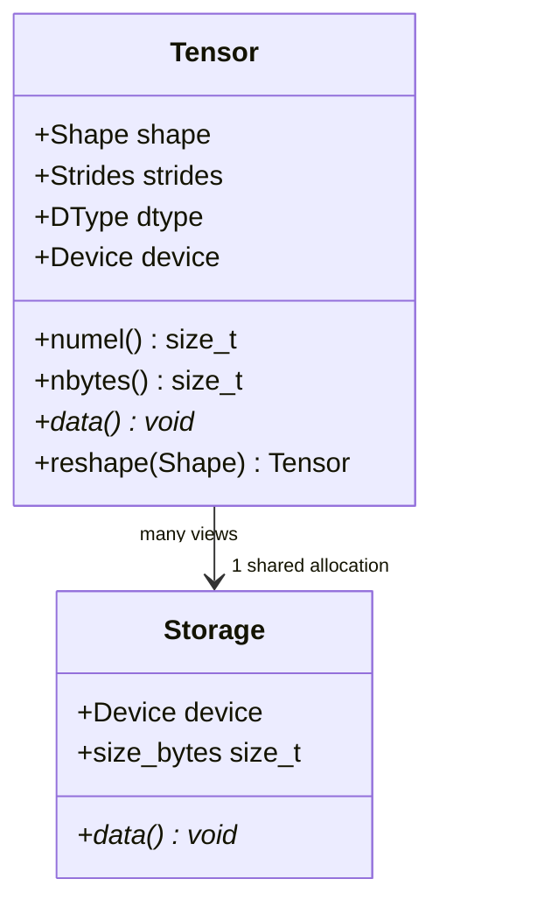
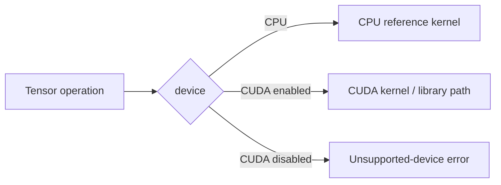
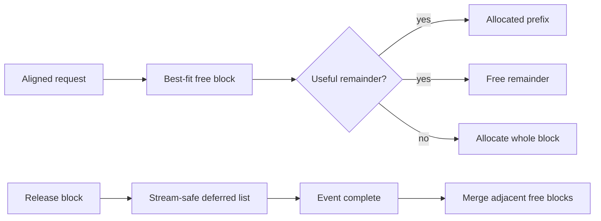
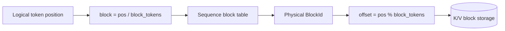
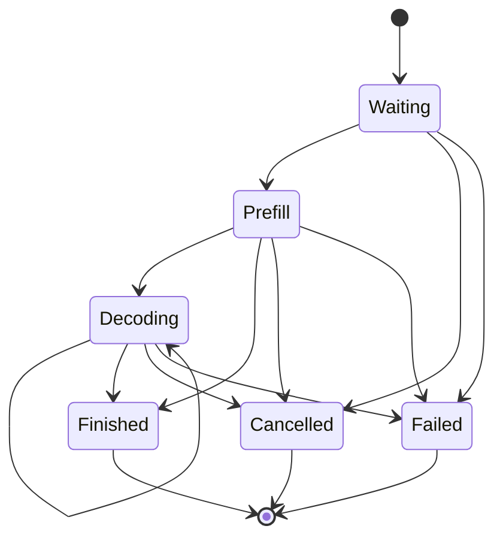
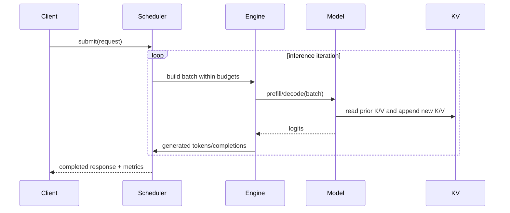

# Helix Architecture

## Purpose and current status

Helix is a lightweight C++20/CUDA runtime for studying and implementing the core
systems behind decoder-only LLM inference. It deliberately exposes tensor layout,
kernel dispatch, GPU memory lifetime, KV paging, scheduling, and asynchronous
execution rather than delegating the whole runtime to a framework.

This document is the target architecture. A component is not complete merely
because it appears here. `docs/ROADMAP.md` and the README distinguish implemented,
validated, and planned work.

## Design principles

- CPU execution is a first-class correctness path and development mode.
- CUDA is an optional compile-time backend, never a configuration-time requirement
  for CPU development.
- Ownership and asynchronous lifetime are explicit.
- Reference implementations precede optimized kernels.
- Custom kernels remain available beside any later library-backed implementation.
- Scheduler policy is independent of tensor and CUDA mechanics.
- Metrics are measurements, not feature claims.

## System context



The eventual runtime executes one scheduling iteration at a time: admit requests,
construct prefill/decode work within token and KV-memory budgets, execute the model,
append K/V state, select tokens, and retire or requeue requests.

## Layering and dependency direction

```mermaid
flowchart TB
    App[CLI / Examples / Benchmarks]
    Runtime[Runtime Engine]
    Model[Model Executor]
    Schedule[Request + Scheduler]
    Attention[Attention + KV Cache]
    Ops[Tensor Operations]
    Tensor[Tensor + Storage]
    Backend[CPU Backend | Optional CUDA Backend]
    Core[Core: errors, logging, dtype, device, checked sizes]

    App --> Runtime
    Runtime --> Model
    Runtime --> Schedule
    Model --> Attention
    Model --> Ops
    Attention --> Ops
    Attention --> Tensor
    Ops --> Tensor
    Tensor --> Backend
    Backend --> Core
    Tensor --> Core
    Schedule --> Core
```

Dependencies point downward. In particular, the scheduler must not include CUDA
headers, and kernels must not know about requests. Backend-specific implementation
details stay out of public, backend-neutral headers where possible.

## Build modes

### CPU-only

`HELIX_ENABLE_CUDA=OFF` configures a C++-only project. It builds core utilities,
tensor/storage, CPU kernels, request/KV metadata, scheduler logic, model structure,
and all applicable tests and benchmarks. CUDA headers and libraries are not
required.

### CUDA

`HELIX_ENABLE_CUDA=ON` explicitly requires a CUDA compiler and toolkit. It adds
CUDA sources, runtime wrappers, GPU storage, kernels, and hardware-gated tests. A
missing toolkit is a clear configuration error rather than a silent fallback.

CUDA validation has three distinct levels:

1. CPU CI: CUDA is disabled; no CUDA claim is made.
2. CUDA compile validation: CUDA translation units compile and link without a GPU.
3. GPU runtime validation: correctness, sanitizer, and benchmark workloads run on
   named NVIDIA hardware.

## Core types and error policy

`Device` is a value type containing a backend kind (`CPU` or `CUDA`) and a device
index. CPU currently permits only index zero. CUDA device construction does not by
itself touch the runtime; backend operations validate availability.

`DType` identifies the element representation and maps to a checked byte size.
Float32 is the first executable type. Float16 is introduced only with explicit
conversion and arithmetic behavior.

Recoverable host-side contract and runtime failures throw `helix::Error` with a
stable category and contextual message. Programmer invariants that cannot safely
continue use a fatal check. Destructors never throw; cleanup failures are logged or
handled by an explicit `close`/synchronization operation when callers need them.

Size helpers reject negative dimensions and detect overflow before allocation or
pointer arithmetic.

## Tensor runtime

### Representation

A `Tensor` is a small handle with:

- shape and strides,
- dtype and device,
- logical element count,
- visible byte count,
- byte offset into storage,
- shared ownership of a `Storage` allocation.



Storage owns memory; Tensor owns metadata. A view shares storage and changes only
metadata/offset after validating bounds. The initial implementation supports
contiguous row-major tensors. General strided execution is deferred until kernels
need it; APIs reject unsupported non-contiguous inputs rather than silently
producing wrong results.

### Ownership

- Owning factory operations allocate `Storage` through the backend allocator.
- Views retain shared storage ownership.
- A non-owning external-buffer tensor, if added, requires an explicit lifetime
  token/deleter; it will not masquerade as owning memory.
- Copies are shallow handle copies. `clone` performs a deep copy.
- Device transfer returns new storage on the target device.

## Device abstraction and backends

Backend-neutral code dispatches using the tensor's `DeviceType`. CPU storage uses
aligned host allocation. CUDA storage eventually uses the active allocator rather
than direct `cudaMalloc` per tensor.



Dispatch is initially explicit and readable. A registry is justified only if the
operation/type/backend matrix becomes difficult to maintain.

## CPU backend

CPU kernels are deterministic correctness oracles and a usable fallback, not an
attempt to replace optimized BLAS. Initial Float32 kernels use straightforward
loops and numerically stable formulas. Parallelism and SIMD may be explored only
after baselines are retained and measured.

The reference set grows in dependency order: elementwise operations, activations,
reduction, softmax, matrix multiplication, RMSNorm, and SwiGLU.

## CUDA backend

### Runtime layer

The CUDA layer wraps device selection, streams, events, allocations, copies, and
synchronization in move-only RAII types. Every CUDA API call produces contextual
errors. Public headers either avoid CUDA types or hide them behind backend-specific
headers so CPU clients do not require the toolkit.

### Kernel progression

Educational kernels remain separately selectable and benchmarkable:

- elementwise: direct one-element-per-thread baselines,
- reductions: naive, shared-memory, then warp-assisted variants,
- softmax: correct row-wise baseline, then reduced global traffic,
- GEMM: naive, shared-memory tiled, then evidence-driven refinements,
- transformer operations: RMSNorm, RoPE, SwiGLU, and attention components.

cuBLAS/cuBLASLt may later provide an optimized GEMM path. It will be labeled as a
library backend and compared honestly with custom kernels.

## Memory allocator

`HelixAllocator` owns device segments obtained from CUDA and suballocates aligned
blocks. The baseline design uses best-fit selection because LLM workloads mix a
small number of long-lived weight/KV allocations with transient buffers; choosing
the smallest sufficient free block limits avoidable remainder growth. Benchmarks
will compare this hypothesis with allocation traces rather than treating it as
settled fact.

Each segment maintains address-ordered blocks for adjacency/merging and a
size-oriented free index for lookup. Allocation splits a block only when the
remainder can satisfy alignment and minimum-block constraints. Freeing merges
adjacent free blocks within the same underlying CUDA segment.



The allocator reports reserved, allocated, reusable free, peak allocated,
allocation/reuse counts, and underlying CUDA allocation count. External
fragmentation is defined as `1 - largest_free_block / total_free_bytes` when free
bytes are nonzero; otherwise it is zero. Alignment waste and unsplittable tails
are reported separately as internal fragmentation when implemented.

The baseline allocator is explicitly single-stream or synchronization-requiring.
Stream-aware reuse adds CUDA event-tracked deferred frees; it is not simulated by
blind immediate reuse.

## Attention

The first scaled dot-product attention path materializes the understandable stages:

```text
scores = Q * transpose(K)
scores = masked(scores / sqrt(head_dimension))
probabilities = softmax(scores)
output = probabilities * V
```

This path establishes correctness and memory-cost baselines. Fusion or paged
attention follows only after profiling identifies the relevant traffic and launch
costs.

## KV cache

For each layer, cached keys and values avoid recomputing projections for prior
tokens during decode. A contiguous baseline first defines append, read, capacity,
and release behavior.

Paged KV storage divides capacity into fixed-token blocks. A per-sequence block
table maps logical token blocks to physical blocks:



The manager owns a free-block pool, allocation state, and sequence tables. The
first memory-pressure policy rejects admission/append with a typed resource error
while preserving current sequences. Preemption, prefix sharing, and reference
counting are added only for implemented policies that need them.

## Request and scheduler

A request has a stable ID, prompt tokens, generation limit, timestamps/metrics,
and a validated state machine:



The FIFO scheduler initially admits work subject to a per-iteration token budget
and available KV blocks. Prefill consumes prompt tokens; decode normally consumes
one token per running request. Continuous batching removes completed requests and
admits waiting work at the next iteration without waiting for an original static
batch to drain.

Scheduler state is host-only and deterministic in tests. The initial scheduler is
not thread-safe; the runtime engine owns it from one orchestration thread. A future
multi-producer submission queue may provide the synchronization boundary.

## Model executor

The first supported model is a narrowly specified Llama-style decoder-only
architecture using pre-normalization, RoPE, grouped heads only if required by the
chosen checkpoint, SwiGLU MLPs, and a final RMSNorm/LM head. Exact tensor names,
layouts, supported dimensions, precision, and tokenizer boundary will be recorded
in `docs/MODEL_SUPPORT.md` before claiming model compatibility.

Weight conversion may use a one-time Python tool. The execution runtime remains
C++/CUDA. The Helix weight container will include a versioned header, dtype, rank,
dimensions, byte length, alignment, and validated offsets.

## Runtime execution and asynchronous work



CUDA execution starts with one explicit stream. Additional streams are introduced
only with event-defined dependencies. Pinned staging buffers support genuinely
asynchronous host-device copies. Each overlap experiment records both latency and
throughput because concurrency can increase contention.

## Observability and benchmark integrity

Logging has severity, source context, and a replaceable sink without imposing a
large dependency. Allocator and scheduler metrics are snapshots with documented
units. Profiling ranges may be added without changing execution semantics.

Every benchmark report records hardware, software, dimensions, precision, build
mode, warmups, measured iterations, timing mechanism, and synchronization. GPU
benchmarks use CUDA events for device work and may separately report end-to-end
host latency.

## Security and robustness boundaries

- Model files and CLI dimensions are untrusted inputs and receive bounds/overflow
  validation.
- Resource exhaustion returns explicit errors; it does not corrupt allocator or KV
  state.
- Allocations, streams, events, and library handles are released by RAII.
- CPU sanitizer jobs cover host memory and undefined behavior.
- CUDA runtime validation includes `compute-sanitizer` when hardware is available.

## Deliberate limitations

The initial architecture does not promise training, autograd, arbitrary model
graphs, arbitrary strides, production serving APIs, quantization, prefix sharing,
preemption, or multi-GPU inference. Each can be considered only after the core
runtime is correct and measured.
