# Helix Architecture

## Purpose and current status

Helix is a lightweight C++20/CUDA runtime for studying and implementing the core
systems behind decoder-only LLM inference. It deliberately exposes tensor layout,
kernel dispatch, GPU memory lifetime, KV paging, scheduling, and asynchronous
execution rather than delegating the whole runtime to a framework.

This document is the target architecture. A component is not complete merely
because it appears here. `docs/ROADMAP.md` and the README distinguish implemented,
validated, and planned work.

## Design principles

- CPU execution is a first-class correctness path and development mode.
- CUDA is an optional compile-time backend, never a configuration-time requirement
  for CPU development.
- Ownership and asynchronous lifetime are explicit.
- Reference implementations precede optimized kernels.
- Custom kernels remain available beside any later library-backed implementation.
- Scheduler policy is independent of tensor and CUDA mechanics.
- Metrics are measurements, not feature claims.

## System context

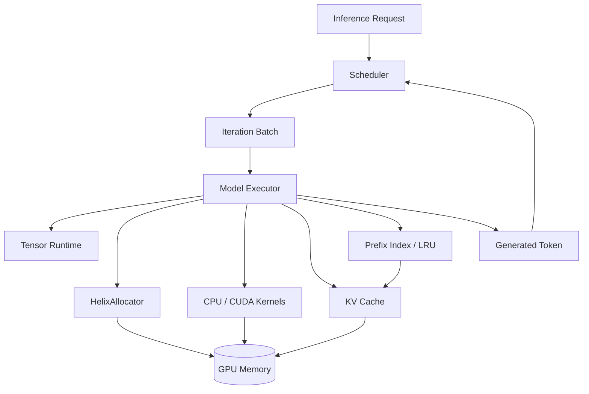

The implemented synchronous CPU runtime executes one scheduling iteration at a
time: admit requests, construct prefill/decode work within token and KV-memory
budgets, optionally seed exact cached prefixes, execute the model serially, append
paged K/V state, select tokens, and retire or requeue requests. CUDA model
execution now has an isolated synchronous full-prefill composition baseline;
CUDA-backed K/V, scheduling, and asynchronous iterations remain later layers of
this architecture.

## Layering and dependency direction

```mermaid
flowchart TB
    App[CLI / Examples / Benchmarks]
    Runtime[Runtime Engine]
    Model[Model Executor]
    Schedule[Request + Scheduler]
    Attention[Attention]
    Cache[KV + Prefix Cache]
    Ops[Tensor Operations]
    Memory[Allocator + Tensor-storage bridge]
    Tensor[Tensor + Storage]
    Backend[CPU Backend | Optional CUDA Backend]
    Core[Core: errors, logging, dtype, device, checked sizes]

    App --> Runtime
    App --> Memory
    Runtime --> Model
    Runtime --> Schedule
    Runtime --> Cache
    Model --> Attention
    Model --> Ops
    Attention --> Cache
    Attention --> Ops
    Cache --> Tensor
    Attention --> Tensor
    Ops --> Tensor
    Memory --> Tensor
    Memory --> Backend
    Tensor --> Backend
    Backend --> Core
    Tensor --> Core
    Schedule --> Core
```

Dependencies point downward. In particular, the scheduler must not include CUDA
headers, and kernels must not know about requests. Backend-specific implementation
details stay out of public, backend-neutral headers where possible.

## Build modes

### CPU-only

`HELIX_ENABLE_CUDA=OFF` configures a C++-only project. It builds core utilities,
tensor/storage, CPU kernels, request/KV metadata, scheduler logic, model structure,
and all applicable tests and benchmarks. CUDA headers and libraries are not
required.

### CUDA

`HELIX_ENABLE_CUDA=ON` explicitly requires a CUDA compiler and toolkit. It adds
CUDA sources, runtime wrappers, GPU storage, kernels, and hardware-gated tests. A
missing toolkit is a clear configuration error rather than a silent fallback.
`HELIX_ENABLE_CUDA_LINEINFO=ON` is an independent opt-in that adds CUDA source-line
metadata for profiler correlation without enabling device-debug execution.

CUDA validation has three distinct levels:

1. CPU CI: CUDA is disabled; no CUDA claim is made.
2. CUDA compile validation: CUDA translation units compile and link without a GPU.
3. GPU runtime validation: correctness, sanitizer, and benchmark workloads run on
   named NVIDIA hardware.

### Installed package boundary

Helix installs its public headers, the generated build-mode configuration header,
static libraries, and a relocatable CMake package. `find_package(Helix CONFIG)`
reconstructs the public dependency graph through stable imported names such as
`helix::tensor`, `helix::model`, and `helix::runtime`; consumers do not need to
repeat Helix's internal library ordering.

The package records whether it was built with CUDA in `Helix_CUDA_ENABLED`. A
CPU-only package exports no CUDA target. A CUDA package additionally exports
`helix::cuda_runtime` and `helix::cuda_kernels` and resolves `CUDAToolkit` before
loading those imported targets. This is a build-contract distinction, not runtime
device detection: a CUDA package may be consumed and compile-checked on a machine
whose toolkit is present but whose NVIDIA driver/device is absent.

The package smoke test deliberately crosses the repository boundary. It installs
to a fresh prefix, configures a separate CMake project using only
`find_package(Helix)`, links `helix::runtime`, compiles against installed headers,
and runs a CPU reference operation. CUDA builds also compile a public CUDA-model
type assertion while keeping the executable path device-independent. Instrumented
static libraries export their sanitizer-runtime link requirement; the ASan/UBSan
configuration runs the same downstream test instead of assuming in-tree link flags
will cover consumers.

## Core types and error policy

`Device` is a value type containing a backend kind (`CPU` or `CUDA`) and a device
index. CPU currently permits only index zero. CUDA device construction does not by
itself touch the runtime; backend operations validate availability.

`DType` identifies the element representation and maps to a checked byte size.
Float32 is the arithmetic type. UInt32 represents token/index tensors and has
typed construction/access, zeroing, copies, transfers, and embedding lookup.
Float16 remains byte storage until explicit conversion and arithmetic behavior are
implemented.

Recoverable host-side contract and runtime failures throw `helix::Error` with a
stable category and contextual message. Programmer invariants that cannot safely
continue use a fatal check. Destructors never throw; cleanup failures are logged or
handled by an explicit `close`/synchronization operation when callers need them.

Size helpers reject negative dimensions and detect overflow before allocation or
pointer arithmetic.

## Tensor runtime

### Representation

A `Tensor` is a small handle with:

- shape and strides,
- dtype and device,
- logical element count,
- visible byte count,
- byte offset into storage,
- shared ownership of a `Storage` allocation or aligned external range.

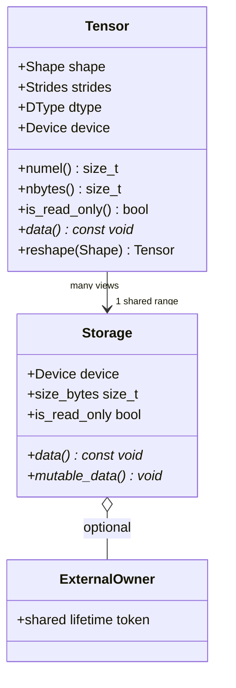

Storage owns memory or an explicit shared lifetime token; Tensor owns metadata. A
view shares storage and changes only metadata/offset after validating bounds.
Externally owned CPU ranges may be explicitly immutable or mutable. Immutable
ranges reject non-const raw access and in-place operations, views preserve the
flag, and a deep clone returns ordinary writable owned storage. Mutable ranges
validate pointer/capacity/alignment/owner consistency and expose storage capacity
separately from logical bytes. The initial implementation supports contiguous
row-major tensors. General strided execution is deferred until kernels need it;
APIs reject unsupported non-contiguous inputs rather than silently producing wrong
results.

### Ownership

- Ordinary owning factory operations allocate `Storage` through a backend-specific
  routine and CUDA defaults remain direct. The opt-in single-stream allocator
  bridge described below provides event-safe pooled CUDA Storage.
- Views retain shared storage ownership.
- A read-only external-buffer Tensor requires a non-null shared lifetime owner for
  non-empty storage, validates its declared alignment, and never exposes a mutable
  pointer. The owner—not Tensor—defines how the backing resource is released.
- A mutable external-buffer Tensor applies the same pointer, owner, and alignment
  checks and additionally requires backing capacity to cover checked logical bytes.
- `memory::allocate_cpu_tensor` wraps one generation-tagged `HelixAllocator`
  handle in such mutable Storage. The lifetime token retains the allocator, views
  retain Storage, and the final release returns the block to the cache exactly once.
  Zero-sized tensors bypass the pool. This bridge is opt-in; ordinary factories and
  deep clones retain direct Storage allocation.
- Copies are shallow handle copies. `clone` performs a deep copy.
- Device transfer returns new storage on the target device.

## Device abstraction and backends

Backend-neutral code dispatches using the tensor's `DeviceType`. Default CPU
storage uses aligned host allocation; clients may opt into the CPU allocator bridge
at an explicit ownership boundary. CUDA storage eventually uses the active
stream-aware allocator rather than direct `cudaMalloc` per tensor.

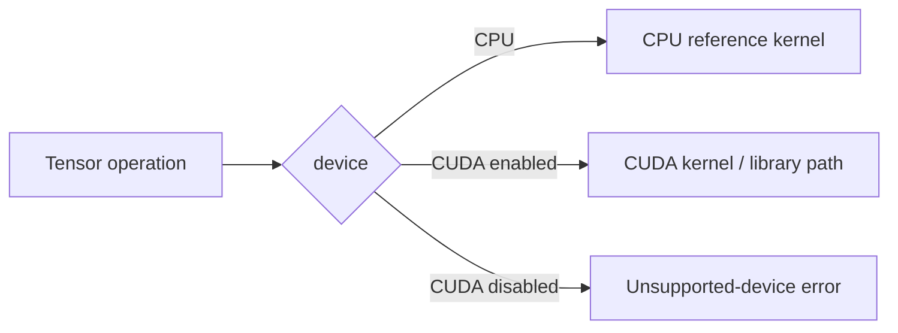

Dispatch is initially explicit and readable. A registry is justified only if the
operation/type/backend matrix becomes difficult to maintain.

## CPU backend

CPU kernels are deterministic correctness oracles and a usable fallback, not an
attempt to replace optimized BLAS. Initial Float32 kernels use straightforward
loops and numerically stable formulas. Parallelism and SIMD may be explored only
after baselines are retained and measured.

The reference set grows in dependency order: elementwise operations, activations,
reduction, softmax, matrix multiplication, RMSNorm, SwiGLU, adjacent-pair RoPE,
embedding lookup, token/head layout transforms, and bias-free linear projection.
CPU embedding first validates every UInt32 token ID, then copies selected Float32
rows, so an out-of-vocabulary failure cannot partially mutate caller output. The
layout transform swaps the first two axes of rank-three Float32 storage while
copying each innermost head vector contiguously; overlapping logical ranges are
rejected.

## CUDA backend

### Runtime layer

The CUDA layer wraps device selection, streams, events, device allocations,
portable pinned-host buffers, copies, and synchronization in move-only RAII types.
Every CUDA API call produces contextual errors. Public headers either avoid CUDA
types or hide them behind backend-specific headers so CPU clients do not require
the toolkit. Pinned buffers have explicit transfer-completion lifetime and are a
prerequisite for testing actual host/device overlap; their presence alone is not
an overlap claim.

The M20 experiment makes the intended dependency graph concrete without wiring it
into the runtime: two transfer streams alternate two device slots, one compute
stream waits on input-ready events, transfer work waits on compute-ready events,
and a coordinator joins final slot events for cross-stream timing. The one-stream
baseline is retained, and only real measurements can justify adopting the graph.

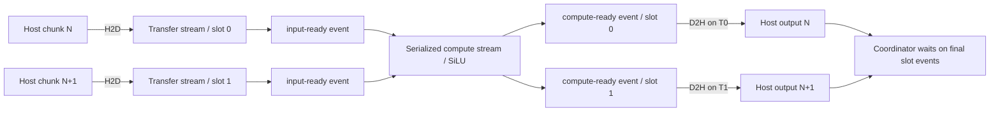

### Kernel progression

Educational kernels remain separately selectable and benchmarkable:

- elementwise: direct one-element-per-thread baselines,
- reductions: naive, shared-memory, then warp-assisted variants,
- softmax: correct row-wise baseline, then reduced global traffic,
- GEMM: naive, shared-memory tiled, then evidence-driven refinements,
- transformer operations: embedding lookup, token/head layout transforms, RMSNorm,
  RoPE, SwiGLU, and attention components.

cuBLAS/cuBLASLt may later provide an optimized GEMM path. It will be labeled as a
library backend and compared honestly with custom kernels.

The implemented transformer primitives retain the same separation. CUDA RMSNorm
uses a block/warp reduction, SwiGLU uses a pointwise grid-stride kernel, and RoPE
maps one thread to each adjacent coordinate pair. RoPE input is
`[tokens, ..., head_dimension]`, with preselected cosine/sine rows shaped
`[tokens, head_dimension/2]`; this keeps position selection outside the math kernel
and supports packed nonuniform positions later. Linear projection is a named
adapter over the selectable custom SGEMM and uses row-major
`[input_features, output_features]` weights.

Embedding is the explicit integer-to-floating boundary: UInt32 `[tokens]` indices
select rows from a Float32 `[vocabulary,hidden]` table. The CUDA baseline assigns
one block to each token and threads stride across the hidden dimension. Its `_out`
form is asynchronous and caller-owned. Metadata is checked before launch; the
kernel bounds-checks device-resident values before address formation and emits a
NaN row for invalid IDs rather than reading outside the table. Runtime-owned host
request IDs must still be range-validated before transfer because reporting a
device value as a synchronous host exception would require synchronization.

The attention-layout boundary is explicit rather than hidden in the model. Both
backends reorder `[tokens,heads,head_dimension]` to
`[heads,tokens,head_dimension]` and back. The CUDA baseline assigns one block to
each complete head vector, caps the grid, and strides 256 threads across its last
dimension. Adjacent active lanes therefore copy adjacent coordinates, while small
head dimensions leave lanes idle. The asynchronous `_out` form rejects exact and
partial range overlap and requires caller-owned input/output lifetime. Tiling or
fusion is deferred until a physical profiler identifies whether the standalone
copy is material.

## Memory allocator

`HelixAllocator` owns segments obtained from a pluggable `MemoryResource` and
suballocates aligned blocks. `SystemMemoryResource` makes the complete metadata
algorithm executable under CPU-only builds; `CudaMemoryResource` is the direct
`cudaMalloc`/`cudaFree` adapter. The baseline uses best-fit selection because LLM
workloads mix long-lived allocations with transient buffers, but benchmarks must
test that hypothesis rather than assuming it.

Each segment stores a vector of address-ordered blocks. The current baseline scans
all free blocks linearly, including alignment padding, then selects the candidate
with the smallest remainder and deterministic segment/address tie breaking. This
is intentionally simpler and easier to audit than a second size index; profiling
must justify a more complex index. Requested sizes round to the effective power-of-
two alignment. Allocation reserves metadata capacity and then splits exact prefix/
suffix remainders in place. Freeing marks the selected block inactive, shifts only
the necessary vector suffix, and coalesces its immediate free neighbors; free-block
adjacency is forbidden by invariant, so no wider scan is needed.

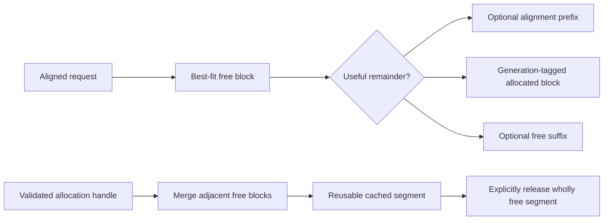

The allocator reports reserved, rounded allocated, requested, free, peak, largest
free block, active/segment counts, cache reuse, and upstream allocation/release
counts. External fragmentation is `1 - largest_free_block / bytes_free` when free
bytes are nonzero. Internal fragmentation is
`(bytes_allocated - bytes_requested) / bytes_allocated` when allocated bytes are
nonzero. Both are otherwise zero.

Allocation handles carry a process-unique allocator ID and monotonic local
allocation ID as well as pointer/size/alignment/device. A private index resolves an
active record in O(1); released record slots are linked into a reusable free list.
The monotonic ID is checked as a generation when a slot is recycled. Deallocation
validates all fields and both identities, so neither a stale copy nor a colliding
handle from another pool can free an allocation (the raw-pointer ABA/cross-pool
problem). This flat registry avoids one host hash-node allocation per logical
allocation. A mutex serializes metadata and upstream calls. Debug builds re-derive
segment coverage, block adjacency, counters, one-to-one active mappings, registry
free-list coverage, and alignment after every mutation without scratch allocation.

`DeferredAllocator` prevents immediate free-list reuse by holding an allocation in
a pending state behind a `Completion`; pending blocks remain active in the base
pool. `StreamOrderedAllocator` supplies CUDA-event completions recorded on an
explicit same-device release stream. Reclamation is nonblocking when polling and
blocking during explicit drain/destruction. This adapter is compile-validated, not
GPU-runtime-validated.

The CPU-only `allocate_cpu_tensor` bridge connects mutable Tensor Storage to the
base pool without asynchronous work. Its shared lifetime token owns the exact
allocation descriptor and a `shared_ptr` to the allocator; the final Storage owner
returns the block, while allocator segments remain cached until explicit trim or
allocator destruction. Cleanup errors are logged from a non-throwing destructor.

The opt-in `allocate_cuda_tensor_on_stream` bridge wraps one pooled device block as
mutable Tensor Storage and retains both a `StreamOrderedAllocator` and one usage
stream through the final view. Destruction records the release event and transfers
the exact generation-tagged handle to the pending list. Constructor rollback
returns a never-used block immediately; release-event failure falls back to bound-
stream synchronization before completed deallocation. A release event is safe only
when all prior uses happen-before it, so this is explicitly a single-stream API.
Tensor still has no per-storage stream ledger and cannot automatically aggregate
multi-stream dependencies. These CUDA paths are compile-validated, not presented
as physical event/reuse evidence.

## Attention

The implemented contiguous scaled dot-product attention path materializes the
understandable stages:

```text
scores = Q * transpose(K)
scores = masked(scores / sqrt(head_dimension))
probabilities = softmax(scores)
output = probabilities * V
```

Q/K/V layouts are `[heads, query_tokens, head_dimension]`,
`[heads, kv_tokens, head_dimension]`, and
`[heads, kv_tokens, value_dimension]`. An explicit query-position offset defines
causal masking for prefill and decode. The caller-owned score workspace is
`[heads, query_tokens, kv_tokens]`, or exactly `4*H*Q*K` bytes for Float32; softmax
reuses it in place.

The CPU implementation is the double-accumulating oracle. Its original
probability-times-V loop remains as a dimension-major benchmark baseline. The
default path uses a fixed 32-coordinate stack tile so each contiguous V row is
consumed while hot without changing any coordinate's accumulation order. The CUDA
baseline uses one serial-dot-product thread per score, the existing stable block
softmax, and one serial-KV-reduction thread per output coordinate. This deliberately
visible path establishes correctness and memory-cost baselines. Q/K/V heads must
currently match; GQA is not implied.

The CPU paged path accepts a move-only layer read lease from `PagedKvCache` and
resolves logical blocks directly to per-head K/V spans. It never materializes a
compact K/V history:

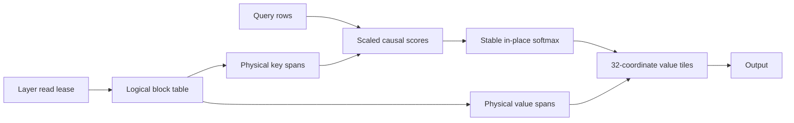

The lease shares ownership of the cache implementation and holds its mutex from
construction through destruction. That pins both the physical pool and the
sequence table and excludes append/release while raw spans are in use. It is safe
but intentionally coarse: one long read blocks unrelated sequences in the same
cache. The final logical block exposes only its written prefix, so stale bytes in
unused slots or recycled blocks are unreachable. CPU measurements compare retained
dimension-major baselines, equal tiled traversals, and the page-table overhead.
A compile-validated CUDA baseline instead consumes layer-local device tensors
`K/V[physical_blocks,heads,block_tokens,width]` and a move-only immutable device
table. Kernels translate each logical token to `(physical block, token offset)` and
bound the final partial page by the explicit logical KV length. This establishes a
visible device traversal contract, but it is not connected to the CPU
`PagedKvCache`, `HelixAllocator`, or model executor. Its compiler resource report is
not GPU coalescing or performance evidence.

The runtime decode variant logically extends the leased history with an
uncommitted contiguous `[heads,tail_tokens,head_dimension]` K/V tail. Tail query
row `q` sees all cached positions plus tail rows through `q`; the cache is not
mutated while attention runs. The model returns all-layer tail K/V and the engine
appends it only after successful execution. This removes two combined-history
tensors per layer while retaining the compact-copy implementation as an explicit
oracle and benchmark baseline.

## KV cache

For each layer, cached keys and values avoid recomputing projections for prior
tokens during decode. The implemented Float32 CPU baseline stores two owned tensors
per sequence with layout `[layers, kv_heads, capacity_tokens, head_dimension]`.
Appending one `[layers, kv_heads, head_dimension]` token fills the current logical
position. Layer retrieval creates a compact owning
`[kv_heads, active_tokens, head_dimension]` snapshot compatible with contiguous
attention; a preallocated-output form excludes allocation when required.

`ContiguousKvCache` is the sole storage owner. Non-owning sequence handles combine
a process-unique cache ID with a monotonic local sequence ID, so foreign, stale,
and released handles cannot mutate another allocation. Creation reserves the full
capacity under a byte ceiling, and exhaustion is transactional. One mutex
serializes mutable sequence state; returned snapshots are independent. Exact
layout, byte formulas, tests, and limitations are documented in
`docs/KV_CACHE.md`.

Paged KV storage divides capacity into fixed-token blocks. A per-sequence block
table maps logical token blocks to physical blocks:

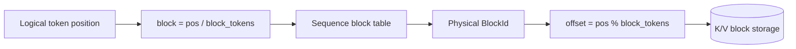

The implemented M12 CPU manager owns two physical-major tensors shaped
`[physical_blocks, layers, kv_heads, block_tokens, head_dimension]`, a preallocated
circular FIFO free-block pool, reference/free/written-token/reuse metadata, and one block table per
sequence. It allocates a physical block only when an append begins a new logical
block. The sequence table is grown before the free queue changes, so metadata OOM
or pool exhaustion preserves the prior mapping and logical length. Release
prevalidates references and returns a block without allocating only when its last
sequence reference disappears.

The M19 bulk append accepts one `[kv_heads,tokens,head_dimension]` key/value pair
per layer. It validates the entire layer-major input, checks capacity, and reserves
the final block-table size before assigning any block. Copies then traverse maximal
spans in a partial or whole page. This lets full model prefill populate the paged
pool without allocating and repacking one `[layers,heads,dimension]` Tensor pair per
token; scalar append remains the incremental decode path.

The M22 block-sharing primitive forks a positive prefix only when its length is an
exact multiple of `block_tokens`. The new sequence copies block IDs into its own
metadata table and increments physical reference counts; K/V payload is not
copied. Because every shared block is full, both branches begin future appends on
exclusive pages and never mutate shared payload. Logical active-token accounting
therefore differs from unique resident-token accounting.

`PagedPrefixCache` adds a bounded content-index layer over those forks. Every
entry owns `(namespace, exact token vector, persistent anchor sequence)` and sits
in an MRU list. A hash index is keyed by namespace, aligned token count, and an
incremental 64-bit token digest; lookup still verifies the complete vector, so a
digest collision affects only candidate cost and never identity. Longest lookup
probes every aligned prefix of the query in one token pass, forks the longest
exact anchor, and transfers release responsibility for that logical child to the
caller. Entry-count and retained-block-reference limits evict the LRU anchors.

The lock order is prefix index then paged cache. A caller must not invoke prefix
operations while holding a `LayerReadView` from the same pool. Metadata insertion
stages token storage, anchor ownership, list state, and hash indexing so allocation
failure either leaves no entry or releases the staged anchor. The prefix manager
owns a `shared_ptr` to the paged cache; destroying or clearing it releases every
persistent anchor.

The first memory-pressure policy rejects append with a typed resource error while
preserving current sequences; an append within an already-owned partial block can
still proceed. Debug builds re-derive ownership and accounting invariants after
every mutation. Both contiguous and paged CPU caches use one mutex per instance.
The M13 read lease lets attention traverse written block spans without compaction;
its exclusive lifetime lock is the current invalidation boundary. GPU-resident pool
integration and request preemption remain separate milestones. In the CPU runtime,
retained prefix anchors are evicted in LRU order only when their page ownership
prevents the scheduler from making any progress.

## Request and scheduler

The implemented M14 request is a move-only owner of a strong nonzero request ID,
immutable prompt tokens, generated-token/timestamp records, generation limit,
terminal context, and validated state machine:

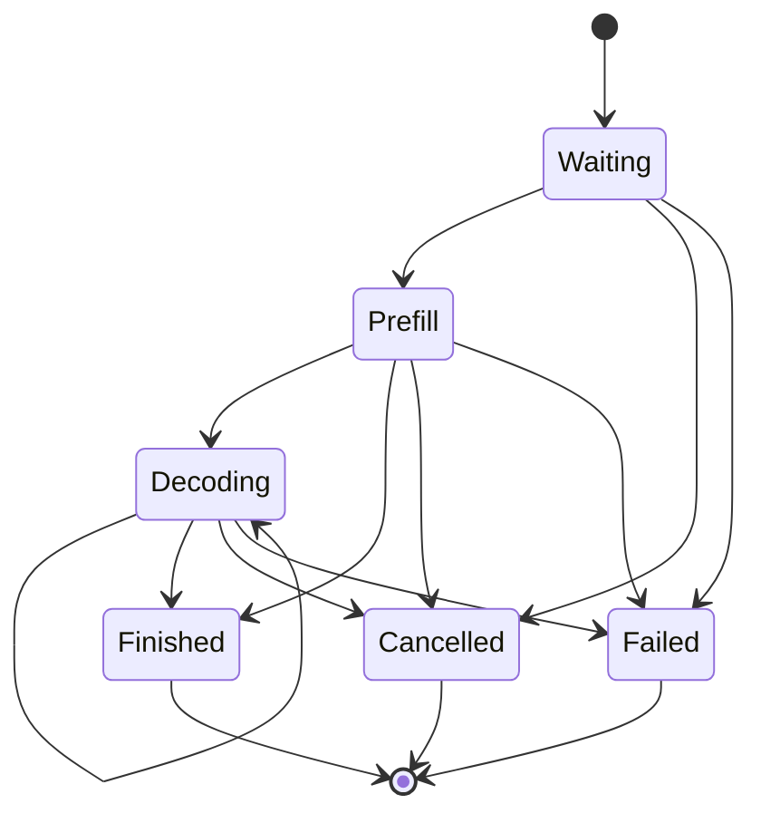

Positive prefill progress may be chunked across iterations. Completing the prompt
enters decode, except a zero generation budget finishes immediately. Appending a
generated token at the configured limit finishes with `length`; EOS, cancellation,
and failure are explicit alternatives. Terminal states have no exits. Every event
uses a caller-supplied monotonic `steady_clock` time, allowing deterministic wait,
TTFT, completion, and inter-token metric derivation. The request is not thread-safe;
one scheduler thread owns mutation. Details and the exhaustive transition matrix
are in `docs/SCHEDULER.md`.

The scheduler can also receive a waiting request with a validated, block-aligned
reused-prefix count. The request records that seed immediately for ownership and
statistics, but logical prefill progress advances only when FIFO admission occurs;
only the uncached suffix becomes model work.

The implemented FIFO scheduler owns requests in a stable map, orders waiting IDs in
a deque, and bounds running IDs in admission order. Each iteration is limited by a
token budget, running-request capacity, and a caller-supplied count of free KV
blocks. Prefill describes a positive prompt range and may be chunked; decode emits
one-token work. Existing running requests are considered before waiting admission,
which is deterministic but intentionally permits head-of-line delay.

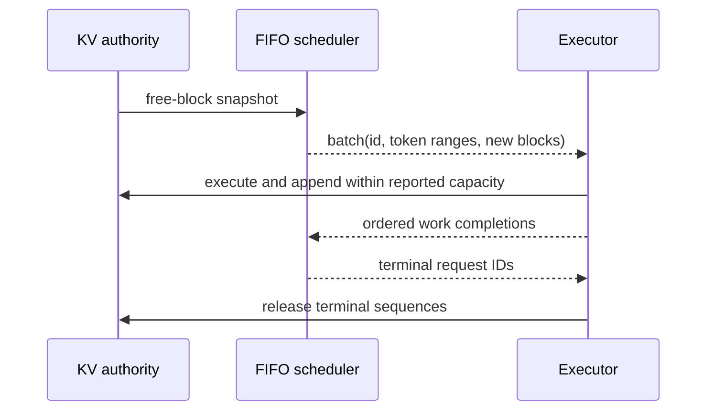

The scheduler does not own physical cache blocks. It predicts block deltas from
logical token counts; the runtime must supply an authoritative free-block snapshot,
keep physical and logical lengths aligned, and release terminal sequences. A final
length-limited token has zero new-block demand because it is selected from existing
logits and is not fed back through the model. Only one batch can be in flight. Completion first
validates every ordered result, then stages all potentially allocating state before
request mutation. This prevents a malformed late result or allocation failure from
partially committing an iteration.

Scheduler state remains host-only and deterministic in tests. It is not thread-
safe; the runtime engine will own it from one orchestration thread. A future multi-
producer submission queue may provide the synchronization boundary.

Continuous replacement is a consequence of the completion/admission boundary:
terminal IDs leave the running vector after an iteration, and the next call admits
waiting IDs into those slots before the surviving cohort finishes. Mixed batches
may therefore carry decode work for resident requests and prefill ranges for newly
admitted requests. This is implemented and deterministically tested both at the
host-policy layer and through the M19 CPU engine with genuine model/cache work.

Metrics are derived from immutable request snapshots at a caller-provided
`steady_clock` observation time. The reporting path validates distinct live IDs and
monotonic time, aggregates state/token counters, then sorts duration samples for
linearly interpolated p50/p95 values. Waiting time includes scheduled requests,
TTFT includes requests with at least one token, request latency includes successful
finishes only, and inter-token latency contributes one sample per adjacent token
pair. Rate denominators begin at the earliest request creation time and require a
positive observation window. Snapshot allocation/sorting is intentionally outside
the per-iteration scheduling hot path.

## Model executor

The implemented M17 model and M18 generation baseline form a narrowly specified
CPU Float32 Llama-style decoder. It uses equal Q/K/V head counts, full
adjacent-pair RoPE over an even head dimension, pre-attention and pre-MLP RMSNorm,
bias-free projections, causal
attention, residuals, SwiGLU, final normalization, and an explicit untied LM head.
All projection weights use row-major `[input_features,output_features]` layout.
GQA/MQA, partial rotary dimensions, biases, tied embeddings, quantization, and
arbitrary checkpoint graphs are rejected rather than guessed.

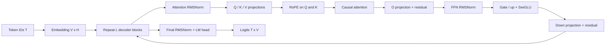

`CpuLlamaModel` moves a validated `LlamaWeights` bundle into one model owner. Its
const forward path allocates independent activations and has no shared mutable
state. Ordinary caller-created Tensor weights remain shallow-copyable, so thread
safety requires that retained writable aliases not be mutated. The mapped loader
instead constructs immutable Tensor views, making that condition enforceable for
file-backed weights. The optional diagnostic path preserves post-layer Tensor
handles and the final normalized state; ordinary execution does not retain those
intermediates.

`CudaLlamaModel` accepts a validated CPU weight bundle and owns a deep copy on one
CUDA device. The host-token overload validates every ID before any transfer and
builds RoPE tables with the same private helper as the CPU model. The device-input
overload requires preloaded contiguous UInt32 IDs and Float32 cosine/sine tables on
the model device; this is the benchmark/composition boundary. Device-resident IDs
cannot be inspected without a transfer, so the embedding kernel turns an invalid
ID into a NaN row after checking the ID before table address formation. The normal
host path rejects that ID instead.

All kernels inside the device-input prefill execute on the caller's stream; the
host overload's ID/RoPE transfers are blocking prerequisites. Each layer owns its
projections, repacked Q/K/V, attention output, and explicit
`[heads,tokens,tokens]` score workspace until a stream synchronization completes.
Only then are layer temporaries destroyed and the next hidden state installed.
Final norm/projection receives the same completion boundary before device logits
return. An exceptional exit makes a best effort to drain already accepted work
before local storage unwinds while preserving the original error.

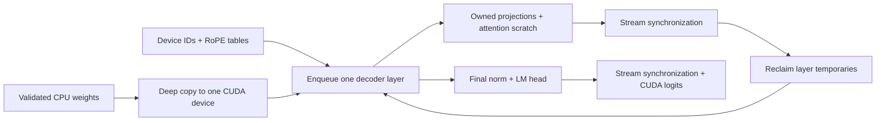

These barriers are a correctness baseline, not a proposed throughput design. The
path uses ordinary Tensor device allocation rather than `HelixAllocator`, exposes
the existing token/head copies and unfused attention stages, and has no K/V decode,
batch construction, graph capture, or overlap. Replacing the barriers requires an
explicit long-lived workspace or stream-aware allocator ownership; merely deleting
them would permit asynchronous use-after-free.

`CpuLlamaGenerator` is the single-sequence session owner. It contains the model,
one `ContiguousKvCache`, and one sequence handle and is deliberately noncopyable,
nonmovable, and not thread-safe. The cache owns fixed-capacity
`[layer,head,capacity,dimension]` K/V storage; temporary attention tensors remain
ordinary CPU Tensor allocations. A caller cannot outlive or accidentally pair the
session's handle with another cache.

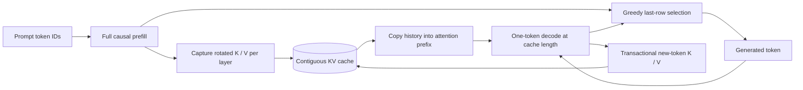

Prefill performs all model math before populating cache storage. The standalone
contiguous-cache generator validates that the supplied position equals cache
length, copies each layer prefix into a caller-owned buffer with one tail row, and
writes current K/V there. The paged runtime defaults to direct block-table
attention over the cached history plus an uncommitted current tail; compact copy is
still selectable. Both paths return new K/V separately, and their caller appends
only after the entire token step and final logits projection succeed. This keeps
model failures from advancing logical cache length. Multi-call execution assumes
the caller does not mutate the same sequence concurrently.

The `HELIXLM1` container is a deterministic little-endian format with a fixed
128-byte versioned header, fixed-size tensor directory, exact role/layer/shape
records, and 64-byte-aligned Float32 payloads. Loading validates file size,
configuration arithmetic, canonical nonoverlapping offsets, zero padding, finite
values, an FNV-1a metadata checksum, and one checksum per payload before returning
a model. FNV provides accidental-corruption detection, not authenticity. Details
and the exact byte layout are in `docs/MODEL_SUPPORT.md`.

The offline checkpoint boundary is intentionally outside runtime execution:

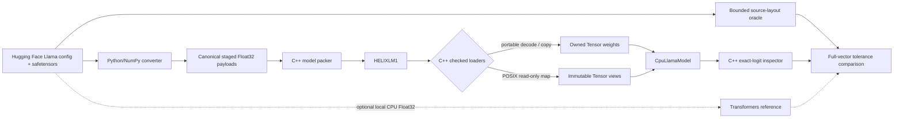

Python owns only strict safetensors/index parsing and chunked dtype/layout
conversion. It transposes `[output,input]` linear weights and interleaves Q/K
coordinates per head so Hugging Face half-split RoPE matches Helix adjacent-pair
RoPE. The C++ packer remains the format authority: it checks raw-file count,
shape-derived sizes, finite little-endian Float32 values, aliasing, and checksums.
Packing occurs in a private same-filesystem temporary directory, and the final
path changes only through atomic replacement after success. The runtime has no
Python dependency.

The bounded validation tool is a correctness harness rather than another runtime:
it independently reads source-layout tensors, evaluates the supported equations,
and compares the complete final logit row emitted by the C++ inspector. Its
generation mode compares Helix contiguous-KV greedy decode with repeated full-
prefix source evaluation; the opt-in external path additionally uses Transformers
`past_key_values`. One revision-pinned public tiny-random checkpoint passes the
logit checks and one eight-token generation trace. Exact artifact hashes,
tolerances, and exclusions are recorded in `docs/MODEL_SUPPORT.md`.

Both native load paths share header/directory validation and scan every payload
for checksum and finite-value correctness. The portable path decodes into aligned
owned allocations. On POSIX little-endian IEEE-754 hosts, the explicit mapped path
creates one private read-only file mapping and payload-sized Tensor storage views
that share its RAII lifetime. It avoids parameter allocation/copy but does not
avoid page faults or validation scans. Rename/unlink is safe after load; modifying
or truncating the live source inode violates the mapping contract.

The current CPU path performs full causal prefill and single-token decode against
either contiguous or paged K/V storage, using the shared layout kernels to repack
token-major Q/K/V tensors around the existing head-major attention API. Greedy
selection, EOS/length/context stops, a token-ID CLI, and scheduler-driven multi-
request paged decode are implemented.
The runtime schedules several requests per iteration but executes their model work
serially; a fused tensor batch, tokenizer integration, validation of additional
checkpoint architectures, CUDA cached decode, and GPU runtime dispatch remain
later work. The
implemented converter supports only the documented ordinary Hugging Face Llama
safetensors layout and rejects GQA/MQA, biases, scaled/partial RoPE, quantization,
and arbitrary model graphs rather than guessing compatibility.

## Runtime execution and asynchronous work

`CpuRuntimeEngine` is the implemented M19 orchestration baseline. It owns the
scheduler, one model, one global paged cache, an optional M22 prefix manager, and a
request/session map. The entire sequence below completes synchronously on its
owning thread:

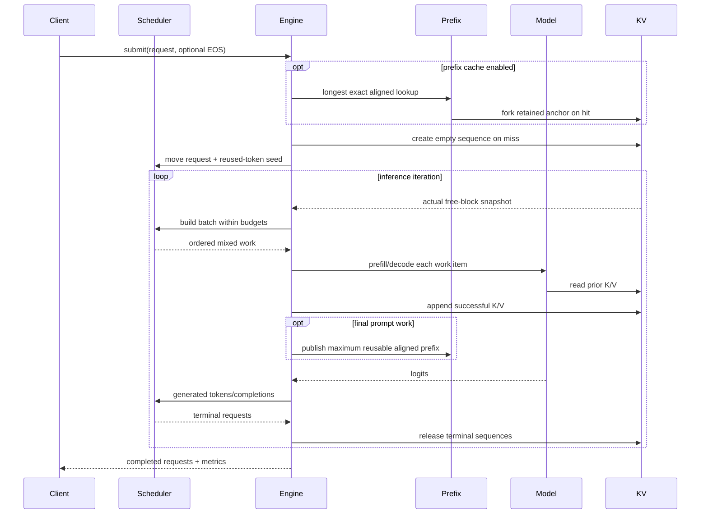

Every operation checks that paged-cache length equals the scheduler's token offset.
Complete new prompts use one full causal prefill and a transactional layer-major
bulk append; chunked prompts retain a selectable token-at-a-time baseline. The
default paged decode traverses block-table spans with a current-token tail; its
compact-copy predecessor remains selectable for paired tests and benchmarks.
On a prefix hit, scheduling starts at the reused physical/logical length and the
engine evaluates the remaining suffix sequentially. It never reuses the complete
prompt: the retained object contains K/V but not the logits after that prompt, so
at least one token must execute to produce fresh sampling logits. If cached anchors
consume the free pages needed for a FIFO head and no batch can be built, the engine
evicts LRU entries and retries scheduling. Model/cache failures become failed ordered
completions and reclaim their sequence; cancellation reclaims waiting or running
sessions immediately when no batch is in flight. See `docs/RUNTIME.md`.

Future CUDA execution starts with one explicit stream. Additional streams are introduced
only with event-defined dependencies. Pinned staging buffers support genuinely
asynchronous host-device copies. Each overlap experiment records both latency and
throughput because concurrency can increase contention.

## Observability and benchmark integrity

Logging has severity, source context, and a replaceable sink without imposing a
large dependency. Allocator and scheduler metrics are snapshots with documented
units. Profiling ranges may be added without changing execution semantics.

Every benchmark report records hardware, software, dimensions, precision, build
mode, warmups, measured iterations, timing mechanism, and synchronization. GPU
benchmarks use CUDA events for device work and may separately report end-to-end
host latency.

## Security and robustness boundaries

- Model files and CLI dimensions are untrusted inputs and receive bounds/overflow
  validation.
- Resource exhaustion returns explicit errors; it does not corrupt allocator or KV
  state.
- Allocations, streams, events, and library handles are released by RAII.
- CPU sanitizer jobs cover host memory and undefined behavior.
- CUDA runtime validation includes `compute-sanitizer` when hardware is available.

## Deliberate limitations

The initial architecture does not promise training, autograd, arbitrary model
graphs, arbitrary strides, production serving APIs, quantization, automatic
cross-model prefix namespaces, partial-page prefix sharing, preemption, or
multi-GPU inference. Each can be considered only after the core runtime is correct
and measured.

The CUDA full-prefill composition is compile-validated but has not executed on an
NVIDIA device. It synchronizes per layer, allocates temporaries directly, and is
not connected to paged K/V, the scheduler, or the runtime engine. No correctness,
latency, throughput, occupancy, or memory-capacity inference is drawn from CUDA
compilation alone.
