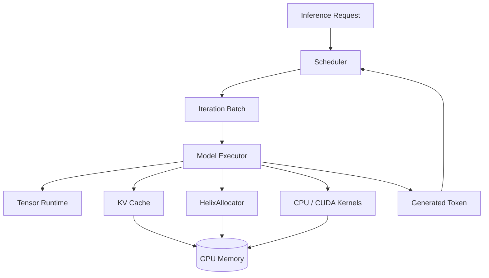
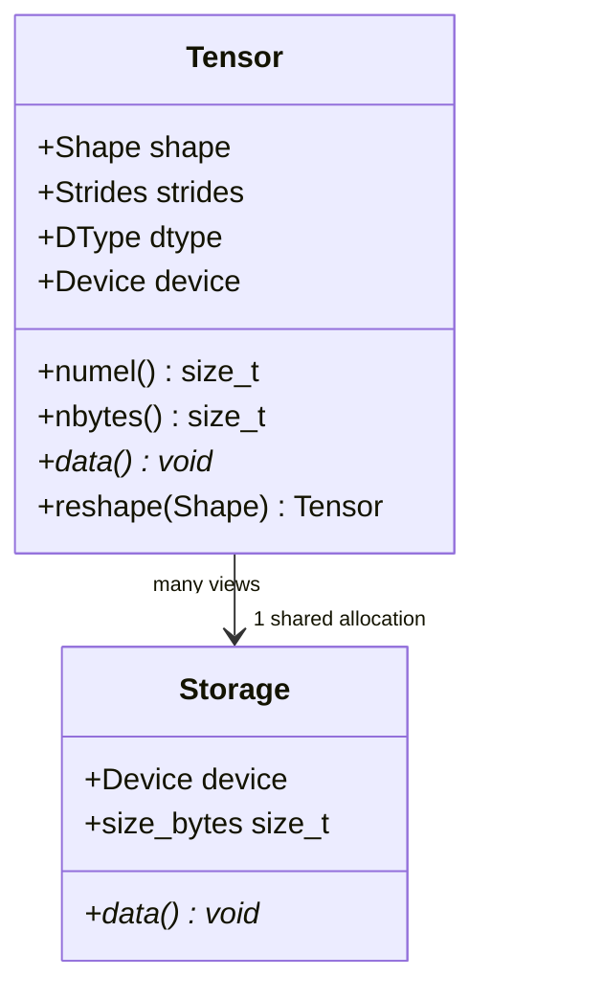
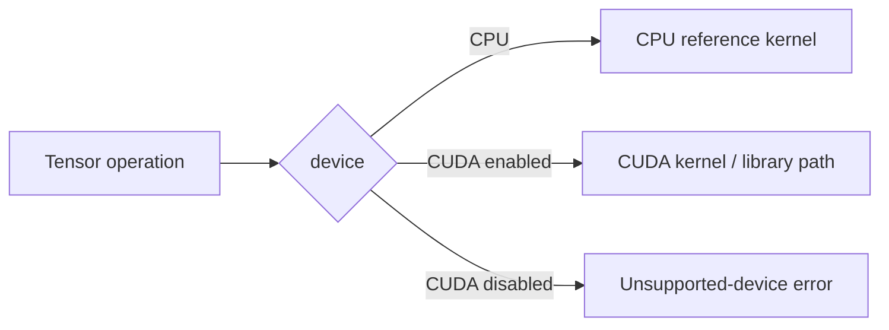
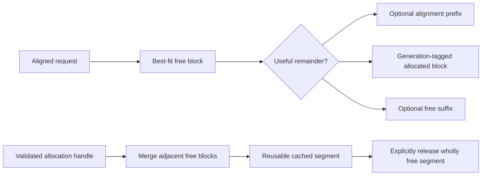
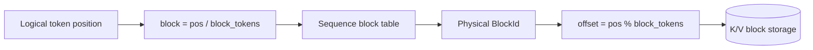
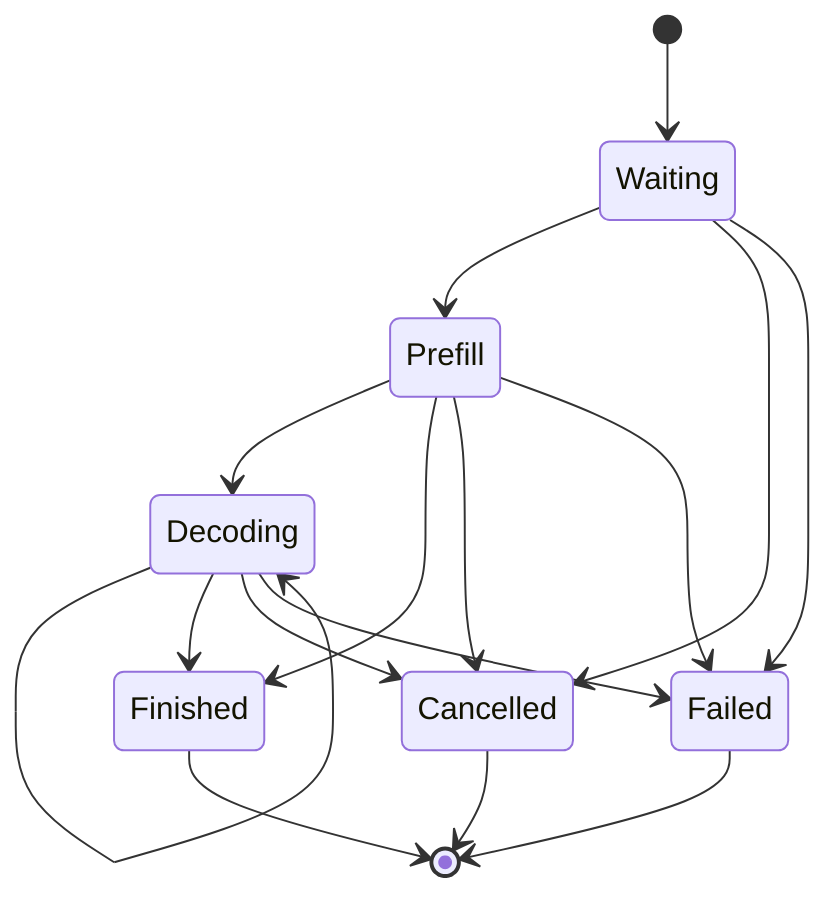
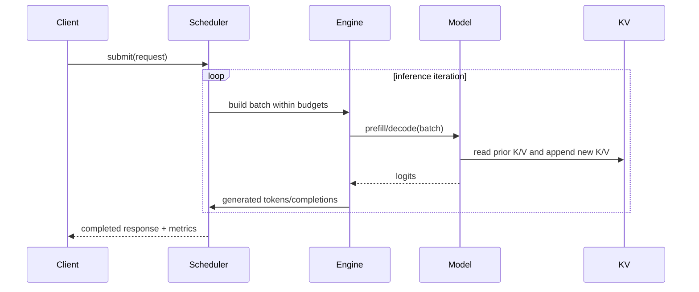

# Helix Architecture

## Purpose and current status

Helix is a lightweight C++20/CUDA runtime for studying and implementing the core
systems behind decoder-only LLM inference. It deliberately exposes tensor layout,
kernel dispatch, GPU memory lifetime, KV paging, scheduling, and asynchronous
execution rather than delegating the whole runtime to a framework.

This document is the target architecture. A component is not complete merely
because it appears here. `docs/ROADMAP.md` and the README distinguish implemented,
validated, and planned work.

## Design principles

- CPU execution is a first-class correctness path and development mode.
- CUDA is an optional compile-time backend, never a configuration-time requirement
  for CPU development.
- Ownership and asynchronous lifetime are explicit.
- Reference implementations precede optimized kernels.
- Custom kernels remain available beside any later library-backed implementation.
- Scheduler policy is independent of tensor and CUDA mechanics.
- Metrics are measurements, not feature claims.

## System context



The eventual runtime executes one scheduling iteration at a time: admit requests,
construct prefill/decode work within token and KV-memory budgets, execute the model,
append K/V state, select tokens, and retire or requeue requests.

## Layering and dependency direction

```mermaid
flowchart TB
    App[CLI / Examples / Benchmarks]
    Runtime[Runtime Engine]
    Model[Model Executor]
    Schedule[Request + Scheduler]
    Attention[Attention + KV Cache]
    Ops[Tensor Operations]
    Tensor[Tensor + Storage]
    Backend[CPU Backend | Optional CUDA Backend]
    Core[Core: errors, logging, dtype, device, checked sizes]

    App --> Runtime
    Runtime --> Model
    Runtime --> Schedule
    Model --> Attention
    Model --> Ops
    Attention --> Ops
    Attention --> Tensor
    Ops --> Tensor
    Tensor --> Backend
    Backend --> Core
    Tensor --> Core
    Schedule --> Core
```

Dependencies point downward. In particular, the scheduler must not include CUDA
headers, and kernels must not know about requests. Backend-specific implementation
details stay out of public, backend-neutral headers where possible.

## Build modes

### CPU-only

`HELIX_ENABLE_CUDA=OFF` configures a C++-only project. It builds core utilities,
tensor/storage, CPU kernels, request/KV metadata, scheduler logic, model structure,
and all applicable tests and benchmarks. CUDA headers and libraries are not
required.

### CUDA

`HELIX_ENABLE_CUDA=ON` explicitly requires a CUDA compiler and toolkit. It adds
CUDA sources, runtime wrappers, GPU storage, kernels, and hardware-gated tests. A
missing toolkit is a clear configuration error rather than a silent fallback.

CUDA validation has three distinct levels:

1. CPU CI: CUDA is disabled; no CUDA claim is made.
2. CUDA compile validation: CUDA translation units compile and link without a GPU.
3. GPU runtime validation: correctness, sanitizer, and benchmark workloads run on
   named NVIDIA hardware.

## Core types and error policy

`Device` is a value type containing a backend kind (`CPU` or `CUDA`) and a device
index. CPU currently permits only index zero. CUDA device construction does not by
itself touch the runtime; backend operations validate availability.

`DType` identifies the element representation and maps to a checked byte size.
Float32 is the first executable type. Float16 is introduced only with explicit
conversion and arithmetic behavior.

Recoverable host-side contract and runtime failures throw `helix::Error` with a
stable category and contextual message. Programmer invariants that cannot safely
continue use a fatal check. Destructors never throw; cleanup failures are logged or
handled by an explicit `close`/synchronization operation when callers need them.

Size helpers reject negative dimensions and detect overflow before allocation or
pointer arithmetic.

## Tensor runtime

### Representation

A `Tensor` is a small handle with:

- shape and strides,
- dtype and device,
- logical element count,
- visible byte count,
- byte offset into storage,
- shared ownership of a `Storage` allocation.



Storage owns memory; Tensor owns metadata. A view shares storage and changes only
metadata/offset after validating bounds. The initial implementation supports
contiguous row-major tensors. General strided execution is deferred until kernels
need it; APIs reject unsupported non-contiguous inputs rather than silently
producing wrong results.

### Ownership

- Owning factory operations allocate `Storage` through a backend-specific storage
  routine. CUDA storage remains direct until the cache is stream-safe.
- Views retain shared storage ownership.
- A non-owning external-buffer tensor, if added, requires an explicit lifetime
  token/deleter; it will not masquerade as owning memory.
- Copies are shallow handle copies. `clone` performs a deep copy.
- Device transfer returns new storage on the target device.

## Device abstraction and backends

Backend-neutral code dispatches using the tensor's `DeviceType`. CPU storage uses
aligned host allocation. CUDA storage eventually uses the active allocator rather
than direct `cudaMalloc` per tensor.



Dispatch is initially explicit and readable. A registry is justified only if the
operation/type/backend matrix becomes difficult to maintain.

## CPU backend

CPU kernels are deterministic correctness oracles and a usable fallback, not an
attempt to replace optimized BLAS. Initial Float32 kernels use straightforward
loops and numerically stable formulas. Parallelism and SIMD may be explored only
after baselines are retained and measured.

The reference set grows in dependency order: elementwise operations, activations,
reduction, softmax, matrix multiplication, RMSNorm, SwiGLU, adjacent-pair RoPE,
and bias-free linear projection.

## CUDA backend

### Runtime layer

The CUDA layer wraps device selection, streams, events, allocations, copies, and
synchronization in move-only RAII types. Every CUDA API call produces contextual
errors. Public headers either avoid CUDA types or hide them behind backend-specific
headers so CPU clients do not require the toolkit.

### Kernel progression

Educational kernels remain separately selectable and benchmarkable:

- elementwise: direct one-element-per-thread baselines,
- reductions: naive, shared-memory, then warp-assisted variants,
- softmax: correct row-wise baseline, then reduced global traffic,
- GEMM: naive, shared-memory tiled, then evidence-driven refinements,
- transformer operations: RMSNorm, RoPE, SwiGLU, and attention components.

cuBLAS/cuBLASLt may later provide an optimized GEMM path. It will be labeled as a
library backend and compared honestly with custom kernels.

The implemented transformer primitives retain the same separation. CUDA RMSNorm
uses a block/warp reduction, SwiGLU uses a pointwise grid-stride kernel, and RoPE
maps one thread to each adjacent coordinate pair. RoPE input is
`[tokens, ..., head_dimension]`, with preselected cosine/sine rows shaped
`[tokens, head_dimension/2]`; this keeps position selection outside the math kernel
and supports packed nonuniform positions later. Linear projection is a named
adapter over the selectable custom SGEMM and uses row-major
`[input_features, output_features]` weights.

## Memory allocator

`HelixAllocator` owns segments obtained from a pluggable `MemoryResource` and
suballocates aligned blocks. `SystemMemoryResource` makes the complete metadata
algorithm executable under CPU-only builds; `CudaMemoryResource` is the direct
`cudaMalloc`/`cudaFree` adapter. The baseline uses best-fit selection because LLM
workloads mix long-lived allocations with transient buffers, but benchmarks must
test that hypothesis rather than assuming it.

Each segment stores a vector of address-ordered blocks. The current baseline scans
all free blocks linearly, including alignment padding, then selects the candidate
with the smallest remainder and deterministic segment/address tie breaking. This
is intentionally simpler and easier to audit than a second size index; profiling
must justify a more complex index. Requested sizes round to the effective power-of-
two alignment, and allocation splits exact prefix/suffix remainders. Freeing
rebuilds the affected address-ordered list and merges every adjacent free block in
the same segment.



The allocator reports reserved, rounded allocated, requested, free, peak, largest
free block, active/segment counts, cache reuse, and upstream allocation/release
counts. External fragmentation is `1 - largest_free_block / bytes_free` when free
bytes are nonzero. Internal fragmentation is
`(bytes_allocated - bytes_requested) / bytes_allocated` when allocated bytes are
nonzero. Both are otherwise zero.

Allocation handles carry a process-unique allocator ID and monotonic local
allocation ID as well as pointer/size/alignment/device. Deallocation validates all
fields and both identities, so neither a stale copy nor a colliding handle from
another pool can free an allocation (the raw-pointer ABA/cross-pool problem). A mutex
serializes metadata and upstream calls. Debug builds re-derive segment coverage,
block adjacency, counters, active mappings, and alignment after every mutation.

`DeferredAllocator` prevents immediate free-list reuse by holding an allocation in
a pending state behind a `Completion`; pending blocks remain active in the base
pool. `StreamOrderedAllocator` supplies CUDA-event completions recorded on an
explicit same-device release stream. Reclamation is nonblocking when polling and
blocking during explicit drain/destruction. This adapter is compile-validated, not
GPU-runtime-validated.

Tensor storage is not wired into the cache yet. A release event is safe only when
all prior uses happen-before that event. Tensor currently has no per-storage stream
ledger and therefore cannot construct the required dependency chain for
multi-stream use automatically. CPU completion tests are not presented as proof of
CUDA event behavior.

## Attention

The implemented contiguous scaled dot-product attention path materializes the
understandable stages:

```text
scores = Q * transpose(K)
scores = masked(scores / sqrt(head_dimension))
probabilities = softmax(scores)
output = probabilities * V
```

Q/K/V layouts are `[heads, query_tokens, head_dimension]`,
`[heads, kv_tokens, head_dimension]`, and
`[heads, kv_tokens, value_dimension]`. An explicit query-position offset defines
causal masking for prefill and decode. The caller-owned score workspace is
`[heads, query_tokens, kv_tokens]`, or exactly `4*H*Q*K` bytes for Float32; softmax
reuses it in place.

The CPU implementation is the double-accumulating oracle. The CUDA baseline uses
one serial-dot-product thread per score, the existing stable block softmax, and one
serial-KV-reduction thread per output coordinate. This deliberately visible path
establishes correctness and memory-cost baselines. Fusion or paged attention
follows only after hardware validation and profiling identify the relevant traffic
and launch costs. Q/K/V heads must currently match; GQA is not implied.

## KV cache

For each layer, cached keys and values avoid recomputing projections for prior
tokens during decode. The implemented Float32 CPU baseline stores two owned tensors
per sequence with layout `[layers, kv_heads, capacity_tokens, head_dimension]`.
Appending one `[layers, kv_heads, head_dimension]` token fills the current logical
position. Layer retrieval creates a compact owning
`[kv_heads, active_tokens, head_dimension]` snapshot compatible with contiguous
attention; a preallocated-output form excludes allocation when required.

`ContiguousKvCache` is the sole storage owner. Non-owning sequence handles combine
a process-unique cache ID with a monotonic local sequence ID, so foreign, stale,
and released handles cannot mutate another allocation. Creation reserves the full
capacity under a byte ceiling, and exhaustion is transactional. One mutex
serializes mutable sequence state; returned snapshots are independent. Exact
layout, byte formulas, tests, and limitations are documented in
`docs/KV_CACHE.md`.

Paged KV storage divides capacity into fixed-token blocks. A per-sequence block
table maps logical token blocks to physical blocks:



The implemented M12 CPU manager owns two physical-major tensors shaped
`[physical_blocks, layers, kv_heads, block_tokens, head_dimension]`, a preallocated
circular FIFO free-block pool, owner/free/reuse metadata, and one block table per
sequence. It allocates a physical block only when an append begins a new logical
block. The sequence table is grown before the free queue changes, so metadata OOM
or pool exhaustion preserves the prior mapping and logical length. Release
prevalidates ownership and returns blocks without allocating.

The first memory-pressure policy rejects append with a typed resource error while
preserving current sequences; an append within an already-owned partial block can
still proceed. Debug builds re-derive ownership and accounting invariants after
every mutation. Both contiguous and paged CPU caches use one mutex per instance.
Paged attention, GPU-resident pool integration, preemption, prefix sharing, and
reference counting remain separate milestones rather than implied features.

## Request and scheduler

A request has a stable ID, prompt tokens, generation limit, timestamps/metrics,
and a validated state machine:



The FIFO scheduler initially admits work subject to a per-iteration token budget
and available KV blocks. Prefill consumes prompt tokens; decode normally consumes
one token per running request. Continuous batching removes completed requests and
admits waiting work at the next iteration without waiting for an original static
batch to drain.

Scheduler state is host-only and deterministic in tests. The initial scheduler is
not thread-safe; the runtime engine owns it from one orchestration thread. A future
multi-producer submission queue may provide the synchronization boundary.

## Model executor

The first supported model is a narrowly specified Llama-style decoder-only
architecture using pre-normalization, RoPE, grouped heads only if required by the
chosen checkpoint, SwiGLU MLPs, and a final RMSNorm/LM head. Exact tensor names,
layouts, supported dimensions, precision, and tokenizer boundary will be recorded
in `docs/MODEL_SUPPORT.md` before claiming model compatibility.

Weight conversion may use a one-time Python tool. The execution runtime remains
C++/CUDA. The Helix weight container will include a versioned header, dtype, rank,
dimensions, byte length, alignment, and validated offsets.

## Runtime execution and asynchronous work



CUDA execution starts with one explicit stream. Additional streams are introduced
only with event-defined dependencies. Pinned staging buffers support genuinely
asynchronous host-device copies. Each overlap experiment records both latency and
throughput because concurrency can increase contention.

## Observability and benchmark integrity

Logging has severity, source context, and a replaceable sink without imposing a
large dependency. Allocator and scheduler metrics are snapshots with documented
units. Profiling ranges may be added without changing execution semantics.

Every benchmark report records hardware, software, dimensions, precision, build
mode, warmups, measured iterations, timing mechanism, and synchronization. GPU
benchmarks use CUDA events for device work and may separately report end-to-end
host latency.

## Security and robustness boundaries

- Model files and CLI dimensions are untrusted inputs and receive bounds/overflow
  validation.
- Resource exhaustion returns explicit errors; it does not corrupt allocator or KV
  state.
- Allocations, streams, events, and library handles are released by RAII.
- CPU sanitizer jobs cover host memory and undefined behavior.
- CUDA runtime validation includes `compute-sanitizer` when hardware is available.

## Deliberate limitations

The initial architecture does not promise training, autograd, arbitrary model
graphs, arbitrary strides, production serving APIs, quantization, prefix sharing,
preemption, or multi-GPU inference. Each can be considered only after the core
runtime is correct and measured.
