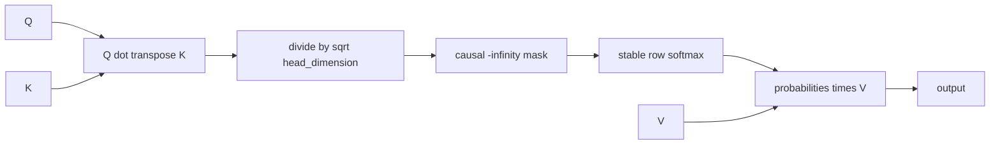
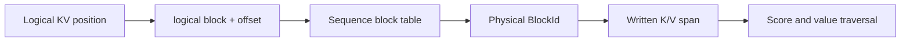
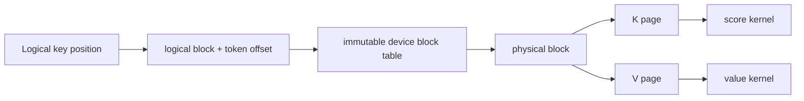

# Scaled Dot-Product Attention

## Validation status

The Milestone 10 contiguous CPU reference, Milestone 13 direct paged CPU path, and
post-M19 paged-history-plus-tail decode path are **implemented, CPU-validated,
sanitizer-validated, and benchmarked**. Ten focused attention tests and the full
186-test CPU suite pass in Debug, Release, and ASan/UBSan builds. The contiguous
and paged CUDA baselines, eight attention GPU tests, and CUDA-event benchmark
fixtures compile with NVCC 12.6.85 and warnings as errors, but have not run without
an NVIDIA driver/device. The CUDA-on build passes 185 hardware-independent tests
and explicitly skips 61 hardware-gated GPU tests (246 total); the Python converter
test is unavailable in that container. No GPU correctness or performance claim is
made.

## Tensor contract

The baseline accepts contiguous Float32 tensors:

```text
Q: [heads, query_tokens, head_dimension]
K: [heads, kv_tokens,    head_dimension]
V: [heads, kv_tokens,    value_dimension]
O: [heads, query_tokens, value_dimension]
```

All three inputs must have the same head count, and K/V must have the same token
count. Head, KV-token, and value dimensions are positive. A zero query-token count
is valid and produces an empty output without executing math. Grouped-query
attention is not silently inferred: Q, K, and V head counts must currently match.

`query_position_offset` gives the logical position of query row zero. The accepted
range is:

```text
query_position_offset <= kv_tokens
query_tokens <= kv_tokens - query_position_offset
```

Therefore ordinary prefill uses offset zero with equal query/KV lengths; one-token
decode over K cached tokens uses offset `K - 1`. Query row `q` may attend only to
key rows `k <= query_position_offset + q`.

## Understandable baseline stages



The implementation materializes one caller-owned Float32 score/probability Tensor:

```text
workspace shape = [heads, query_tokens, kv_tokens]
workspace bytes = 4 * heads * query_tokens * kv_tokens
```

The same bytes hold scaled/masked scores and then probabilities after exact in-
place softmax. Output bytes are separate. The `_out` API requires both output and
workspace so model execution and benchmarks can reuse their allocations. The
allocating convenience API creates both internally. On CUDA, that convenience form
explicitly synchronizes before releasing its private workspace; callers that need
asynchronous execution use `_out` and own both lifetimes.

All input/output/workspace aliasing is rejected. The current Tensor API cannot
construct partial overlapping slices, but exact pointer checks make the present
contract explicit and remain safe if views expand later.

## CPU reference

The CPU path uses double accumulation for QK dot products and probability-times-V,
then stores Float32 results. It scales by `1/sqrt(head_dimension)`, writes negative
infinity into causal-mask positions, and delegates the in-place probability stage
to Helix's stable CPU softmax. The default value stage accumulates 32 adjacent
output coordinates at a time while each V row is hot. A named dimension-major path
retains the original loop for correctness comparison and benchmarking. Both keep
each coordinate's KV accumulation order unchanged and allocate no hidden memory.

Known-value tests check causal probabilities and outputs by hand. A separate
single-token case verifies decode offset semantics against a three-token KV
history. Multi-head shapes with head dimension 5 and value dimension 7 exercise
odd extents; empty queries, zero heads, invalid ranges, wrong shapes/dtypes, and
every unsafe alias are covered.

## Direct paged CPU path

`PagedKvCache::LayerReadView` exposes one sequence layer as logical blocks without
copying it into `[heads, kv_tokens, head_dimension]`. For each logical block and
head it returns a contiguous `[written_tokens_in_block, head_dimension]` span for
keys or values. The final span stops at logical length; unwritten or recycled
storage is never visible.



The read view is move-only. It shares ownership of the cache implementation and
holds the cache's mutex for the full view lifetime, so cache-facade destruction
cannot free storage and append/release cannot invalidate a span mid-traversal. This
coarse lease is a correctness-first contract: it also blocks operations on
unrelated sequences in that cache and would be unsuitable around asynchronous GPU
work without a separate stream/event lifetime mechanism.

Paged Q/K head dimensions must match because the cache currently stores K and V
with one common dimension. The path retains the same `[H,Q,K]` caller-owned
workspace and explicit causal query offset as contiguous attention. Score traversal
visits key pages directly. Relative to `retrieve_layer`, it avoids two transient
compact Float32 buffers totaling `2 * H * K * D * sizeof(float)` bytes and their
copies; the long-lived paged pool and block-table capacity are accounted separately
by `PagedKvCache` statistics. The original value baseline reacquired each value page
for every output dimension and read values with a `head_dimension` stride. The
default fixed 32-coordinate tile reduces page lookups from
`head_dimension * logical_blocks` to
`ceil(head_dimension / 32) * logical_blocks` per head/query and consumes adjacent
values. Its 256-byte double-accumulator array has fixed stack size; odd dimensions
use a checked tail tile.

For decode or continuation, the cache does not yet contain the current token.
`paged_scaled_dot_product_attention_with_tail` therefore accepts query, key-tail,
and value-tail tensors shaped `[H,T,D]`. Query row `q` attends to every cached token
and tail rows through `q`; the caller commits the tail only after the complete
model step succeeds. Empty history is valid for this API, so the first token uses
the same path. The cache read lease remains held throughout score, softmax, and
value traversal, preventing concurrent append/release from invalidating raw page
spans. Output and `[H,T,history+T]` workspace are the only allocating convenience-
API tensors; no contiguous history-plus-tail K/V pair is created.

Six paged-attention tests compare direct paging against compact contiguous
attention for causal prefill, chunked decode, cached-plus-tail continuation,
multiple heads, odd dimensions, empty history, and non-divisible block boundaries.
They also cover zero query work, shape/range/dtype failures, and output/workspace/
tail alias rejection. A KV-cache test independently proves storage pinning and
written-prefix visibility.

## Contiguous CUDA baseline

The CUDA path preserves the three stages as separate same-stream launches:

1. One grid-stride thread computes one `(head, query, key)` score and serially
   traverses `head_dimension`.
2. The existing block-per-row shared-memory stable softmax runs in place.
3. One grid-stride thread computes one `(head, query, value_dimension)` output and
   serially traverses all KV tokens.

The score mapping is intentionally naive. Adjacent threads own adjacent key rows;
for a fixed dot-product dimension their K addresses are separated by
`head_dimension`, and Q values are redundantly reread. The value stage has a better
layout: adjacent threads own adjacent value dimensions, so their V loads are
adjacent for each key while the probability is common. Both kernels use 256-thread
blocks, cap the grid at 65,535 blocks, and use `std::size_t` for indexing.

Static CUDA 12.6 `sm_52` compiler inspection—not runtime measurement—reports:

| Kernel | Registers/thread | Shared memory | Spills |
|---|---:|---:|---:|
| score + scale + mask | 29 | 0 B | 0 B |
| probabilities x V | 32 | 0 B | 0 B |

The softmax stage retains its separately documented 5,120-byte static shared
scratch. Register counts alone do not establish occupancy or achieved performance.

The `_out` launches are asynchronous on the caller's stream and checked immediately
for launch errors. Q/K/V, output, and workspace must remain alive until stream
completion. The allocating convenience form synchronizes before its local workspace
is destroyed instead of relying on implicit `cudaFree` behavior. Benchmarks use
`_out`; tests synchronize before copying output to the CPU oracle.

## Paged CUDA baseline

The M13 CUDA path keeps the same visible score, softmax, and value stages but reads
K/V through a device-resident logical-to-physical table. Its layer-local layout is:

```text
Q:      [heads, query_tokens, key_dimension]
K pool: [physical_blocks, heads, block_tokens, key_dimension]
V pool: [physical_blocks, heads, block_tokens, value_dimension]
table:  logical_block -> uint32 physical_block
```

`kv_tokens` is the logical history length. The table must contain exactly
`ceil(kv_tokens / block_tokens)` entries; each entry is checked against the packed
physical capacity before a synchronous host-to-device upload. Duplicate physical
IDs are permitted because the K/V inputs are read-only and this is compatible with
future prefix sharing. The final page is bounded by `kv_tokens`, so padding and
stale bytes beyond the written prefix are never addressed.



One score thread performs the table lookup and then serially traverses the key
width. One output-coordinate thread traverses all logical tokens and resolves each
V page. This is deliberately straightforward and adds repeated table arithmetic;
it does not claim the warp-grouped, page-tiled access pattern of an optimized paged-
attention kernel. Adjacent score threads still select adjacent logical tokens, but
their inner-dimension loads are separated by a full head width. Adjacent value
threads select adjacent output dimensions and therefore issue adjacent V loads for
each logical token.

The move-only `PagedBlockTable` owns its device allocation and is immutable after
construction. The caller must retain it, the three input tensors, output,
workspace, and stream until all `_out` work completes. Host validation prevents an
out-of-range table from launching; each device kernel also converts a corrupted
physical ID to NaN without dereferencing outside the packed pool. This defensive
check is not a substitute for stream-safe ownership.

GPU tests compare reordered, non-identity page tables with the contiguous CPU
oracle, poison unwritten tail slots, cover multiple heads and odd widths through
key/value dimensions 37/41, accept empty query work, and reject invalid tables,
capacities, devices, shapes, offsets, and aliases. The allocating and preallocated
APIs share the same validation. CUDA 12.6 static `sm_52` inspection reports 31
registers/thread for the paged score kernel and 29 for the paged value kernel, with
no static shared/local memory or spills. That does not establish occupancy or
runtime performance.

## CPU benchmark results

On the Apple M3 Pro development host (Apple Clang 17, Release, Float32), with
preallocated output/workspace and five repetitions:

| H x Q x K x D x DV | Median CPU time | Score workspace | Dot-product rate |
|---|---:|---:|---:|
| 8 x 1 x 128 x 64 x 64 | 76.371 us | 4,096 B | 3.433 GFLOP/s |
| 8 x 1 x 1,024 x 64 x 64 | 825.128 us | 32,768 B | 2.542 GFLOP/s |
| 3 x 17 x 29 x 37 x 41 | 46.284 us | 5,916 B | 4.985 GFLOP/s |
| 8 x 128 x 128 x 64 x 64 | 8.164 ms | 524,288 B | 4.110 GFLOP/s |

These M10 rows are the retained original dimension-major baseline. The rate counts
only the two dense dot-product stages (`2*H*Q*K*(D+DV)`); softmax
operations are excluded from that FLOP numerator but included in elapsed time.
The host load average was 15.64 at measurement start, so these are local reference
baselines, not optimization claims. Full methodology is in `docs/PERFORMANCE.md`.

Contiguous and paged CUDA fixtures use the same logical shapes, preallocate all
tensors, issue ten warmups, and time the complete three-stage sequence with same-
stream CUDA events and stop-event synchronization. The paged fixture uses reversed
non-identity mappings, a 16-token page for the standard shapes (8 for the odd
case), and two spare physical pages; allocation and table upload are outside the
timed region. The fixtures have not executed, so there are no GPU result rows.

The M13 same-process run retained both dimension-major baselines and applied the
same 32-coordinate value tile to contiguous and paged storage. Median CPU times:

| H x Q x K x D; page tokens | Contiguous major | Contiguous tiled | Paged major | Paged tiled | Tiled page overhead |
|---|---:|---:|---:|---:|---:|
| 8 x 1 x 128 x 64; 16 | 77.621 us | 42.299 us | 101.751 us | 43.188 us | 2.1% |
| 8 x 1 x 1,024 x 64; 16 | 813.689 us | 328.774 us | 889.556 us | 349.214 us | 6.2% |
| 3 x 17 x 29 x 37; 7 | 44.480 us | 34.060 us | 96.676 us | 35.490 us | 4.2% |
| 8 x 128 x 128 x 64; 16 | 8.192 ms | 3.544 ms | 11.300 ms | 3.780 ms | 6.7% |

Paged tiling improved its own retained baseline by 2.36x–2.99x. Contiguous tiling
also improved 1.31x–2.47x, proving much of the original gain was loop locality, not
paging. With equal value traversal, the direct paged path was modestly slower in
these local CPU cases. The prefill score loops are not identical—paged traversal
groups work by physical block—so even the equal-value comparison is an end-to-end
path comparison, not a pure instruction-level cost of one table lookup. Full
methodology and coefficients of variation are in `docs/PERFORMANCE.md`.

The post-M19 decode experiment compares the actual compact-copy boundary with the
history-plus-tail API. Both allocating paths create output and score workspace;
the baseline additionally creates and fills two combined K/V tensors. Across
histories of 3, 15, 63, and 255 tokens, direct traversal reduced isolated median
CPU time by 23.0%, 13.3%, 27.7%, and 20.8%, while eliminating 2,048 B, 8,192 B,
131,072 B, and 1,048,576 B of combined-K/V temporaries per layer call. Complete
tiny runtime traces showed much smaller 3.97%, 6.23%, and 0.08% median reductions;
the last is effectively a tie relative to 2.84%–4.02% variation. Exact shapes,
timing boundaries, and commands are in `docs/PERFORMANCE.md`.

## Limitations and next step

- materialized workspace is `O(heads * query_tokens * kv_tokens)`,
- Q/K/V head counts must match; GQA/MQA is not implemented,
- only causal masking with contiguous logical query positions is supported,
- no batch dimension or ragged packed-sequence metadata exists yet,
- CPU and CUDA paths are Float32 only,
- the CUDA dot products are educational serial-per-output baselines,
- the CPU paged path uses one exclusive cache-wide read lease,
- the CUDA paged baseline uses a direct `cudaMalloc` table and caller-packed layer
  tensors; it is not integrated with `PagedKvCache` or `HelixAllocator`,
- no attention fusion, GQA, GPU page-pool lifetime, or measured page-table analysis
  is claimed.

GPU runtime correctness against the CPU oracle is the next mandatory gate before
optimizing this paged baseline. Integrating it into a concurrent GPU executor also
requires device-resident KV allocation and a stream/event lifetime mechanism rather
than the CPU cache's coarse read lease.
