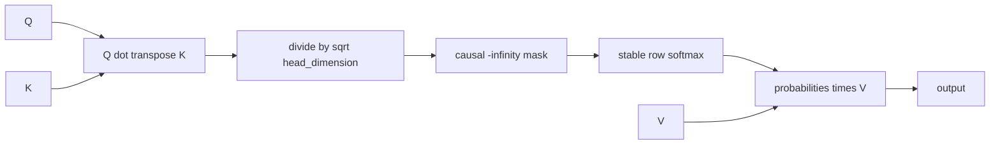

# Contiguous Scaled Dot-Product Attention

## Validation status

The Milestone 10 CPU reference is **implemented, CPU-validated, sanitizer-
validated, and benchmarked**. Four focused attention tests and the full 76-test
CPU suite pass in normal and ASan/UBSan builds. The CUDA baseline, four GPU tests,
and CUDA-event benchmark fixtures compile with NVCC 12.6.85 and warnings as errors,
but have not run without an NVIDIA driver/device. No GPU correctness or performance
claim is made.

## Tensor contract

The baseline accepts contiguous Float32 tensors:

```text
Q: [heads, query_tokens, head_dimension]
K: [heads, kv_tokens,    head_dimension]
V: [heads, kv_tokens,    value_dimension]
O: [heads, query_tokens, value_dimension]
```

All three inputs must have the same head count, and K/V must have the same token
count. Head, KV-token, and value dimensions are positive. A zero query-token count
is valid and produces an empty output without executing math. Grouped-query
attention is not silently inferred: Q, K, and V head counts must currently match.

`query_position_offset` gives the logical position of query row zero. The accepted
range is:

```text
query_position_offset <= kv_tokens
query_tokens <= kv_tokens - query_position_offset
```

Therefore ordinary prefill uses offset zero with equal query/KV lengths; one-token
decode over K cached tokens uses offset `K - 1`. Query row `q` may attend only to
key rows `k <= query_position_offset + q`.

## Understandable baseline stages



The implementation materializes one caller-owned Float32 score/probability Tensor:

```text
workspace shape = [heads, query_tokens, kv_tokens]
workspace bytes = 4 * heads * query_tokens * kv_tokens
```

The same bytes hold scaled/masked scores and then probabilities after exact in-
place softmax. Output bytes are separate. The `_out` API requires both output and
workspace so model execution and benchmarks can reuse their allocations. The
allocating convenience API creates both internally.

All input/output/workspace aliasing is rejected. The current Tensor API cannot
construct partial overlapping slices, but exact pointer checks make the present
contract explicit and remain safe if views expand later.

## CPU reference

The CPU path uses double accumulation for QK dot products and probability-times-V,
then stores Float32 results. It scales by `1/sqrt(head_dimension)`, writes negative
infinity into causal-mask positions, and delegates the in-place probability stage
to Helix's stable CPU softmax. This is deliberately direct and single-threaded so
it remains a readable correctness oracle.

Known-value tests check causal probabilities and outputs by hand. A separate
single-token case verifies decode offset semantics against a three-token KV
history. Multi-head shapes with head dimension 5 and value dimension 7 exercise
odd extents; empty queries, zero heads, invalid ranges, wrong shapes/dtypes, and
every unsafe alias are covered.

## CUDA baseline

The CUDA path preserves the three stages as separate same-stream launches:

1. One grid-stride thread computes one `(head, query, key)` score and serially
   traverses `head_dimension`.
2. The existing block-per-row shared-memory stable softmax runs in place.
3. One grid-stride thread computes one `(head, query, value_dimension)` output and
   serially traverses all KV tokens.

The score mapping is intentionally naive. Adjacent threads own adjacent key rows;
for a fixed dot-product dimension their K addresses are separated by
`head_dimension`, and Q values are redundantly reread. The value stage has a better
layout: adjacent threads own adjacent value dimensions, so their V loads are
adjacent for each key while the probability is common. Both kernels use 256-thread
blocks, cap the grid at 65,535 blocks, and use `std::size_t` for indexing.

Static CUDA 12.6 `sm_52` compiler inspection—not runtime measurement—reports:

| Kernel | Registers/thread | Shared memory | Spills |
|---|---:|---:|---:|
| score + scale + mask | 29 | 0 B | 0 B |
| probabilities x V | 32 | 0 B | 0 B |

The softmax stage retains its separately documented 5,120-byte static shared
scratch. Register counts alone do not establish occupancy or achieved performance.

All launches are asynchronous on the caller's stream and checked immediately for
launch errors. Q/K/V, output, and workspace must remain alive until stream
completion. Tests synchronize before copying output to the CPU oracle.

## CPU benchmark baseline

On the Apple M3 Pro development host (Apple Clang 17, Release, Float32), with
preallocated output/workspace and five repetitions:

| H x Q x K x D x DV | Median CPU time | Score workspace | Dot-product rate |
|---|---:|---:|---:|
| 8 x 1 x 128 x 64 x 64 | 76.371 us | 4,096 B | 3.433 GFLOP/s |
| 8 x 1 x 1,024 x 64 x 64 | 825.128 us | 32,768 B | 2.542 GFLOP/s |
| 3 x 17 x 29 x 37 x 41 | 46.284 us | 5,916 B | 4.985 GFLOP/s |
| 8 x 128 x 128 x 64 x 64 | 8.164 ms | 524,288 B | 4.110 GFLOP/s |

The rate counts only the two dense dot-product stages (`2*H*Q*K*(D+DV)`); softmax
operations are excluded from that FLOP numerator but included in elapsed time.
The host load average was 15.64 at measurement start, so these are local reference
baselines, not optimization claims. Full methodology is in `docs/PERFORMANCE.md`.

CUDA fixtures use the same shapes, preallocate all tensors, issue ten warmups, and
time the complete three-stage sequence with same-stream CUDA events and stop-event
synchronization. They have not executed, so there are no GPU result rows.

## Limitations and next step

- materialized workspace is `O(heads * query_tokens * kv_tokens)`,
- Q/K/V head counts must match; GQA/MQA is not implemented,
- only causal masking with contiguous logical query positions is supported,
- no batch dimension or ragged packed-sequence metadata exists yet,
- CPU and CUDA paths are Float32 only,
- the CUDA dot products are educational serial-per-output baselines,
- no fusion, tiling, or paged-KV access is claimed.

M11 first introduces correct contiguous KV-cache ownership. M13 will read K/V
through block tables and compare that path with this materialized contiguous
baseline before any attention fusion is justified.
