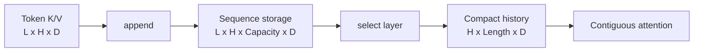
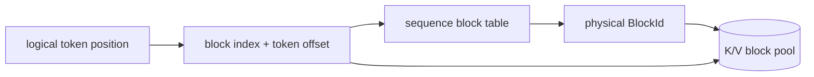
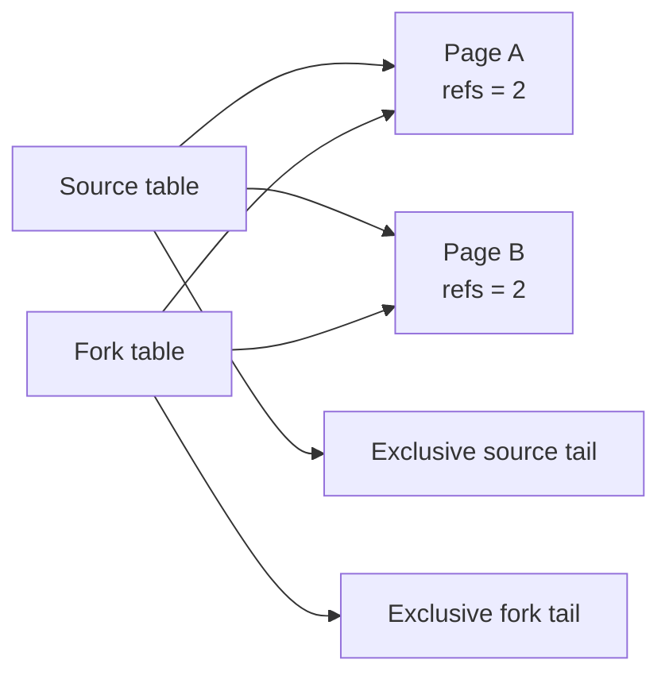
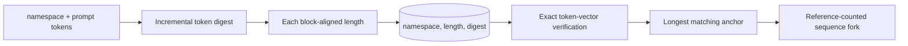

# KV Cache

## Status

The M11 contiguous cache, M12 paged cache, M13 direct paged-attention read path,
M19 bulk-append/runtime/direct-decode integration, and M22 block-aligned prefix
sharing plus bounded exact-content cache are implemented, CPU-validated,
sanitized, and benchmarked in Float32. The CPU runtime can opt into longest-prefix
reuse and pressure-driven LRU anchor eviction. These paths expose the memory-
capacity, compaction, direct-traversal, lookup-scaling, and reuse tradeoffs between
a per-sequence allocation and a global fixed-block pool. There is not yet a GPU-
resident KV cache or CUDA prefix-reuse path. A compile-validated CUDA paged-
attention baseline accepts separately packed layer-local device pages and an
immutable uploaded block table; it is deliberately not presented as cache/runtime
integration.

## Why cache keys and values?

In autoregressive decode, a request adds one token while continuing to attend to
all earlier tokens. The earlier tokens' projected keys and values do not change.
Recomputing those projections on every decode step repeats work and requires the
old hidden states. A KV cache stores each layer's projected K/V vectors once and
appends only the new token.

For Float32 with `L` layers, `H` KV heads, and head dimension `D`, Helix stores per
token:

```text
bytes_per_token = L * 2 * H * D * sizeof(float)
                          ^ keys + values
```

Every multiplication is overflow-checked before storage is allocated or pointer
arithmetic is performed.

## Contiguous baseline

`ContiguousKvCache` owns a map of live sequences. Creating a sequence reserves its
entire declared token capacity in two CPU tensors:

```text
keys   [layers, kv_heads, capacity_tokens, head_dimension]
values [layers, kv_heads, capacity_tokens, head_dimension]
```

An append accepts one complete token shaped
`[layers, kv_heads, head_dimension]`. It copies each layer/head vector into the
current logical position and advances length only after every copy completes.
Retrieval returns an owning, compact layer snapshot shaped
`[kv_heads, current_length, head_dimension]`, which can be passed directly to the
M10 attention API. `copy_layer_out` uses caller-owned outputs to avoid allocation
in repeated retrieval and benchmark paths. M18 adds `copy_layer_prefix_out` for
decode staging: it copies the current history into caller tensors whose token axis
may include a trailing row, leaves that suffix untouched, and checks an expected
sequence length while holding the cache lock. This lets the model write current
K/V directly after the prefix without first allocating and copying a compact
snapshot.



The capacity stride means each head's active prefix is contiguous. Retrieving one
layer performs two `memcpy` operations per head—one for keys and one for values.
Unused capacity is uninitialized and is never exposed or read.

## Ownership and handles

The cache exclusively owns all sequence storage. `SequenceHandle` contains both a
process-unique cache identity and a monotonically increasing sequence identity.
This prevents an equal local sequence number from another cache instance from
releasing or mutating storage. Handles are non-owning capabilities: releasing a
sequence invalidates every copy, and subsequent use produces a contextual error.

Retrieved `KvLayer` tensors own independent compact storage, so their lifetime is
not tied to the sequence. This deliberate baseline copy is safe and makes the
attention boundary explicit. Prefix-copy outputs are likewise caller-owned and
remain valid after the cache changes; only the copied prefix represents the locked
snapshot. The paged cache additionally provides an M13 read
lease for direct block-table traversal; it does not change the owning semantics of
compact retrieval.

## Capacity, exhaustion, and accounting

Capacity is reserved transactionally at sequence creation. If
`capacity_tokens * bytes_per_token` overflows or would exceed `maximum_bytes`, no
sequence or counter is changed. Appending to a full sequence likewise preserves
length and statistics. The first pressure policy is rejection with
`kResourceExhausted`; there is no implicit eviction or preemption.

Statistics expose:

- currently allocated and peak bytes,
- live sequence count,
- active capacity tokens and written tokens,
- successful create, append, and release counts.

The contiguous baseline's sequence-level utilization is:

```text
active_tokens / active_capacity_tokens
```

and its unused reserved payload is:

```text
(active_capacity_tokens - active_tokens) * bytes_per_token
```

This is capacity slack, not the `HelixAllocator` block-fragmentation metric. A
request must choose one fixed maximum up front, and its unused tail cannot serve a
different sequence. That is the allocation problem M12 paging addresses.

## Thread safety

Each cache instance serializes public operations that access sequence state with
one mutex. Immutable configuration and byte formulas can be read without locking.
The coarse lock intentionally covers metadata updates and copies in these
correctness baselines; it gives a clear shared-state boundary and is tested with
concurrent appends to independent sequences. Fine-grained locking is deferred
until a measured scheduler workload demonstrates contention. A paged
`LayerReadView` retains this lock for its complete lifetime because its spans point
into mutable pool storage. Callers must not invoke another operation on the same
cache from the lock-owning thread while the view exists; doing so would attempt to
reacquire the non-recursive mutex. The lease also serializes unrelated sequences,
which is safe but may become a measured scheduler bottleneck.

## Contiguous correctness coverage

Deterministic tests cover:

- multi-layer, multi-head layout and exact head-major retrieval,
- append-to-attention integration for single-token decode,
- full-sequence and whole-cache exhaustion without partial mutation,
- exact byte/capacity/statistic accounting and reclamation,
- empty sequences, invalid configurations, shapes, dtypes, layers, and outputs,
- empty, foreign, released, and cross-cache handles,
- output alias rejection for nonempty copies,
- larger prefix destinations, untouched tail rows, and stale-length rejection,
- concurrent appends to independent sequences,
- normal and ASan/UBSan execution.

Actual CPU workload baselines and their limitations are recorded in
`docs/PERFORMANCE.md`.

## Paged block cache

`PagedKvCache` allocates two long-lived, physical-major CPU tensors when the cache
is constructed:

```text
keys   [physical_blocks, layers, kv_heads, block_tokens, head_dimension]
values [physical_blocks, layers, kv_heads, block_tokens, head_dimension]
```

It assigns a fixed-token `PhysicalBlockId` only when an append crosses a logical
block boundary. A sequence's `std::vector<PhysicalBlockId>` block table maps a
logical position to pool storage:



For position `p`, `logical_block = p / block_tokens` and
`token_offset = p % block_tokens`. The physical-major layout keeps every physical
block's complete layer/head K/V payload together. Within one layer and head, a
block's token vectors are contiguous. Retrieving a compact layer therefore issues
two copies per head per logical block instead of two copies per head in the
contiguous cache.

### Free pool, references, and payload lifetime

The free pool is a fixed-capacity circular FIFO initialized with block IDs in
ascending order. It allocates no metadata during release, returns blocks in a
deterministic order, and prefers never-used blocks before recycled blocks. Parallel
arrays record each physical block's reference count, written-token count, free
membership, and whether it has ever been assigned. `PagedSequenceHandle` carries
a cache identity and monotonic sequence identity independently from the contiguous
handle type.

When an append needs a new block, Helix validates the input and checks availability
before changing the free queue. It first grows the sequence table; only after that
potentially throwing allocation succeeds does it dequeue and assign the physical
block. All remaining writes are bounds-derived nonthrowing copies, so exhaustion or
host metadata OOM cannot leave a partial mapping. An append inside an exclusive
partial block remains legal even when the free pool is empty.

`append_layer_major` is the full-prompt companion to scalar append. It accepts one
contiguous `[kv_heads,tokens,head_dimension]` key/value tensor per layer, validates
the complete set, checks final capacity, counts reusable blocks, and reserves the
sequence table's final size before ownership changes. It then copies maximal token
spans into the current partial page and subsequent whole pages while holding the
cache lock. Its statistics count appended tokens rather than API calls, preserving
the meaning of `append_count` across scalar and bulk paths. A focused test compares
five tokens spanning three blocks byte-for-byte with scalar append and proves
shape, zero-length, and pool-exhaustion failures leave an empty sequence unchanged.

Release validates every block reference before mutation and does not allocate. It
decrements one reference per table entry and returns a physical block to the FIFO
only when the count reaches zero. Reused storage is not cleared, but retrieval
exposes only the new sequence's written logical length; every visible token
position is overwritten before it can be read.

### Block-aligned prefix sharing

`fork_sequence(source, prefix_tokens)` creates a new logical sequence by copying
only the source's leading block IDs and incrementing their physical reference
counts. The prefix must be positive, no longer than the source, and exactly aligned
to `block_tokens`:



Alignment is the immutability boundary. Every aliased page is full, so the fork
allocates an exclusive page before writing its next token; the source either writes
an already-existing later exclusive tail or allocates a new exclusive page. Helix
therefore needs no partial-page copy-on-write, and branch appends cannot overwrite
one another. Either sequence can be released first; referenced pages remain
readable through the survivor and are reclaimed exactly once after the last
release.

Forking is transactional with respect to metadata allocation and counter overflow.
The new block table and map entry are created before any reference count changes.
It requires no free physical page and can succeed when the pool is full; a later
append at the aligned boundary still fails transactionally until a page is freed.
The cache mutex serializes forks with append, release, and read leases. This API is
the ownership primitive used by the content cache below; by itself it does not
hash prompts, find matches, retain hidden anchors, or evict entries.

### Bounded exact-content prefix cache

`PagedPrefixCache` owns a `shared_ptr<PagedKvCache>` and a bounded metadata index.
Each entry contains:

- a nonzero `PrefixNamespaceId` for model/tokenization isolation;
- the complete block-aligned token-ID vector;
- one persistent anchor sequence forked from a source with matching K/V;
- its digest and block-reference count;
- a position in a most-recently-used list.

Both `maximum_entries` and `maximum_block_references` must be positive. The latter
counts block-table references retained by anchors, not unique physical pages or
reserved pool bytes. Insertion validates namespace, alignment, source ownership,
source length, and configured capacity before publishing a key. An exact duplicate
only becomes MRU; it does not replace its existing anchor. A single oversized
entry returns `kRejectedTooLarge` without mutation. Otherwise token storage, the
anchor fork, the list node, and hash entry are staged with rollback before older
LRU entries are released to satisfy both bounds.



`lookup_longest` scans the input tokens once, extends the digest using explicit
bytes of each 32-bit token, and probes the hash index at every block boundary up
to the caller's maximum. It remembers the longest candidate whose entire stored
vector equals the query prefix. Digest collision can therefore increase candidate
work but cannot produce a false hit. A successful fork occurs before the entry is
moved to MRU and before hit counters change; the returned `PagedSequenceHandle` is
owned by the caller and must be released through the underlying paged cache.

The prefix-cache mutex is acquired before the paged-cache mutex on every composite
operation. Callers must not call the prefix manager while holding a
`LayerReadView` from the same cache. `clear`, explicit erase, bounded insertion,
and `evict_lru` release anchors; destruction performs the same cleanup without
throwing. Statistics report current/peak entries and block references, retained
tokens, lookups/hits/misses, insertions/duplicates/rejections, evictions, and
explicit erases.

The first correct lookup baseline scanned every LRU entry. Measurement showed
that path wins for tiny caches but scales linearly. The production index above is
expected independent of entry count aside from hash collisions and the number of
aligned query prefixes; the retained linear benchmark makes the small-cache loss
and large-cache crossover visible in `docs/PERFORMANCE.md`.

### CPU runtime integration

`CpuRuntimeConfig::prefix_cache` is optional and disabled by default. When
enabled, submission searches up to:

```text
floor((prompt_tokens - 1) / block_tokens) * block_tokens
```

The subtraction is required because a K/V anchor does not contain the logits
after its final token. At least one prompt token must execute to produce fresh
next-token logits. A hit supplies a forked physical sequence and
`FifoScheduler::submit_prefilled` records the block-aligned logical seed; the seed
becomes processed prompt progress only when FIFO admission happens. Cancellation
or failure releases the fork like any other session.

After final prompt work succeeds, the engine publishes only that request's maximum
reusable aligned prefix. A duplicate refreshes recency. Retained anchors own real
page references, so a prefix-enabled cache can correctly report used blocks with
no live request sessions. If those anchors leave a FIFO head unable to schedule
any work, `run_iteration` evicts LRU entries and retries until it can make progress
or no cached entry remains. This is cache eviction, not request preemption.

### Accounting and invariants

The pool reserves:

```text
pool_bytes = physical_blocks * block_tokens * bytes_per_token
```

Assigned capacity is `used_blocks * block_tokens`; per-sequence tail slack is less
than `block_tokens`. With sharing, `active_tokens` is logical demand summed across
all live sequences, while `resident_tokens` counts unique written physical slots.
Consequently:

```text
shared_token_references = active_tokens - resident_tokens
unused_token_slots      = allocated_token_slots - resident_tokens
token_slot_utilization  = resident_tokens / allocated_token_slots
```

Statistics also report total block-table references, physical blocks with multiple
references, successful forks, reserved/used/free/peak bytes, block assignments, and
reuse. Debug builds re-derive every physical reference count from all sequence
tables, require shared blocks to be full, reject duplicate IDs within one table,
verify written-token counts, detect duplicate free-queue entries, and reconcile
logical/resident tokens, bytes, slots, and counters after every mutation.

The deterministic comparison test uses two requests declared with contiguous
capacities of ten tokens but active lengths of one and five. The contiguous cache
assigns 20 token slots (160 bytes) and leaves 14 unused; a four-token paged pool
assigns 12 slots (96 bytes) and leaves six unused. This result is specific to an
over-reserved trace. If every contiguous request knew its exact final length,
paging could use more memory because each sequence retains up to one partial-block
tail.

### Paged correctness coverage

Twelve deterministic tests cover:

- multi-layer/head values spanning odd and complete block boundaries,
- visible block-table order and compact retrieval,
- cached decode passed through the M10 attention oracle,
- transactional exhaustion and continued writes to a partial final block,
- bulk layer-major append across partial/whole blocks and transactional rollback,
- FIFO reclamation, reuse, stale-data invisibility, and double-release rejection,
- invalid/overflowing configuration, handles, shapes, dtypes, layers, and outputs,
- exact statistics and contiguous-versus-paged tail accounting,
- concurrent append followed by complete reclamation,
- byte-exact aligned prefix sharing, divergent scalar/bulk tails, and source-first
  release with survivor reads,
- invalid/unaligned/foreign/stale forks, full-pool fork success, transactional tail
  exhaustion, and recycled-page reuse,
- concurrent multi-reference fork/append/release transitions through reference
  counts greater than two,
- read-lease storage pinning, physical-block identity, and final-prefix bounds,
- normal and ASan/UBSan execution.

Release-mode lifecycle and layer-copy comparisons are recorded in
`docs/PERFORMANCE.md`. The large-history layer-copy results are deliberately
unfavorable to paging because materialization must traverse many discontiguous
blocks; direct block-table attention therefore does not use compact retrieval.

Seven additional prefix-index tests cover longest exact matching, namespace and
token separation, duplicate handling, both capacity bounds, deterministic LRU
eviction, explicit erase/clear, invalid/stale/foreign sources, anchor lifetime,
destructor reclamation, and concurrent lookup/fork/release lifecycles. Runtime
tests compare reused-suffix output with full recomputation, verify cancellation
ownership, and force anchor eviction in a three-page pool. The complete native
Debug, Release, and ASan/UBSan suites pass 186/186. The CUDA-on compile-validation
suite passes 185 hardware-independent tests and explicitly skips 65 GPU tests
without a device (250 total); its missing Python/NumPy omits the separate converter
integration test.

## Direct block-table attention lease

`read_layer(sequence, layer)` returns a move-only `LayerReadView`. It shares
ownership of the cache implementation, stores a pointer to the validated sequence
state, and owns the already-acquired cache mutex lock. This combination provides
three lifetime guarantees:

1. Destroying the `PagedKvCache` facade cannot free the physical tensors while a
   view exists.
2. Append and release cannot resize or erase the sequence table while block spans
   are in use.
3. A recycled physical block cannot change owner during the traversal.

The view exposes logical length, geometry, physical IDs, tokens written in each
logical block, and per-head key/value spans. A complete block span contains
`block_tokens * head_dimension` floats. The last block contains only
`(length % block_tokens) * head_dimension` floats when partial. Span offsets are
derived with checked pool geometry at construction and bounded indices at access;
no pointer to an unwritten slot is returned.

The M13 CPU attention implementation holds this lease while it computes scaled
scores, stable softmax, and probability-times-V directly from pages. That removes
the two compact-history copies measured in M12. It does not make attention
workspace-free: probabilities still use the explicit `[heads, queries, length]`
Float32 workspace. It also does not establish asynchronous GPU safety. A future
device view needs a device-resident table and stream-ordered ownership whose
lifetime extends through kernel completion, not a host mutex held across an
asynchronous launch.

The runtime's default one-token paged decode now uses the same lease without first
committing the current token. The attention API consumes cached pages plus
contiguous `[heads,tail_tokens,head_dimension]` current K/V tensors, applies causal
masking across the combined logical positions, and returns before the lease is
released. Only after every model layer succeeds does the engine append the
all-layer token K/V. The retained compact-copy mode still calls
`copy_layer_prefix_out` and is used as a correctness/performance baseline. Paired
tests compare both model/runtime modes; isolated benchmarks show the direct path's
benefit and the much smaller end-to-end effect in `docs/PERFORMANCE.md`.

## Current limitations

- Float32 CPU tensors only; no GPU-resident cache or asynchronous copy contract.
- Keys and values use the same head dimension.
- Compact retrieval still copies; direct CPU attention consumes a read lease
  instead.
- The direct CPU path holds the cache-wide lease throughout attention, blocking
  unrelated sequence mutation during that layer call.
- Contiguous sequence capacity cannot grow; the paged pool cannot grow after
  construction.
- Prefix reuse is block-aligned and exact-token only. Partial-page sharing and
  copy-on-write are absent.
- The CPU runtime stores only the maximum reusable prefix published by each
  completed prompt, uses one engine-local namespace, and does not cache logits.
  Cross-model/shared-runtime namespace management is not implemented.
- Prefix lookup and reuse are CPU-only and opt-in; GPU-resident anchors and a
  device block table do not exist.
- No request preemption exists; only retained prefix anchors can be evicted.
- One mutex serializes all sequences, and a direct read lease holds it for the
  complete attention call.

The implementation is original. Fixed-size blocks, block tables, and KV reuse are
standard inference-runtime concepts; Helix keeps its own layout, ownership,
failure, and validation contracts visible rather than copying another runtime's
allocator or cache implementation.
