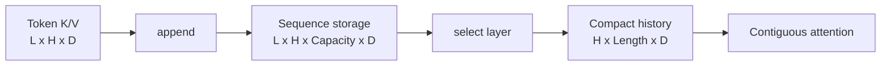
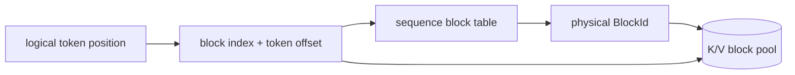

# KV Cache

## Status

The M11 contiguous Float32 CPU cache is implemented, CPU-validated, sanitized,
and benchmarked. It defines the ownership, layout, append, retrieval, accounting,
and exhaustion contracts that paging will preserve. M12 paged storage and M13
paged attention remain planned; there is not yet a GPU-resident KV-cache path.

## Why cache keys and values?

In autoregressive decode, a request adds one token while continuing to attend to
all earlier tokens. The earlier tokens' projected keys and values do not change.
Recomputing those projections on every decode step repeats work and requires the
old hidden states. A KV cache stores each layer's projected K/V vectors once and
appends only the new token.

For Float32 with `L` layers, `H` KV heads, and head dimension `D`, Helix stores per
token:

```text
bytes_per_token = L * 2 * H * D * sizeof(float)
                          ^ keys + values
```

Every multiplication is overflow-checked before storage is allocated or pointer
arithmetic is performed.

## Contiguous baseline

`ContiguousKvCache` owns a map of live sequences. Creating a sequence reserves its
entire declared token capacity in two CPU tensors:

```text
keys   [layers, kv_heads, capacity_tokens, head_dimension]
values [layers, kv_heads, capacity_tokens, head_dimension]
```

An append accepts one complete token shaped
`[layers, kv_heads, head_dimension]`. It copies each layer/head vector into the
current logical position and advances length only after every copy completes.
Retrieval returns an owning, compact layer snapshot shaped
`[kv_heads, current_length, head_dimension]`, which can be passed directly to the
M10 attention API. `copy_layer_out` uses caller-owned outputs to avoid allocation
in repeated retrieval and benchmark paths.



The capacity stride means each head's active prefix is contiguous. Retrieving one
layer performs two `memcpy` operations per head—one for keys and one for values.
Unused capacity is uninitialized and is never exposed or read.

## Ownership and handles

The cache exclusively owns all sequence storage. `SequenceHandle` contains both a
process-unique cache identity and a monotonically increasing sequence identity.
This prevents an equal local sequence number from another cache instance from
releasing or mutating storage. Handles are non-owning capabilities: releasing a
sequence invalidates every copy, and subsequent use produces a contextual error.

Retrieved `KvLayer` tensors own independent compact storage, so their lifetime is
not tied to the sequence. This deliberate baseline copy is safe and makes the
attention boundary explicit; M13 will replace it with block-table traversal rather
than claiming that this path is zero-copy.

## Capacity, exhaustion, and accounting

Capacity is reserved transactionally at sequence creation. If
`capacity_tokens * bytes_per_token` overflows or would exceed `maximum_bytes`, no
sequence or counter is changed. Appending to a full sequence likewise preserves
length and statistics. The first pressure policy is rejection with
`kResourceExhausted`; there is no implicit eviction or preemption.

Statistics expose:

- currently allocated and peak bytes,
- live sequence count,
- active capacity tokens and written tokens,
- successful create, append, and release counts.

The contiguous baseline's sequence-level utilization is:

```text
active_tokens / active_capacity_tokens
```

and its unused reserved payload is:

```text
(active_capacity_tokens - active_tokens) * bytes_per_token
```

This is capacity slack, not the `HelixAllocator` block-fragmentation metric. A
request must choose one fixed maximum up front, and its unused tail cannot serve a
different sequence. That is the allocation problem M12 paging targets.

## Thread safety

All public operations that access sequence state are serialized by one cache
mutex. The immutable configuration and bytes-per-token value can be read without
locking. The coarse lock intentionally covers allocation and copies in this
correctness baseline; it gives a clear shared-state boundary and is tested with
concurrent appends to independent sequences. Fine-grained locking is deferred
until a measured scheduler workload demonstrates contention.

## Correctness coverage

Deterministic tests cover:

- multi-layer, multi-head layout and exact head-major retrieval,
- append-to-attention integration for single-token decode,
- full-sequence and whole-cache exhaustion without partial mutation,
- exact byte/capacity/statistic accounting and reclamation,
- empty sequences, invalid configurations, shapes, dtypes, layers, and outputs,
- empty, foreign, released, and cross-cache handles,
- output alias rejection for nonempty copies,
- concurrent appends to independent sequences,
- normal and ASan/UBSan execution.

Actual CPU workload baselines and their limitations are recorded in
`docs/PERFORMANCE.md`.

## Paged design (M12 target)

Paged storage will allocate fixed-token physical blocks only as a sequence crosses
a block boundary. A sequence's block table maps logical blocks to pool-owned
physical blocks:



The manager will own the free-block pool and all block tables. Allocation of the
next block must be transactional: exhaustion leaves sequence length, mappings,
data, and counters unchanged. Release returns every owned block exactly once.
Reference counting is intentionally absent until prefix sharing creates shared
ownership. The initial policy remains safe rejection when no block is free.

## Current limitations

- Float32 CPU tensors only; no GPU-resident cache or asynchronous copy contract.
- Keys and values use the same head dimension.
- Retrieval compacts/copies a layer rather than returning a non-owning strided
  view.
- Sequence capacity cannot grow.
- No paging, prefix sharing, eviction, preemption, or reference counting yet.
- One mutex serializes all sequences.

The implementation is original. Fixed-size blocks, block tables, and KV reuse are
standard inference-runtime concepts; Helix keeps its own layout, ownership,
failure, and validation contracts visible rather than copying another runtime's
allocator or cache implementation.
