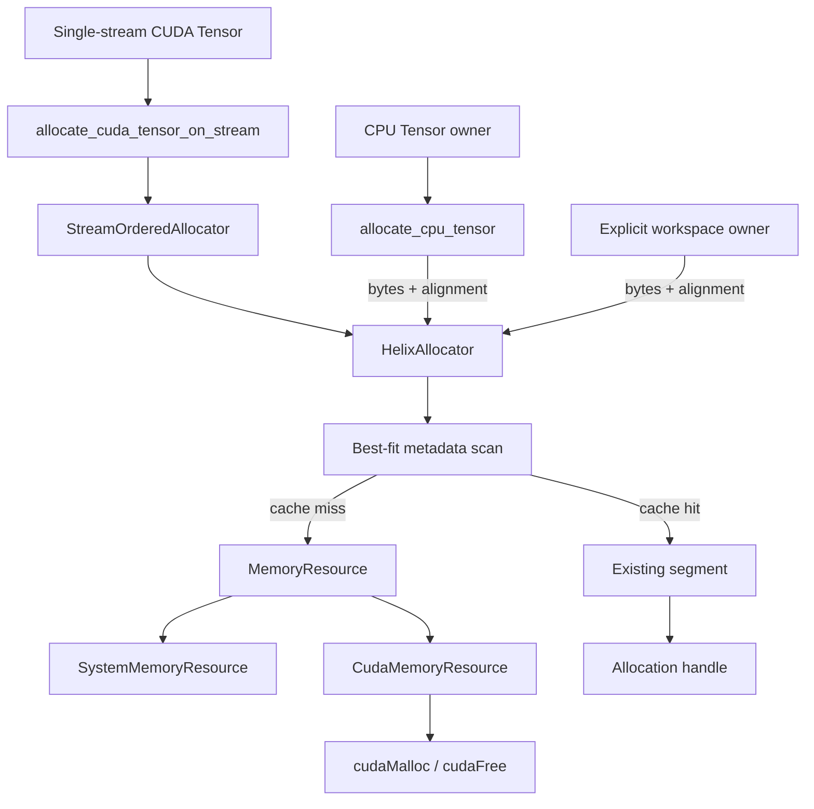
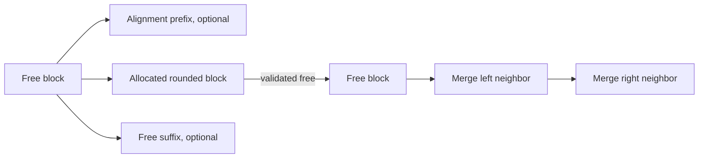
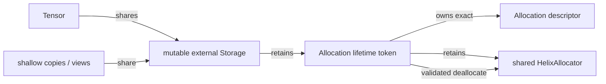
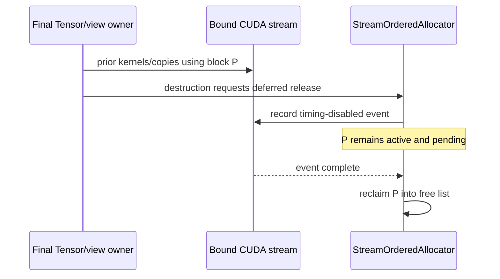
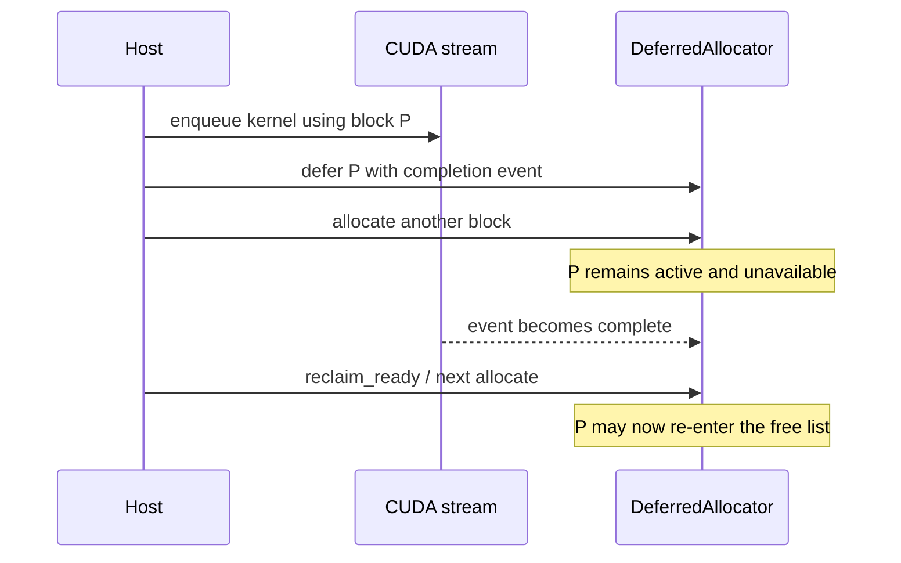

# HelixAllocator

## Validation status

The allocator metadata, generic deferred-reclamation layer, and opt-in CPU Tensor
ownership bridge are **implemented, CPU-validated, sanitizer-validated, and host-
resource benchmarked**. Twenty-one focused allocator/deferred/bridge tests and the
full 186-test CPU suite pass in Debug, Release, and ASan/UBSan builds. A CUDA 12.6
warnings-as-errors build compiles `CudaMemoryResource`, `StreamOrderedAllocator`,
six hardware-gated allocator/ownership tests, both Tensor bridges, and native-CUDA
comparison benchmarks. It passes 185 hardware-independent tests and skips 64 GPU
tests without a driver/device (249 registered), so no CUDA allocator code has run
on a physical GPU.

The event-backed adapter is therefore compile-validated rather than hardware-
validated. The CUDA Tensor bridge has an explicit single-stream contract; Tensor
does not yet track all streams that use an allocation. CPU ownership/completion
tests and CUDA compilation do not prove CUDA event semantics.

## Why cache device allocations?

Direct CUDA Tensor storage currently calls `cudaMalloc` and `cudaFree`. Those APIs
manage global device-allocator state, and `cudaFree` can introduce synchronization;
repeating them for every transient Tensor is therefore a plausible inference-loop
bottleneck. Helix retains larger upstream segments and performs common allocation/
free operations in host metadata. The hypothesis must still be tested against
native CUDA on actual hardware; the local host-resource results are not a proxy for
GPU latency.

## Resource boundary



`MemoryResource` owns the backend-specific upstream operation. The System resource
uses aligned C++ allocation so the exact allocator core is executable without
CUDA. The CUDA resource selects its device with `DeviceGuard`, checks every runtime
call, and currently accepts alignments up to CUDA's 256-byte allocation guarantee.

`HelixAllocator` owns its resource through `shared_ptr`; every segment is released
when the allocator dies, even if callers still hold non-owning `Allocation`
descriptors. The allocator must therefore outlive all clients that dereference its
pointers.

## Allocation algorithm

Configuration provides a preferred segment size (64 MiB by default), minimum
alignment (256 B), and maximum reserved bytes. A request:

1. rejects zero bytes and non-power-of-two alignment,
2. uses the larger of requested and minimum alignment,
3. rounds requested bytes upward to that effective alignment with overflow checks,
4. scans every free block and accounts for pointer-alignment padding,
5. selects the candidate leaving the least unused remainder,
6. breaks ties by stable segment ID and then lower address,
7. acquires a new aligned segment only on a cache miss,
8. reserves any required block-table and active-registry capacity before mutation,
9. updates the selected block in place with optional prefix, allocated block, and
   optional suffix metadata.

The linear scan is `O(number_of_blocks)`. It was chosen as an auditable baseline;
a size-indexed tree/bin structure adds update complexity and should follow only if
profiles show search cost matters.



Every nonempty remainder is retained; there is no hidden minimum-split threshold.
Address-ordered blocks always cover their segment exactly. A free marks one block
inactive and coalesces its immediate free neighbors in place; the invariant that
free neighbors are never adjacent makes that sufficient. Blocks never merge across
upstream segments.

## Ownership and stale-pointer defense

Raw pointer lookup cannot distinguish this sequence:

```text
allocate A at address P
free A
allocate B, reusing P
accidentally free stale A
```

Helix therefore returns an `Allocation` descriptor containing a monotonic 64-bit
allocation ID, a process-unique allocator-instance ID, pointer, requested/rounded
bytes, alignment, and device. A private slot index gives O(1) access to an active
record. Freed slots form an intrusive free list and are reused, while the monotonic
ID serves as the generation: a stale descriptor that names a recycled slot fails
the ID check. This avoids allocating and destroying a hash node for every logical
allocation without weakening cross-pool, double-free, or ABA protection.
Deallocation validates the allocator identity, active generation, and every
descriptor field. `Allocation` is not independently RAII because its valid lifetime
depends on the owning allocator.

## CPU Tensor ownership bridge

`memory::allocate_cpu_tensor(shape, dtype, shared_allocator, alignment)` is the
explicit bridge between the non-RAII allocation descriptor and Tensor's shared
RAII Storage. It is deliberately opt-in and CPU-only:

1. validate the allocator, checked logical byte count, alignment, and CPU device;
2. return a null, zero-capacity Tensor without touching the pool for zero work;
3. allocate exactly the logical byte request through `HelixAllocator`;
4. wrap the pointer and rounded block capacity as mutable external CPU Storage;
5. retain both the exact generation-tagged descriptor and a `shared_ptr` to its
   allocator in a private lifetime token;
6. return the block to the allocator when the final Tensor/view releases Storage.



The allocator reference prevents its segments from disappearing while the Tensor
pointer is live. All views share one Storage object, so the descriptor is returned
exactly once. `Tensor::nbytes()` remains the logical byte count while
`Tensor::allocated_bytes()` reports the rounded block capacity. Construction
failure after allocation is transactional: either local cleanup or the lifetime
token returns the handle. Destruction cannot throw; an unexpected metadata failure
is logged, after which the retained allocator still performs non-throwing segment
cleanup during its own destruction.

The bridge does not change default `Tensor::empty`, `zeros`, `clone`, or transfer
behavior. In particular, a clone of a pooled Tensor owns ordinary direct Storage.
Callers must not destroy the last Tensor concurrently with unsynchronized access to
its data; allocator metadata itself remains protected by the allocator mutex.
Supplying a CUDA resource is rejected before an upstream allocation because this
simple owner has no stream-use ledger or release event.

## Single-stream CUDA Tensor ownership bridge

`memory::allocate_cuda_tensor_on_stream(shape, dtype, shared_allocator,
shared_stream, alignment)` is the opt-in device counterpart. It does not change
default CUDA Tensor factories. Its ownership sequence is:

1. validate shape/byte overflow, `alignof(max_align_t)`–256-byte power-of-two
   alignment, non-null allocator and stream, live stream handle, and equal CUDA
   device indices;
2. bypass the pool for zero logical bytes;
3. allocate through `StreamOrderedAllocator` and expose the rounded capacity as
   mutable external CUDA Storage;
4. retain the exact allocation, shared allocator, and shared stream in one private
   lifetime token shared by every Tensor view;
5. after the final owner disappears, record a timing-disabled event after prior
   work on that stream and transfer the block to the pending list;
6. make the block reusable only when polling or blocking reclamation observes that
   event complete.

The underlying `Tensor::from_mutable_cuda_buffer` interop entry point validates
shape capacity, declared device, ownership, and alignment, but deliberately avoids
a CUDA pointer-attribute query on every pooled allocation. Direct callers must
therefore guarantee the pointer's device provenance and accessible byte range; the
owning allocator factory supplies those guarantees for the normal bridge path.



Construction arms the lifetime token only after Tensor metadata and Storage are
complete. A failure before that point returns the never-used allocation immediately.
If release-event creation unexpectedly fails during non-throwing destruction, the
owner logs the error, synchronizes the bound stream, and attempts a completed
release; it never knowingly puts incomplete bytes back on the free list.

This API intentionally does **not** infer arbitrary stream use. Every Helix or raw-
pointer operation must happen on the retained stream, or other streams must feed
an explicit dependency into it before the final owner is destroyed. Moving from
the retained stream object while storage is live is also invalid. `Tensor::clone`,
`to`, and default factories continue to allocate direct Storage. A future general
pool requires per-storage record-stream tracking and dependency aggregation.

## Coalescing and explicit release

Deallocation changes only metadata; it does not return a partial block upstream.
After coalescing, a segment represented by one free block is wholly cached.
`release_cached()` returns only such segments to the resource. If an upstream
release fails, Helix leaves that segment and all counters intact so the caller may
retry. Destructor cleanup cannot throw and logs upstream failures.

The reservation limit is checked before an upstream call. Upstream allocation
failure, size/alignment overflow, and metadata allocation failure leave active
allocations unchanged. A commit grows block/slot vectors before publishing an
active record; subsequent block moves are statically required to be non-throwing.
Debug builds re-scan the entire structure after mutations to verify contiguous
coverage, nonadjacent free blocks, counter sums, one-to-one active-slot mappings,
free-list coverage, generation IDs, pointer alignment, and requested-versus-rounded
bounds. Those invariant scans allocate no scratch memory after a commit.

## Statistics and fragmentation

`AllocatorStats` exposes:

- `bytes_reserved`: bytes held in upstream segments,
- `bytes_allocated`: rounded bytes in active blocks,
- `bytes_requested`: client-requested bytes in active blocks,
- `bytes_free`: `reserved - allocated`,
- `peak_bytes_allocated`, `largest_free_block`, segment and active counts,
- successful allocation/cache-reuse/upstream allocation/upstream release counts.

External fragmentation answers how dispersed reusable capacity is:

```text
external = 0                                      when bytes_free == 0
external = 1 - largest_free_block / bytes_free   otherwise
```

It is zero for one coalesced free region and approaches one when free memory is
split into many small regions. It does not include memory outside Helix.

Internal fragmentation measures size/alignment rounding in active blocks:

```text
internal = 0                                              when bytes_allocated == 0
internal = (bytes_allocated - bytes_requested)
           / bytes_allocated                              otherwise
```

Alignment prefix/suffix blocks remain externally reusable and therefore are not
counted as internal waste.

## Thread safety

All public allocation, free, ownership, stats, and trim operations serialize on one
mutex. The upstream resource is called under that mutex, making state transitions
simple and preventing duplicate segment acquisition. Independent allocators can
run concurrently. Destroying an allocator concurrently with any method is invalid.
The coarse lock is a correctness baseline; sharded locks or per-device bins require
contention measurements.

## Deferred reclamation and stream safety

Kernel launch completion is asynchronous. Returning allocation A to the free list
immediately after enqueueing a kernel that uses A can let a second allocation reuse
the same bytes while the first kernel is still executing. That is a use-after-free
even if the host-side owner is gone.



`DeferredAllocator` composes a `HelixAllocator` with a small polymorphic
`Completion` contract. Deferral transfers the allocation from client-owned to a
pending list but intentionally leaves it active in the base allocator. Allocation
opportunistically polls ready completions; callers can also call `reclaim_ready()`
or the blocking `wait_and_reclaim_all()`. Destructor cleanup waits before returning
blocks to the base pool. Query failures leave the pending entry unchanged.

`DeferredAllocatorStats` separates client and pending allocation counts, reports
pending requested/rounded bytes, and counts deferrals and successful reclamations.
The base `AllocatorStats::bytes_allocated` includes pending blocks because those
bytes are still physically unavailable for reuse.

In CUDA builds, `StreamOrderedAllocator::defer_deallocate(allocation,
release_stream)` records a timing-disabled event after work already queued on that
stream. The event object owns its CUDA resource until reclamation. Device mismatch,
moved-from stream, unknown handle, and duplicate deferral are rejected before the
allocation can become reusable.

The caller must ensure that **every use of the allocation happens-before the event
recorded on the release stream**. If multiple streams used the block, the release
stream must first wait on events from all of them. Merely passing any stream is not
sufficient; Helix does not yet maintain a per-allocation stream-use ledger.

The hardware-gated regression test queues a host callback that holds the release
stream incomplete, defers a block, and verifies that a same-sized allocation gets a
different address. Only after opening the gate and synchronizing the completion may
the original address be reused. The test compiles, but it has not executed without
an NVIDIA driver/device. Direct calls to base `HelixAllocator::deallocate` still
require the caller to have completed all device uses.

## Benchmarks

Host-resource results are recorded in `docs/PERFORMANCE.md`. The original baseline
showed that block-vector rebuilding and hash-node churn dominated small allocation
traces. Capacity-planned in-place split/coalesce plus reusable active slots reduced
median cached-trace CPU time by 53.1%–66.7% across deterministic random-size,
small-heavy, large-heavy, bursty, and LLM-like workloads. On this Apple M3 Pro, the
final cache was 3.13x–9.41x faster than direct aligned host allocation for the
random/large/LLM-like traces, but 2.34x–2.45x slower for small-heavy/bursty traces.
The host allocator already caches small blocks, Helix retains a 64 MiB minimum
segment, and best-fit still scans linearly. These are useful design observations,
not CUDA claims.

The allocator-backed Tensor follow-up measures the complete pre-warmed Tensor
allocation/destruction ownership path. Median CPU time was 238 ns versus 117 ns
direct for one Float32 element, 239 ns versus 117 ns for 1,024 elements, and 239 ns
versus 459 ns direct for 1,048,576 elements (4 MiB logical). Thus the bridge was
about 2.04x slower for the two small cases but 47.9% lower latency for the large
case. It retained one 64 MiB default segment. Payload bytes were not touched and no
bandwidth counter is reported. The result supports an opt-in host policy; it does
not predict native CUDA behavior.

CUDA builds contain fixed, random-size, small-heavy, large-heavy, bursty, and
LLM-like comparisons between direct `cudaMalloc/cudaFree` and
`HelixAllocator(CudaMemoryResource)`. CPU and CUDA fixtures consume the same
deterministic trace definitions. They time the full host allocation workload with
Google Benchmark real time; CUDA events are not used to time host APIs. GPU model,
driver, toolkit, warmup, iteration count, trace, reserved/peak bytes, underlying
calls, and fragmentation must accompany any future published result.

## Current limitations

- CUDA event-backed reclamation and the stream-bound Tensor bridge are not
  hardware-validated,
- CPU Tensor pooling is opt-in and not wired into model/runtime allocations,
- CUDA Tensor pooling is opt-in, single-stream, and not wired into model/runtime
  allocations,
- correctness across multiple use streams depends on an explicit caller-created
  dependency chain into the release stream,
- CUDA runtime correctness and allocation latency unvalidated,
- CUDA alignments above 256 bytes unsupported by the direct resource,
- linear best-fit scan and address-ordered vector shifts may scale poorly with many
  fragmented blocks,
- no memory-pressure callback or automatic trim policy,
- no `cudaMallocAsync` baseline yet,
- no per-stream, per-size, or per-device sharding within one allocator.
