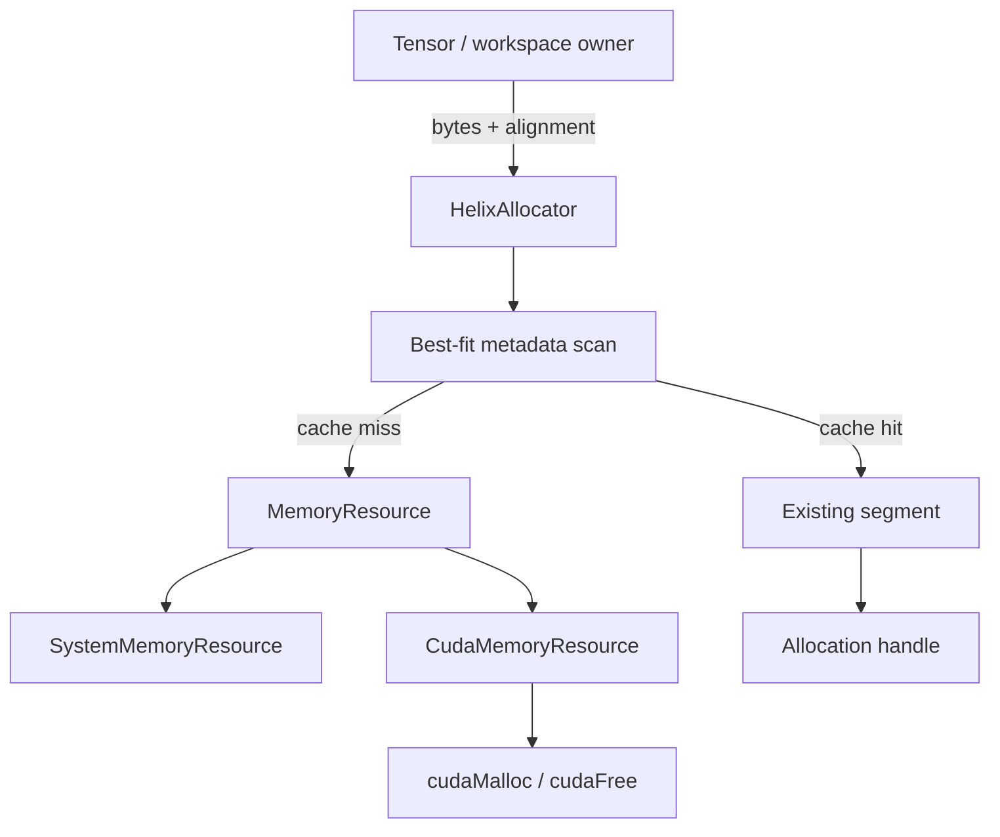
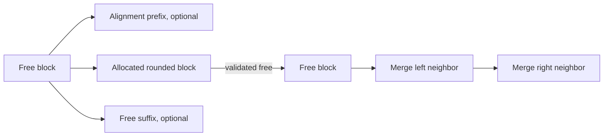

# HelixAllocator

## Validation status

The allocator metadata core is **implemented, CPU-validated, sanitizer-validated,
and host-resource benchmarked**. Commit `746d0a5` passes 12 focused allocator tests
and the full 62-test CPU suite under normal and ASan/UBSan builds. The CUDA 12.6
warnings-as-errors build compiles `CudaMemoryResource`, two hardware-gated GPU
tests, and native-CUDA comparison benchmarks, but no CUDA allocator code has run on
a physical GPU.

Most importantly, the current immediate reuse path is not stream-safe and is not
wired into Tensor storage. CPU metadata validation does not prove asynchronous GPU
lifetime safety. M8 adds event-backed reclamation before that integration.

## Why cache device allocations?

Direct CUDA Tensor storage currently calls `cudaMalloc` and `cudaFree`. Those APIs
manage global device-allocator state, and `cudaFree` can introduce synchronization;
repeating them for every transient Tensor is therefore a plausible inference-loop
bottleneck. Helix retains larger upstream segments and performs common allocation/
free operations in host metadata. The hypothesis must still be tested against
native CUDA on actual hardware; the local host-resource results are not a proxy for
GPU latency.

## Resource boundary



`MemoryResource` owns the backend-specific upstream operation. The System resource
uses aligned C++ allocation so the exact allocator core is executable without
CUDA. The CUDA resource selects its device with `DeviceGuard`, checks every runtime
call, and currently accepts alignments up to CUDA's 256-byte allocation guarantee.

`HelixAllocator` owns its resource through `shared_ptr`; every segment is released
when the allocator dies, even if callers still hold non-owning `Allocation`
descriptors. The allocator must therefore outlive all clients that dereference its
pointers.

## Allocation algorithm

Configuration provides a preferred segment size (64 MiB by default), minimum
alignment (256 B), and maximum reserved bytes. A request:

1. rejects zero bytes and non-power-of-two alignment,
2. uses the larger of requested and minimum alignment,
3. rounds requested bytes upward to that effective alignment with overflow checks,
4. scans every free block and accounts for pointer-alignment padding,
5. selects the candidate leaving the least unused remainder,
6. breaks ties by stable segment ID and then lower address,
7. acquires a new aligned segment only on a cache miss,
8. transactionally replaces the selected block with optional prefix, allocated
   block, and optional suffix metadata.

The linear scan is `O(number_of_blocks)`. It was chosen as an auditable baseline;
a size-indexed tree/bin structure adds update complexity and should follow only if
profiles show search cost matters.



Every nonempty remainder is retained; there is no hidden minimum-split threshold.
Address-ordered blocks always cover their segment exactly. A free rebuild merges
all adjacent free neighbors but never merges across upstream segments.

## Ownership and stale-pointer defense

Raw pointer lookup cannot distinguish this sequence:

```text
allocate A at address P
free A
allocate B, reusing P
accidentally free stale A
```

Helix therefore returns an `Allocation` descriptor containing a monotonic 64-bit
ID, pointer, requested/rounded bytes, alignment, and device. Deallocation validates
the active ID and every descriptor field. A copied handle can trigger a clean
double-free error, and an old handle cannot free a newer allocation at the same
address. `Allocation` is not independently RAII because its valid lifetime depends
on the owning allocator.

## Coalescing and explicit release

Deallocation changes only metadata; it does not return a partial block upstream.
After coalescing, a segment represented by one free block is wholly cached.
`release_cached()` returns only such segments to the resource. If an upstream
release fails, Helix leaves that segment and all counters intact so the caller may
retry. Destructor cleanup cannot throw and logs upstream failures.

The reservation limit is checked before an upstream call. Upstream allocation
failure, size/alignment overflow, and metadata allocation failure leave active
allocations unchanged. Debug builds re-scan the entire structure after mutations
to verify contiguous coverage, nonadjacent free blocks, counter sums, active IDs,
pointer alignment, and requested-versus-rounded bounds.

## Statistics and fragmentation

`AllocatorStats` exposes:

- `bytes_reserved`: bytes held in upstream segments,
- `bytes_allocated`: rounded bytes in active blocks,
- `bytes_requested`: client-requested bytes in active blocks,
- `bytes_free`: `reserved - allocated`,
- `peak_bytes_allocated`, `largest_free_block`, segment and active counts,
- successful allocation/cache-reuse/upstream allocation/upstream release counts.

External fragmentation answers how dispersed reusable capacity is:

```text
external = 0                                      when bytes_free == 0
external = 1 - largest_free_block / bytes_free   otherwise
```

It is zero for one coalesced free region and approaches one when free memory is
split into many small regions. It does not include memory outside Helix.

Internal fragmentation measures size/alignment rounding in active blocks:

```text
internal = 0                                              when bytes_allocated == 0
internal = (bytes_allocated - bytes_requested)
           / bytes_allocated                              otherwise
```

Alignment prefix/suffix blocks remain externally reusable and therefore are not
counted as internal waste.

## Thread safety

All public allocation, free, ownership, stats, and trim operations serialize on one
mutex. The upstream resource is called under that mutex, making state transitions
simple and preventing duplicate segment acquisition. Independent allocators can
run concurrently. Destroying an allocator concurrently with any method is invalid.
The coarse lock is a correctness baseline; sharded locks or per-device bins require
contention measurements.

## Stream-safety boundary

Kernel launch completion is asynchronous. Returning allocation A to the free list
immediately after enqueueing a kernel that uses A can let a second allocation reuse
the same bytes while the first kernel is still executing. That is a use-after-free
even if the host-side owner is gone.

The current API assumes the caller has already synchronized all device uses before
`deallocate`. Its GPU test uses synchronous memset/copy operations for exactly this
reason. M8 will associate frees with CUDA events/streams, hold them in a pending
state, reclaim only after completion, and add pending bytes/counters. Until then,
Tensor CUDA storage retains direct allocation/free semantics.

## Benchmarks

Host-resource results are recorded in `docs/PERFORMANCE.md`. On this Apple M3 Pro,
the cache was slower for 256 B, 4 KiB, and the 16-allocation mixed trace because
the host allocator already caches those blocks and Helix adds a mutex, linear scan,
vector rebuild, and active-map update. Reusing a 1 MiB block was lower latency than
repeated aligned host allocation. The default 64 MiB segment also over-reserved
the small mixed trace. These are useful design observations, not CUDA claims.

CUDA builds contain fixed and mixed-trace comparisons between direct
`cudaMalloc/cudaFree` and `HelixAllocator(CudaMemoryResource)`. They time the full
host allocation workload with Google Benchmark real time; CUDA events are not used
to time host APIs. GPU model, driver, toolkit, warmup, iteration count, trace,
reserved/peak bytes, underlying calls, and fragmentation must accompany any future
published result.

## Current limitations

- no stream/event-aware deferred free,
- not integrated with Tensor storage,
- CUDA runtime correctness and allocation latency unvalidated,
- CUDA alignments above 256 bytes unsupported by the direct resource,
- linear best-fit scan and vector rebuild may scale poorly with many blocks,
- no memory-pressure callback or automatic trim policy,
- no `cudaMallocAsync` baseline yet,
- no per-stream, per-size, or per-device sharding within one allocator.
