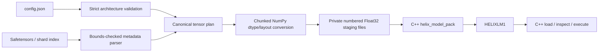
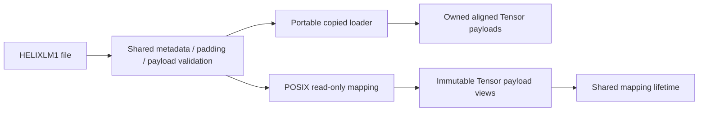

# Helix Model Support

## Status

Milestones 17–19 implement one narrow, deterministic Llama-style model,
single-sequence generation session, and multi-request CPU orchestration path. They
are Float32 correctness baselines for full causal prefill and contiguous or paged
KV decode, not a claim
of compatibility with every model whose configuration contains the word “Llama.”
The implementation, native weight container, unit tests, sanitizer suite, CPU
benchmarks, and a narrowly checked Hugging Face Llama safetensors conversion path
are complete. Native files can be loaded through either portable owned copies or
an opt-in immutable POSIX mapping. CUDA model execution, fused tensor batching,
and tokenizer/text-prompt integration remain later gates. One revision-pinned
public tiny-random checkpoint has been validated at the raw-token/logit boundary;
that single artifact does not imply broad checkpoint compatibility.

## Exact architecture contract

For vocabulary `V`, hidden width `H`, intermediate width `I`, layer count `L`,
attention heads `A`, head dimension `D = H/A`, and prompt length `T`, Helix accepts:

- positive dimensions, `H % A == 0`, and an even `D`;
- one Q, K, and V head per attention head; grouped-query and multi-query attention
  are not supported;
- Float32 CPU weights and activations in contiguous row-major storage;
- bias-free embedding/projection/MLP operations;
- pre-attention and pre-MLP RMSNorm;
- full adjacent-pair RoPE across each head dimension;
- causal scaled dot-product attention;
- a SwiGLU MLP, residual connections, final RMSNorm, and an explicit LM-head
  payload. A tied source embedding can be duplicated into that payload by the
  offline converter.

The complete baseline is:

```text
token_ids[T]
  -> embedding[V,H]                         => hidden[T,H]
  -> repeat L times:
       RMSNorm
       Q/K/V linear[H,H]
       reshape[T,A,D] + RoPE(Q,K)
       causal attention[A,T,D]
       output linear[H,H] + residual
       RMSNorm
       gate linear[H,I], up linear[H,I]
       SiLU(gate) * up
       down linear[I,H] + residual
  -> final RMSNorm
  -> LM head[H,V]                           => logits[T,V]
```

Every linear weight uses `[input_features, output_features]` layout. Attention
temporarily repacks token-major `[T,A,D]` projections into the existing
head-major `[A,T,D]` attention contract, then repacks its result back to `[T,H]`.
That copying is intentionally visible in this first baseline.

`CpuLlamaModel::forward` returns logits for every prompt position. The opt-in
`forward_with_trace` additionally retains each post-layer hidden state and the
final normalized state. Tests compare all of those stages with an independent
`std::vector<float>` oracle; the ordinary forward path does not retain them.

## Prefill, cached decode, and generation

`CpuLlamaModel::prefill_with_kv` runs the same full causal path as `forward` and
additionally returns one rotated key tensor and one value tensor per layer, each
head-major `[A,T,D]`. `CpuLlamaModel::decode_one` consumes one token at absolute
position `P`, requires an existing cache length of exactly `P`, applies RoPE at
that absolute position, and attends the single query over `P` cached tokens plus
its current K/V. It returns `[1,V]` logits and the new token's all-layer K/V shaped
`[L,A,D]` without changing the cache.

`CpuLlamaGenerator` owns the model, a `ContiguousKvCache` sized to the model's
maximum sequence length, and one sequence handle. It is noncopyable, nonmovable,
single-sequence, and not thread-safe. Prefill computes every model artifact before
appending prompt tokens. Decode computes the complete token result before append.
Therefore ordinary validation/model failures leave cache length unchanged. Cache
append itself is a prevalidated, fixed-capacity copy with no allocation after the
model step.

The first decode baseline retrieved an owning compact K/V snapshot per layer and
then copied that snapshot into a second buffer with a current-token tail.
`copy_layer_prefix_out` now copies the locked history directly into that final
`[A,P+1,D]` buffer, validates the caller's expected length under the cache mutex,
and leaves the tail untouched for the current K/V. This preserves cache ownership
while removing two Tensor temporaries and one history-copy pass per layer.

The paged `decode_one` overload retains two attention modes. `kCompactCopy` uses
the contiguous history-plus-tail algorithm above. The measured default,
`kDirectBlockTable`, holds a paged layer read lease and consumes cached physical
spans plus current K/V as an uncommitted tail. It checks cache length under the
lease, supports position zero with no pages, and releases the lease before its
caller appends. The model never owns or mutates either cache.

`CpuRuntimeEngine` selects the mode for one paged sequence per live request and
appends returned all-layer K/V only after a successful model step. A deterministic
test crosses a paged block boundary and compares direct, compact, and full-prefix
results at every sequential position; a separate runtime test compares complete
generated requests through both modes.

When a new prompt is scheduled as one complete range, the M19 engine calls
`prefill_with_kv` once, retains only the final `[1,V]` logits row, and passes the
layer-major K/V artifacts to `PagedKvCache::append_layer_major`. Partial prompt
ranges retain token-at-a-time decode so arbitrary scheduler chunking remains
correct. These are selectable benchmark paths rather than an erased baseline.

`select_greedy_token` examines the last logits row, requires finite Float32 CPU
values, and selects the lowest token ID among equal maxima. `generate` emits until
the requested count, optional EOS token, or context capacity prevents another
decode. A selected token is appended to K/V only when it becomes the input to a
later decode step, so a final emitted token may not be cached. `GenerationResult`
reports the actual cache count instead of implying otherwise.

The `helix_generate` example loads `HELIXLM1` and accepts prompt token IDs:

```bash
./build/examples/helix_generate \
  --model ./models/example.helix \
  --max-new-tokens 16 \
  1 42 17
```

This explicit token-ID boundary avoids making a tokenizer or Python a runtime
dependency. It is not text-in/text-out model support.

## Weight tensors

The runtime requires exactly `3 + 9*L` tensors in this order:

| Scope | Role | Shape |
|---|---|---:|
| Global | token embedding | `[V,H]` |
| Each layer | attention norm | `[H]` |
| Each layer | query, key, value | each `[H,H]` |
| Each layer | attention output | `[H,H]` |
| Each layer | FFN norm | `[H]` |
| Each layer | gate, up | each `[H,I]` |
| Each layer | down | `[I,H]` |
| Global | final norm | `[H]` |
| Global | LM head | `[H,V]` |

`LlamaWeights` is move-only and validates every tensor's device, dtype,
contiguity, and exact shape. `CpuLlamaModel` moves the weight bundle into one
owner. Ordinary Tensor storage is reference-counted, so a caller that retained a
shallow writable alias before model construction could still mutate the same
bytes. The mapped loader closes that boundary: each payload is an externally owned
read-only Tensor, views retain the mapping and immutability, mutable pointer access
and in-place operations fail, and `clone` makes an independent writable copy.
Const model APIs never mutate weights. Concurrent forward calls over mapped
weights therefore share immutable parameters and allocate independent activations;
the source inode must not be modified while those mappings live.

## Offline Hugging Face Llama conversion

`tools/convert_hf_llama.py` maps one explicit Hugging Face Llama checkpoint
layout into Helix; it is not a generic `transformers` importer. It follows the
published [safetensors metadata layout](https://huggingface.co/docs/safetensors/metadata_parsing)
and the projection/RoPE semantics in Hugging Face's
[Llama implementation](https://github.com/huggingface/transformers/blob/main/src/transformers/models/llama/modeling_llama.py),
but its parser, layout conversion, packer, and tests are implemented independently.
Python/NumPy is used only during conversion. Loading and execution remain C++.

Accepted input is a directory containing `config.json` and either:

- one `model.safetensors`; or
- `model.safetensors.index.json` plus the referenced shards.

The converter accepts F32, F16, and BF16 safetensors payloads and materializes
Float32 Helix weights. It requires `model_type == "llama"`, SiLU/SwiGLU, no
attention/MLP projection bias, equal attention and K/V head counts, the ordinary
`hidden_size / num_attention_heads` head dimension, full rotary dimensions, and
default unscaled RoPE. GQA/MQA, scaled/dynamic/partial RoPE, adapters, fused QKV,
quantized tensors, and nonstandard tensor names are rejected with context.

### Layout mapping

PyTorch linear layers store `[output,input]`; Helix linear kernels consume
`[input,output]`. All projection and LM-head matrices are therefore transposed.
Embedding and normalization vectors keep their source order. The Q/K mapping has
one additional transformation:

```text
Hugging Face head coordinates: [x0 x1 ... xN  y0 y1 ... yN]
Helix head coordinates:        [x0 y0 x1 y1 ... xN yN]
```

Hugging Face's Llama path rotates the two coordinate halves, while Helix's
educational kernel rotates adjacent pairs. Interleaving Q/K projection outputs per
head makes those two representations mathematically equivalent. V and the output
projection are not permuted. If `tie_word_embeddings` is true and
`lm_head.weight` is absent, the converter transposes the token embedding into
Helix's explicit LM-head payload.

### Conversion and packing boundary



The safetensors reader requires duplicate-free JSON, exact shape/dtype byte
lengths, in-bounds nonoverlapping ranges, and complete data-buffer coverage.
Sharded index paths must resolve inside the checkpoint directory. Conversion is
chunked, checks every converted value for finiteness, and writes into a private
temporary directory beside the output.

`helix_model_pack` calls
`write_llama_model_file_from_raw_float32_files`. That C++ path checks canonical
file count/order, exact byte length, little-endian Float32 finiteness, output/input
aliasing (including hard links), and checksums every raw file before opening its
output. It recomputes the checksum while copying so concurrent source mutation
cannot silently produce a self-inconsistent container. The packer refuses to
overwrite an existing file. Only after packing succeeds does Python use a
same-filesystem atomic replacement; `--force` therefore preserves the old output
until a complete new file exists.

The straightforward staging design has an explicit cost: conversion temporarily
needs roughly twice the final Float32 payload size in free space. It avoids
retaining an entire second `LlamaWeights` object in RAM, but it is not a zero-copy
or low-disk-footprint converter.

```bash
python3 -m venv .venv-convert
.venv-convert/bin/python -m pip install -r tools/requirements-convert.txt
cmake --build build --target helix_model_pack helix_model_inspect

.venv-convert/bin/python tools/convert_hf_llama.py \
  --input ./models/hf-llama \
  --output ./models/model.helix \
  --packer ./build/tools/helix_model_pack

./build/tools/helix_model_inspect ./models/model.helix --smoke

.venv-convert/bin/python tools/validate_hf_llama.py \
  --checkpoint ./models/hf-llama \
  --model ./models/model.helix \
  --inspector ./build/tools/helix_model_inspect \
  --tokens 1,42,7
```

`helix_model_inspect` loads and validates every payload, reports geometry and
parameter count, and can run a one-token CPU smoke forward. Its
`--last-logits TOKEN[,TOKEN...]` mode prints exact hexadecimal Float32 values for
validation tooling; it is not the user-facing generation CLI.

To register the converter integration test in a fresh build, point CMake at the
conversion environment before configuring:

```bash
cmake -S . -B build-converter \
  -DPython3_EXECUTABLE="$PWD/.venv-convert/bin/python"
cmake --build build-converter -j
ctest --test-dir build-converter -L converter --output-on-failure
```

If Python/NumPy is absent, CMake reports converter tests as off; this never blocks
the C++ runtime, tools, or the remaining test suite.

### Revision-pinned public checkpoint validation — 2026-08-24

Helix has one deliberately narrow public-checkpoint result. The artifact is
[`llamafactory/tiny-random-Llama-3`](https://huggingface.co/llamafactory/tiny-random-Llama-3/tree/c17693c90450da4160582668bfe65a60175d43e5)
at immutable revision `c17693c90450da4160582668bfe65a60175d43e5`, not that
repository's moving `main` branch. Its Apache-2.0 model card and configuration
describe a two-layer `LlamaForCausalLM` with `H=16`, `I=64`, four attention and
four K/V heads, default full RoPE, a 32,000-token vocabulary, and F16 weights.
The exact downloaded inputs were:

| File | Bytes | SHA-256 |
|---|---:|---|
| `config.json` | 629 | `fa37499d22425657fa3a03a0dceaeb8c6c4d1161c0c254aa0d16e2390628f02a` |
| `model.safetensors` | 2,066,736 | `893f1e09fc17a2148c1aab60bdb8a5c50b69f14d3ce40afa893901482dba4f54` |

Starting from an empty `/tmp/helix-public-checkpoint`, the pinned download and
conversion commands are:

```bash
mkdir -p /tmp/helix-public-checkpoint
curl -fL --output /tmp/helix-public-checkpoint/config.json \
  https://huggingface.co/llamafactory/tiny-random-Llama-3/resolve/c17693c90450da4160582668bfe65a60175d43e5/config.json
curl -fL --output /tmp/helix-public-checkpoint/model.safetensors \
  https://huggingface.co/llamafactory/tiny-random-Llama-3/resolve/c17693c90450da4160582668bfe65a60175d43e5/model.safetensors
shasum -a 256 /tmp/helix-public-checkpoint/config.json \
  /tmp/helix-public-checkpoint/model.safetensors

.venv-convert/bin/python tools/convert_hf_llama.py \
  --input /tmp/helix-public-checkpoint \
  --output /tmp/helix-public-checkpoint/model.helix \
  --packer ./build-release/tools/helix_model_pack \
  --chunk-mib 1
shasum -a 256 /tmp/helix-public-checkpoint/model.helix
```

Conversion through commit `d433760`, using Python 3.14.3, NumPy 2.5.2, and the
Release Apple Clang 17 packer, produced a deterministic 4,130,944-byte Float32
`HELIXLM1` file with 1,032,272 parameters and SHA-256
`a855bb813b69b71d613347be1e31d7bf21f73d2be0b5b60227e5cd4c944177cd`.
Downloaded inputs and generated weights remained outside the repository.

`tools/validate_hf_llama.py` is a bounded correctness oracle, not an alternate
runtime. It independently parses source-layout safetensors, evaluates bias-free
Llama with `[output,input]` projections and half-split RoPE, invokes the C++
inspector, and compares the complete last-token logits vector. It refuses more
than five million logical parameters by default so an accidental 7B-model command
does not enter a path built from explicit reference loops. The CTest integration
covers mixed F32/F16/BF16 shards, success, out-of-vocabulary input, size refusal,
and a deliberately mismatched source/model pair.

Four public-model sequences were checked:

```text
0
1,42,7
31999,0,17,2048,3
5,1,31,7,99,2,1234
```

All 128,000 logits passed at `rtol=2e-5`, `atol=2e-6`. Maximum absolute error
against the independent NumPy source-layout oracle was `2.98023224e-8`. The same
four sequences were also run through the source checkpoint with PyTorch 2.0.1 /
Transformers 4.32.0 on CPU, forced to Float32, eager execution, one host thread,
and `use_cache=False` under Python 3.11.14 on the Apple M3 Pro/macOS 26.0.1 arm64
host; maximum absolute Helix/framework error was
`8.94069672e-8`. Relative maxima are less informative near logits that round close
to zero, so pass/fail uses the disclosed combined relative/absolute tolerance.

The core validation is reproducible with the NumPy-only conversion environment.
`--transformers` is optional and imports external packages only when requested:

```bash
.venv-convert/bin/python tools/validate_hf_llama.py \
  --checkpoint /tmp/helix-public-checkpoint \
  --model /tmp/helix-public-checkpoint/model.helix \
  --inspector ./build-release/tools/helix_model_inspect \
  --tokens 1,42,7

# Exact optional external-reference environment used for the recorded run:
python3.11 -m venv .venv-hf-validation
.venv-hf-validation/bin/python -m pip install \
  numpy==1.26.4 torch==2.0.1 transformers==4.32.0 safetensors==0.3.3
HF_HOME=/tmp/helix-hf-cache \
  .venv-hf-validation/bin/python tools/validate_hf_llama.py \
  --checkpoint /tmp/helix-public-checkpoint \
  --model /tmp/helix-public-checkpoint/model.helix \
  --inspector ./build-release/tools/helix_model_inspect \
  --tokens 1,42,7 \
  --transformers
```

This validates weight mapping and CPU Float32 forward semantics for one random
model. It does not validate learned language quality, tokenization, text prompts,
generation parity, GQA/MQA, scaled RoPE, CUDA execution, or other checkpoints.

## Native model file v1

`write_llama_model_file`, `read_llama_model_file`, and
`read_llama_model_file_mapped` implement a deterministic, little-endian container.
Streams must be seekable and start at offset zero. The runtime does not require
Python to read it.

### Header

The v1 header is exactly 128 bytes:

| Offset | Bytes | Field |
|---:|---:|---|
| 0 | 8 | magic `HELIXLM1` |
| 8 | 4 | format version (`1`) |
| 12 | 4 | endian marker (`0x01020304`) |
| 16 | 4 | header size (`128`) |
| 20 | 4 | model kind (`1`, Llama-style) |
| 24 | 8 | exact file size |
| 32 | 8 | tensor-directory offset (`128`) |
| 40 | 8 | tensor count |
| 48 | 8 | directory-entry size (`80`) |
| 56 | 8 | first payload-region offset |
| 64 | 48 | `V`, `H`, `I`, `L`, `A`, maximum sequence length as six `uint64` values |
| 112 | 4 | RMSNorm epsilon as IEEE-754 Float32 bits |
| 116 | 4 | RoPE theta as IEEE-754 Float32 bits |
| 120 | 8 | FNV-1a checksum of the header with this field zeroed plus the directory |

### Directory and payloads

Each 80-byte directory entry contains a stable tensor-role code, layer index,
dtype code, rank, four dimension slots, payload offset, byte length, alignment,
and payload checksum. Unused dimension slots must be zero. Global tensors use a
sentinel layer index. Payloads contain little-endian IEEE-754 Float32 bits, begin
at 64-byte-aligned offsets, and have zero-filled alignment gaps.

The loader checks, before exposing a model:

- magic, version, endian marker, model kind, header sizes, and exact stream size;
- all configuration invariants and checked host-size conversions;
- the exact `3 + 9*L` tensor count and canonical directory size/data offset;
- metadata checksum before trusting directory records;
- canonical tensor order, role/layer identity, dtype, rank, shape, byte length,
  alignment, nonoverlapping offsets, and complete file coverage;
- zero alignment padding, every payload checksum, and finite Float32 values;
- the assembled `LlamaWeights` contract once more before return.

Both loaders use the same header/directory parser and perform every check above
before returning. An error destroys all local Tensor/mapping owners, so a partially
loaded `LoadedLlamaModel` never escapes. FNV-1a detects accidental corruption but
is not cryptographic authentication. Treat model files as untrusted structured
input, not as signed artifacts.

### Copied and mapped load paths



The portable filesystem/stream loader reads chunks, decodes little-endian
Float32 values, and allocates one aligned owning Tensor per payload. The mapped
path is deliberately explicit rather than silently replacing it. On a POSIX,
little-endian IEEE-754 host it opens a regular file read-only, obtains the exact
size from that descriptor, creates a private read-only mapping, and closes the
descriptor. Canonical 64-byte file offsets plus the page-aligned mapping base make
every Tensor pointer aligned; both assumptions are checked at runtime. Each Tensor
wraps only its payload range while sharing one RAII mapping owner, so
`allocated_bytes()` remains the tensor's payload size and the final view keeps the
mapping alive.

Mapping does not skip validation or make loading constant-time. Helix still scans
all metadata, padding, and payload bytes, verifies every checksum, decodes every
Float32 representation for finite-value validation, and revalidates the assembled
weight shapes. It removes payload heap allocation, endian-copy loops, and owned
parameter copies on a compatible host. Callers can query
`mapped_model_loading_supported()`; stream inputs and unsupported hosts must
explicitly select the copied loader instead.

The mapping owns an inode, not an immutable snapshot. Rename or unlink after a
successful load is safe and tested because the mapping retains the pages. In-place
modification or truncation by another process while the model lives violates the
API contract and can change bytes or fault future accesses; Helix cannot enforce
cooperation from an external writer. Model deployment must publish complete files
by replacement and leave live inodes unchanged.

## Correctness and validation

The deterministic model test uses two layers, two heads, odd prompt length three,
and independently implements embedding lookup, RMSNorm, every projection, RoPE,
causal attention, residuals, SwiGLU, final normalization, and the LM head with
plain vectors. It compares each layer state, the final normalized state, and every
logit within `5e-5`, then checks bitwise repeatability. Boundary tests cover empty,
overlength, maximum-length, and out-of-vocabulary token sequences, invalid head
geometry, non-finite configuration values, wrong layer counts, dtype errors, and
bad weight shapes.

Generation tests compare prompt logits and two successive cached decode positions
with full-prefix recomputation, then compare a complete four-token greedy sequence
with repeated full recomputation. They cover decode at position zero, deterministic
tie-breaking, non-finite logits, invalid EOS/token/cache geometry, zero budget,
EOS, context exhaustion, repeated-prefill misuse, and transactional cache length
on failures. The direct prefix-copy test verifies multi-head layout, untouched tail
rows, stale expected-length rejection, insufficient output capacity, and alias
rejection.

Model-file tests cover bit-exact deterministic round trips, executable loaded
weights, filesystem APIs, truncation, trailing bytes, wrong magic/version/endian
markers, metadata and payload corruption, nonzero padding, structurally invalid
but checksum-consistent ranks/offsets, invalid weights, non-finite weights, and
nonzero stream origins. Two additional C++ tests prove that canonical raw Float32
files produce byte-identical containers and reject wrong counts/sizes, non-finite
values, direct aliases, and hard-link aliases before destructive output access.
Mapped-loader tests additionally compare every payload bit with copied/expected
weights, execute identical logits, enforce read-only mutation failures, verify
64-byte alignment and payload-sized storage accounting, and prove mapping lifetime
after the pathname is unlinked. Truncation, trailing bytes, metadata corruption,
nonzero padding, checksum-consistent non-finite payloads, and missing paths are
rejected with the same format/error boundary.

The converter integration test synthesizes a two-layer sharded Hugging Face-style
checkpoint containing F32, F16, and BF16 tensors. It independently parses the
resulting directory/payloads, checks every transformed value and checksum, proves
that Q permutation is nontrivial, and executes the C++ loader/forward path. A
separate NumPy oracle evaluates the source `[output,input]` projections with
Hugging Face half-split RoPE and compares its final logits with converted Helix
execution. Tied-embedding fallback, atomic `--force`, GQA rejection, wrong shapes,
non-finite inputs, and shard path escape are also covered. This is strong mapping
evidence. The separate bounded validator then exercises the exact source-layout
math, failure detection, and the revision-pinned public checkpoint described
above; tokenizer/text-prompt behavior remains untested.

Validation on 2026-08-24 through checkpoint-validator commit `d433760`:

- Debug, Release, and Apple Clang ASan/UBSan CPU suites: 177/177 tests passed;
- all Release tests and benchmark smoke workloads passed;
- CUDA 12.6.85/GCC 13.2 warnings-as-errors build: all targets compiled and all
  176 C++ hardware-independent tests passed;
- 57 GPU runtime tests remained explicitly skipped because the compile container
  has no NVIDIA driver or device (233 registered tests total);
- the CUDA container lacks Python/NumPy, so its converter integration test was not
  registered; that test passed in every native CPU configuration.

## Measured CPU baselines

Release-mode full-prefill and checked in-memory-load measurements are recorded in
[`PERFORMANCE.md`](PERFORMANCE.md). `forward` includes its temporary tensor
allocations and full model math; model construction and weight initialization are
outside timing. The load fixture includes stream construction, metadata and
payload validation/checksums, endian decoding, Tensor allocation, and final weight
validation, but excludes filesystem I/O and serialization.

Those measurements establish the first implementation. A separate paired
filesystem fixture preserves the copied loader and compares it with the immutable
mapping after one untimed load per path. Mapped median CPU time was 20.96%, 15.14%,
and 12.78% lower for the three disclosed 117,184 B–3,153,600 B synthetic files.
It includes open/map-or-read, full validation, Tensor/weight assembly, and
destruction, but it is a warm-page experiment—not cold-storage latency, an RSS
measurement, GPU behavior, model execution, production throughput, or a
BLAS/framework comparison.

The M18 next-position fixture compares one cached decode against recomputing the
same complete prefix. Model/cache setup and prompt prefill are excluded; the cached
timed region includes one-token math, cache history reads, final cache append, and
temporary allocations. The paired cache-staging fixture retains the original
two-stage snapshot algorithm beside the direct-prefix path and includes output
allocation and current-tail copies for both. Exact medians, variation, model
shapes, repetitions, and commands are in `PERFORMANCE.md`.

The M19 paired engine trace holds scheduler/decode/pool behavior constant and
compares sequential-token prompt execution with full-prompt execution plus bulk
paged append while pinning compact-copy decode. The full-prompt default reduced
median CPU trace time by 15.8%–51.3% across the three tiny disclosed workloads. It
measures serial CPU orchestration, not fused batch or GPU throughput.

The post-M19 paged-decode experiment retains compact copy and direct block-table
execution in the same binary. Direct traversal reduced isolated layer median CPU
time by 13.3%–27.7% across four histories and removed 2 KiB–1 MiB of combined-K/V
temporaries. Complete runtime trace medians improved by 0.08%–6.23%; the largest
case is a practical tie relative to its variation. These are CPU reference-path
results, not evidence about a future CUDA paged-attention kernel.

## Deliberate limitations

- CPU Float32 only for complete model execution.
- Complete new prompts use one full prefill; chunked runtime prefill falls back to
  sequential one-token execution rather than a multi-token continuation kernel.
- The standalone generator's contiguous-cache decode materializes one
  `[A,P+1,D]` K/V pair per layer; the multi-request paged runtime defaults to
  direct traversal instead.
- The standalone generator supports one sequence and greedy selection only. The
  runtime supports several paged sessions but executes work items serially and has
  no sampling or fused tensor batch.
- No tokenizer or text-prompt path. One public tiny-random checkpoint is validated
  from raw token IDs through full logits, not through meaningful text generation.
- The offline converter supports only the documented standard Llama safetensors
  layout. No GQA/MQA, biases, partial/scaled RoPE, sliding windows, mixture-of-
  experts blocks, quantization, adapters, or arbitrary model graphs. Tied input
  embeddings are materialized as a separate explicit output payload.
- Immutable mapped loading requires a POSIX, little-endian IEEE-754 host and a
  regular file whose inode remains unchanged for the model lifetime. The portable
  stream/filesystem path still allocates and copies every payload. Cold-page
  latency and resident-memory effects have not been measured.

Those omissions are compatibility boundaries, not silently accepted variants.
