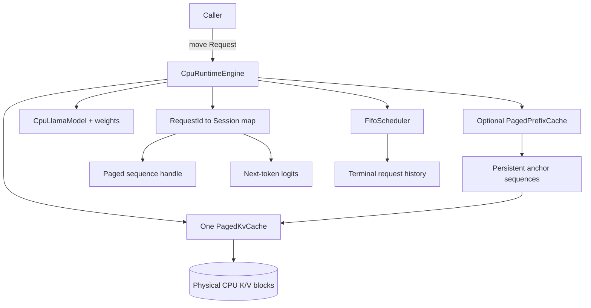
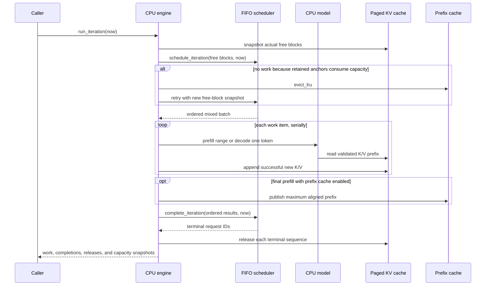

# CPU Runtime Execution Engine

## Status and scope

Milestone 19 now has a synchronous CPU correctness engine. `CpuRuntimeEngine`
connects the implemented FIFO scheduler, `CpuLlamaModel`, one global
`PagedKvCache`, greedy token selection, request completion, and physical K/V
reclamation. It accepts multiple requests and performs genuine model work for the
mixed prefill/decode batches produced by continuous replacement.

Milestone 22 adds an optional bounded `PagedPrefixCache`. The engine can fork the
longest exact block-aligned prompt prefix, seed scheduler progress, execute only
the suffix needed for fresh logits, retain successful prefixes as LRU anchors, and
evict those anchors when they prevent scheduling progress. This path is CPU-
validated, sanitized, and benchmarked; it is disabled by default because measured
short prompts regress.

This is not yet a CUDA execution engine. It has no device-resident block table,
CUDA stream, event dependency, allocator-backed Tensor storage, or fused model
batch. Scheduled work items execute serially on the calling thread using Float32
CPU reference kernels. Those boundaries are deliberate and are not hidden by the
`Runtime` name.

## Ownership

The engine is the sole mutable owner of its scheduler, model, cache facade, and
session map. The paged cache owns two long-lived physical pool tensors and is
shared with the optional prefix manager. A session owns a cache-tagged sequence
handle, optional EOS token, logits needed to select its next token, and—only when
prefixing is enabled—an exact copy of its prompt token IDs for later publication.
Prefix entries own separate persistent anchor handles. Terminal `Request` objects
remain owned by the scheduler so callers can inspect output and lifecycle metrics;
their model sessions are released immediately, while referenced pages can remain
resident through an anchor.

`CpuRuntimeEngine` is noncopyable, nonmovable, and single-thread-owned. Returned
request references are invalidated only when the engine dies, but their generated-
token spans must not be retained across another iteration that can append.

## Submission contract

`submit` accepts a move-only waiting `Request` and an optional EOS token. Before
creating observable scheduler state it validates:

- every prompt/EOS token is within the model vocabulary;
- prompt length and generation budget fit the model context;
- the maximum physically cached prefix can fit in the global page pool;
- the request ID is not already owned by the engine.

For a prompt of `P` tokens and a length budget of `N`, at most
`P + max(N - 1, 0)` tokens need K/V storage. The final length-limited output is
selected from logits already available and is not fed back through the model.
Submission therefore does not reject an exact-boundary request merely to reserve
an unused final-token page.

With prefixing disabled, the engine creates an empty paged sequence before moving
the request into the scheduler. With prefixing enabled, it copies the prompt key
and searches no farther than
`floor((P - 1) / block_tokens) * block_tokens`. A hit returns an owned sequence
fork and the scheduler receives the same aligned reused-token count; a miss creates
an empty sequence. The `P - 1` bound guarantees that at least one token executes,
because cached K/V alone cannot reproduce the logits after a completely cached
prompt. If session-map or scheduler insertion fails, the engine releases whichever
sequence it acquired. Invalid submissions leave the scheduler, session count, and
physical block pool unchanged.

## Iteration protocol

`run_iteration` is synchronous: scheduling, all model operations, logical
completion, and reclamation finish before it returns. At most one scheduler batch
exists, and no in-flight state escapes the call. The completion vector reserves
its maximum size before scheduling so its ordinary growth cannot strand a newly
opened scheduler iteration.

The cache's measured free-block count, rather than a separate mirrored counter,
is passed to the scheduler. Before every prefill or decode operation, the engine
checks that physical cache length equals the scheduled logical token offset. For
every nonterminal generated token, it eagerly evaluates that token and appends its
K/V before scheduler completion, preserving this equality for the next iteration.
The final length-limited token needs no append; the scheduler explicitly gives it
zero new-block demand, so it can finish at an exact block boundary with no free
page.

If scheduling returns no batch specifically because K/V capacity is limiting, an
enabled prefix cache evicts one LRU anchor and retries against a fresh physical
free-block snapshot. Eviction continues only while no work can be scheduled; a
valid partial batch is never discarded to chase a larger batch. Releasing an
anchor that is still shared by a live session may not free a page immediately, so
the loop can remove additional entries without violating reference ownership.

An EOS token is not predictable until logits are sampled. The scheduler therefore
reserves capacity conservatively for a non-final decode; if the result is EOS, the
engine skips the unused model step and reclaims the request's actual pages during
the same call.

## Prefill paths

Two implementations remain selectable through `CpuPrefillMode`:

- `kSequentialDecode` is the retained baseline. Every scheduled prompt token
  executes through one-token decode and appends one K/V record. It supports
  arbitrary scheduler chunk boundaries and makes the incremental semantics easy
  to audit.
- `kFullPrompt` is the default. When the scheduler delivers an entire new prompt,
  the model executes one full causal prefill, retains only the final logits row,
  and bulk-appends its layer-major `[heads,tokens,head_dimension]` K/V artifacts.
  Chunked or resumed prompts fall back to the sequential path.

A prefix hit is a resumed prompt by construction. Its block-aligned cached seed is
already present in the paged sequence and the scheduler emits only the suffix.
The engine evaluates that suffix through the sequential path so its first token
can attend to the shared history and its last token produces fresh logits. After
the final prompt work succeeds, the engine attempts to publish the maximum aligned
prefix that still leaves one token outside the cache. Only this maximum prefix is
stored for a request; intermediate block boundaries are not separately inserted.
An exact duplicate refreshes MRU state. Optional publication metadata exhaustion
does not fail an otherwise correct request and increments a diagnostic counter;
other invariant/ownership errors remain fatal to the work item.

`PagedKvCache::append_layer_major` validates every tensor and reserves the entire
resulting block table before ownership changes. It then copies maximal spans into
partial and whole physical blocks while holding the cache lock. Pool exhaustion,
bad shapes, zero token ranges, or metadata allocation failure leave sequence
length and block ownership unchanged. Its `append_count` continues to count
tokens, not API calls.

The paired Release benchmark retains both prefill modes and pins compact-copy
decode so only prompt execution changes. Full-prompt execution reduced median CPU
trace time by 51.3%, 36.0%, and 15.8% in three disclosed tiny workloads. The
decreasing benefit is expected because decode accounts for more of the larger
trace. Exact environments, shapes, timing boundaries, variation, and commands are
in `PERFORMANCE.md`.

The steady-state prefix benchmark performs the same untimed warm request in both
modes, then times 16 sequential one-output requests with one shared aligned prefix.
Reuse reduced executed prefill tokens from 256 to 64 for the 16-token case and
from 512 to 64 for the 32-token case, improving median CPU time by 1.80x and 6.04x.
For an 8-token prompt it reduced work from 128 to 64 tokens but was 68.7% slower
because four sequential suffix calls plus lookup/fork overhead lost to one
vectorized full prefill. Prefixing therefore remains opt-in rather than relying on
an unmeasured universal threshold.

## Paged decode paths

`CpuRuntimeConfig::paged_decode_mode` retains two implementations:

- `kCompactCopy` allocates `[heads,history+1,head_dimension]` key and value
  tensors per layer, copies every cached page prefix into them, writes current K/V
  into the final row, then calls contiguous attention.
- `kDirectBlockTable` is the measured default. It acquires a move-only layer read
  lease and computes attention over cached physical spans plus the current
  uncommitted K/V tail. The model returns that tail for one all-layer append only
  after complete token execution succeeds.

The direct path preserves physical sequence length throughout model execution and
checks the leased length against the scheduled position under the cache lock. It
supports an empty history, which is required by sequential prefill at position
zero. The lease is released before the engine appends; attempting to append while
holding it would deadlock on the cache's nonrecursive mutex.

In paired isolated layer calls, direct traversal reduced median CPU time by
13.3%–27.7% and removed 2 KiB–1 MiB of combined-K/V temporaries. Complete runtime
trace medians fell by 3.97%, 6.23%, and 0.08%; the largest case is effectively a
tie relative to measured variation. Both modes remain executable so this tradeoff
can be remeasured on different workloads rather than encoded as an unsupported
universal claim.

## Completion, failure, and cancellation

A successful prefill carries no output token. Decode selects the lowest-ID finite
maximum from the session's last logits and reports exactly one token plus an EOS
flag. Model/cache exceptions are converted into ordered failed work completions;
the scheduler transitions that request to `failed`, retains contextual error text,
and the engine releases its physical sequence.

Completion validates the whole ordered vector before logical request mutation.
After it returns, the engine releases every reported terminal session before
moving the retirement records into the public result. This order is intentional:
moving the vector first would make reclamation iterate an empty, moved-from
container.

`cancel` delegates state validation to the scheduler, then immediately releases
the corresponding empty, prefill, or decode sequence. Cancellation is rejected
while a scheduler iteration is in flight, matching the single-iteration ownership
contract.

## Observability

Each iteration result reports:

- iteration identity and exact scheduled work;
- ordered work completions and terminal requests;
- actual free physical blocks before and after execution;
- scheduled prefill/decode token counts;
- token-budget and K/V-capacity limiting flags;
- number of prefix entries evicted to make progress.

`CpuRuntimeStats` combines scheduler and paged-cache snapshots with active session,
executed iteration, failed work, full-prompt prefill, and sequential-prefill token
counters. When enabled, it also returns the complete prefix-cache snapshot and an
optional-publication failure count. Scheduler statistics separate actually
scheduled prefill tokens from logically reused prompt tokens. Lifecycle metrics
remain available at an explicit monotonic observation time.

## Correctness coverage

Eleven engine tests exercise:

- chunked prefill and multi-step paged decode against full-prefix recomputation;
- full-prompt prefill and bulk K/V append across page boundaries;
- compact-copy and direct block-table decode producing identical request output;
- real-model continuous replacement with mixed prefill/decode work;
- exact-boundary physical exhaustion, reclamation, and block reuse;
- EOS, running cancellation, waiting cancellation, and complete reclamation;
- 32 mixed-length requests under constrained-pool pressure, with every generated
  sequence checked against independent full recomputation and final leak checks;
- invalid configuration/submission with no leaked sessions;
- injected non-finite model output converted to request failure and reclaimed K/V;
- block-aligned exact-prefix reuse with suffix-only execution and outputs checked
  against full recomputation, including cancellation of a waiting fork;
- automatic LRU-anchor eviction and continued progress in a three-block pool.

The bulk cache, scheduler final-token rule, and paged model decode have additional
focused tests. The full Debug, Release, and ASan/UBSan CPU suites pass 196/196,
including the independent model-converter integration test. A CUDA 12.6 warnings-
as-errors build passes 195 hardware-independent tests and registers 75 GPU-required
tests/benchmark gates, all explicitly skipped without an NVIDIA driver/device (270
total); Python/NumPy is not installed in that compile container.

## Current limitations

- Work items execute serially; this engine does not form vectorized model batches.
- Full-prompt prefill is used only for a complete first prompt chunk. Partial
  prefill remains the slower one-token baseline.
- Direct one-token attention holds a cache-wide read lease for each layer, so it
  serializes unrelated mutation in the same physical pool.
- The physical K/V pool is CPU Tensor storage and does not use `HelixAllocator`.
- There are no CUDA streams, events, asynchronous copies, or device execution.
- The strict FIFO policy has no request preemption, priority, or terminal request
  archive/reaping API. Prefix eviction applies only to retained cache anchors.
- Prefixing is disabled by default, exact-token and block-aligned only, and uses
  one engine-local namespace. It stores one maximum prefix per completed prompt,
  not every boundary or next-token logits; there is no cross-model shared cache.
- Host allocation failure while constructing an error message is not a recoverable
  fault boundary; ordinary model/cache failures are handled and tested.

The next execution-engine step is a CUDA model path with device-resident paged K/V
and explicit stream ownership. Stream overlap is considered only after that path
is correct and measured on NVIDIA hardware.
