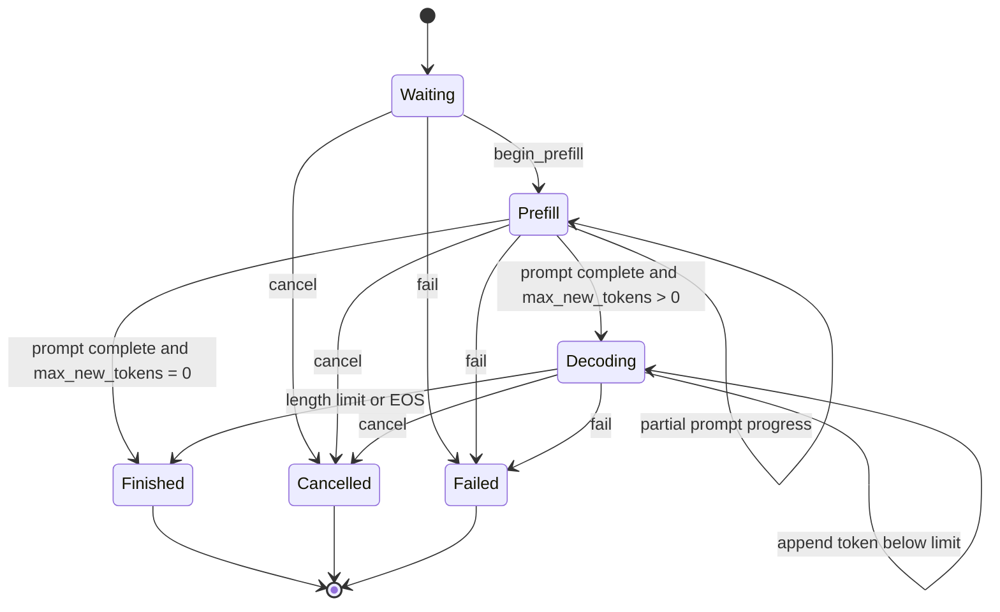

# Request and Scheduler Design

## Status

Milestone 14's host-only request state machine is implemented, tested under normal
and ASan/UBSan builds, and compile-validated as part of the CUDA-enabled build.
Milestones 15–16 scheduler policy and continuous batching remain planned in this
revision. No scheduler throughput or latency result is claimed yet.

## Ownership and thread safety

A `Request` owns its immutable prompt tokens, generated-token records, lifecycle
state, terminal context, and timestamps. It is move-constructible but neither
copyable nor move-assignable. Moving invalidates the source ID, so one live object
owns the state associated with a nonzero `RequestId`. The scheduler will own these
objects; request methods are intentionally not internally synchronized.

`RequestId` is a strong 64-bit type with zero reserved as invalid. `TokenId` is a
separate strong 32-bit type; token zero is valid. This prevents a token, count, or
raw integer from being passed accidentally where a request identity is expected.

Returned prompt and generated-token spans are non-owning. Prompt storage is stable
until the request moves or dies. Appending a generated token can reallocate its
vector, so a generated-token span must not be retained across mutation.

## Lifecycle

No terminal state has an outgoing transition, and same-state progress is not
represented as a transition. The public `request_state_transition_allowed`
function defines the complete matrix and is tested across all 36 state pairs.

Prompts must contain at least one token. `max_new_tokens` may be zero; such a
request still performs prefill and finishes with the length reason when its prompt
is complete. Prefill can be reported in positive chunks and rejects work beyond
the remaining prompt. This is the boundary the token-budget scheduler will use.

Generated tokens may be appended only during decode. Reaching the configured
limit atomically marks the request finished with `length`; the executor may finish
earlier with `end_of_sequence`. Cancellation and failure are accepted from any
active state and retain a required nonempty context. Invalid operations leave
state and token counters unchanged.

## Time and metrics contract

Request time uses `std::chrono::steady_clock`, so durations are immune to wall-
clock adjustments. Construction records `created_at`; every mutation receives its
event time explicitly. This makes scheduler simulations deterministic and allows a
future runtime to sample the clock once at the orchestration boundary. An event
earlier than prior activity is rejected transactionally.

The request records:

- first scheduling time,
- prefill completion time,
- every generated token and emission time,
- first and last token times,
- terminal completion time,
- derived waiting time and time to first token.

Per-token timestamps are sufficient to derive inter-token latency later without
introducing a scheduler-global clock. A cancelled or failed request has a completion
time but no fabricated first-token metric when it emitted nothing.

## Failure behavior and invariants

- zero request IDs and empty prompts are rejected at construction;
- zero-sized or overlarge prefill progress is rejected;
- decode output cannot exceed `max_new_tokens`;
- finish/EOS is legal only while decoding;
- cancellation/failure context cannot be empty;
- event time cannot move backward;
- terminal requests reject every later mutation;
- unknown enum values produce contextual errors when converted to names.

Ten deterministic tests cover the definition/strong types, chunked prefill,
zero-generation completion, length and EOS completion, metrics, the transition
matrix, cancellation/failure from all active states, transactional invalid paths,
unknown enums, and move ownership.

## Next scheduler gate

Milestone 15 will add a single-thread-owned FIFO scheduler over this type. Its
batch descriptions will distinguish prefill token ranges from one-token decode
work, enforce a per-iteration token budget and explicit KV-block budget, and keep
submission/admission/completion ownership testable without CUDA. Continuous
replacement of finished requests is deferred to Milestone 16 after the FIFO
baseline is correct.
