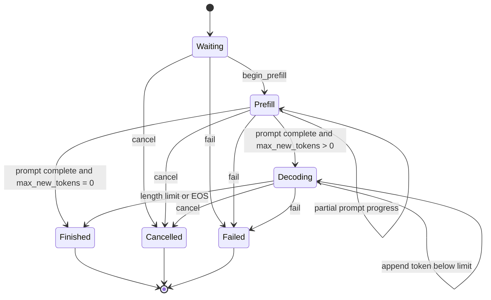

# Request and Scheduler Design

## Status

Milestones 14–15 are implemented: the host-only request state machine feeds a
single-thread-owned FIFO scheduler with explicit token and KV-block budgets. The
normal, ASan/UBSan, and CUDA-enabled host suites pass 113/113 tests. The CUDA build
also registers 57 GPU tests, but this scheduler is host policy and requires no GPU.
Milestone 16's continuous-batching comparison and aggregate latency metrics remain
planned in this revision.

## Ownership and thread safety

A `Request` owns its immutable prompt tokens, generated-token records, lifecycle
state, terminal context, and timestamps. It is move-constructible but neither
copyable nor move-assignable. Moving invalidates the source ID, so one live object
owns the state associated with a nonzero `RequestId`. The scheduler owns these
objects; request methods are intentionally not internally synchronized.

`FifoScheduler` owns every submitted request through a `unique_ptr`; stable object
addresses permit read-only request inspection while queue containers change. A
FIFO deque contains waiting IDs and a bounded vector contains running IDs. Terminal
requests leave both containers but remain queryable in the ownership map, so IDs
cannot be reused accidentally. Retaining all terminal history is simple and useful
for metrics, but an engine will eventually need an explicit reap/archive policy.

`RequestId` is a strong 64-bit type with zero reserved as invalid. `TokenId` is a
separate strong 32-bit type; token zero is valid. This prevents a token, count, or
raw integer from being passed accidentally where a request identity is expected.

Returned prompt and generated-token spans are non-owning. Prompt storage is stable
until the request moves or dies. Appending a generated token can reallocate its
vector, so a generated-token span must not be retained across mutation.

## Lifecycle

No terminal state has an outgoing transition, and same-state progress is not
represented as a transition. The public `request_state_transition_allowed`
function defines the complete matrix and is tested across all 36 state pairs.

Prompts must contain at least one token. `max_new_tokens` may be zero; such a
request still performs prefill and finishes with the length reason when its prompt
is complete. Prefill can be reported in positive chunks and rejects work beyond
the remaining prompt. This is the boundary the token-budget scheduler will use.

Generated tokens may be appended only during decode. Reaching the configured
limit atomically marks the request finished with `length`; the executor may finish
earlier with `end_of_sequence`. Cancellation and failure are accepted from any
active state and retain a required nonempty context. Invalid operations leave
state and token counters unchanged.

## Time and metrics contract

Request time uses `std::chrono::steady_clock`, so durations are immune to wall-
clock adjustments. Construction records `created_at`; every mutation receives its
event time explicitly. This makes scheduler simulations deterministic and allows a
future runtime to sample the clock once at the orchestration boundary. An event
earlier than prior activity is rejected transactionally.

The request records:

- first scheduling time,
- prefill completion time,
- every generated token and emission time,
- first and last token times,
- terminal completion time,
- derived waiting time and time to first token.

Per-token timestamps are sufficient to derive inter-token latency later without
introducing a scheduler-global clock. A cancelled or failed request has a completion
time but no fabricated first-token metric when it emitted nothing.

## Failure behavior and invariants

- zero request IDs and empty prompts are rejected at construction;
- zero-sized or overlarge prefill progress is rejected;
- decode output cannot exceed `max_new_tokens`;
- finish/EOS is legal only while decoding;
- cancellation/failure context cannot be empty;
- event time cannot move backward;
- terminal requests reject every later mutation;
- unknown enum values produce contextual errors when converted to names.

Ten deterministic request tests cover the definition/strong types, chunked prefill,
zero-generation completion, length and EOS completion, metrics, the transition
matrix, cancellation/failure from all active states, transactional invalid paths,
unknown enums, and move ownership.

## FIFO scheduling policy

Each call to `schedule_iteration(available_kv_blocks, now)` considers existing
running requests in stable admission order, then waiting requests in submission
order until one of three limits is reached:

- the per-iteration token budget;
- the maximum number of resident/running requests;
- the caller-reported number of free KV blocks.

Prefill work describes a positive prompt range `(token_offset, token_count)` and
may be chunked by either token or KV capacity. Decode work is exactly one generated
token per selected request. Existing requests are considered before new admission,
so this deliberately simple baseline can exhibit head-of-line delay. It does not
perform preemption, aging, priority scheduling, or prompt/decode fairness tuning.

At most one batch may be in flight. The returned nonzero `IterationId` must be
presented with an ordered completion vector of the same size. This prevents a
second scheduling decision from observing work whose device outcome is unknown.
Failed work carries only a nonempty error context; successful prefill carries no
token, while successful decode carries exactly one token and an optional EOS flag.

## KV ownership boundary

The scheduler never owns or fabricates KV memory. Its input is a free-block
snapshot from the runtime's authoritative cache manager. Every work item reports
blocks owned before the iteration and blocks newly required; the batch reports the
sum. The runtime must reserve that exact amount before launching work. Completion,
failure, cancellation, and zero-generation retirement return exact release counts
for the runtime to reclaim.

Block demand is computed as `ceil((prompt_processed + generated) / block_tokens)`.
Consequently, a request may append into slack in its last block even when the free
pool is empty. If the FIFO head cannot append one token, scheduling returns a
partial batch or no batch with `kv_capacity_limited=true`; it does not fail or
silently skip the request. The future engine integration must treat schedule,
physical reservation, execution, completion, and release as one checked protocol.

## Transactional completion

Completion uses two phases. First it validates the iteration identity, complete
ordered result vector, request state, work offsets, token/EOS/error contracts, and
release accounting without advancing any request. It then stages all failure
strings and generated-token vector capacity before mutation. Once mutation starts,
the remaining state transitions and vector insertions are nonallocating. A malformed
later completion therefore cannot leave an earlier request partially progressed.

Ten scheduler tests cover configuration, mixed prefill/decode batches, token and
running limits, KV exhaustion and partial-block slack, malformed whole-vector
completion, failure/release accounting, cancellation, time validation, lookup,
and statistics. Together with the ten request tests, these paths pass in normal and
sanitized builds.

## M15 host-policy benchmark

The Release benchmark reconstructs a scheduler outside timing, then times every
schedule/completion decision for a complete deterministic request trace. It does
not execute model math, allocate physical KV blocks, or measure inference. Median
CPU cost ranged from 49.720 us for 16 requests/256 logical token transitions to
1.363 ms for 128 requests/6,144 transitions across the four recorded workloads.
Exact configurations, repetitions, variation, and logical-work rates are in
`docs/PERFORMANCE.md`.

## Next scheduler gate

Milestone 16 will test replacement explicitly: a request that finishes in one
iteration leaves the running set, and a waiting request can enter the next without
waiting for the original cohort to drain. It will add deterministic request-level
wait, TTFT, inter-token, completion, p50, and p95 aggregation plus a carefully
labeled static-versus-continuous synthetic comparison.
