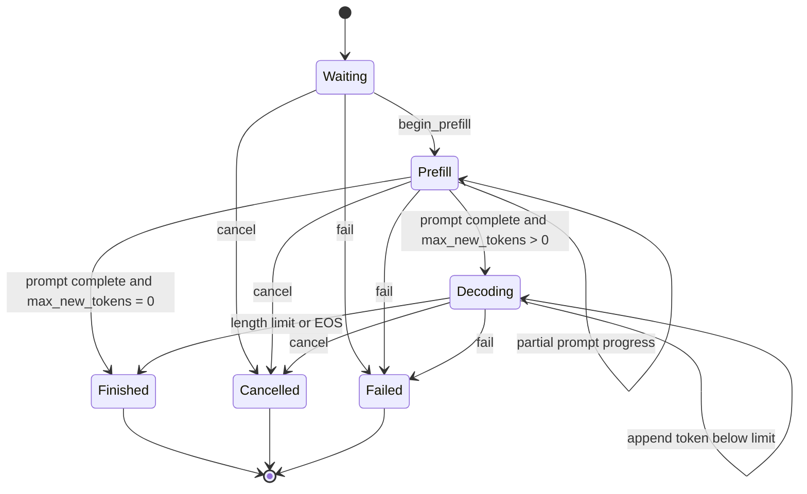

# Request and Scheduler Design

## Status

Milestones 14–16 are implemented and integrated by the M19 CPU engine: the
host-only request state machine feeds a single-thread-owned FIFO/token/KV-budget
scheduler, finished slots are refilled between iterations, and deterministic
metric aggregation exposes lifecycle distributions and rates. Normal, Release,
and ASan/UBSan-applicable paths pass in the current 186-test CPU suite. The CUDA
build passes 185 hardware-independent tests and explicitly skips 65 GPU tests (250
total); its container omits the Python converter test. This scheduler is host
policy and requires no GPU.

## Ownership and thread safety

A `Request` owns its immutable prompt tokens, generated-token records, lifecycle
state, terminal context, and timestamps. It is move-constructible but neither
copyable nor move-assignable. Moving invalidates the source ID, so one live object
owns the state associated with a nonzero `RequestId`. The scheduler owns these
objects; request methods are intentionally not internally synchronized.

`FifoScheduler` owns every submitted request through a `unique_ptr`; stable object
addresses permit read-only request inspection while queue containers change. A
FIFO deque contains waiting IDs and a bounded vector contains running IDs. Terminal
requests leave both containers but remain queryable in the ownership map, so IDs
cannot be reused accidentally. Retaining all terminal history is simple and useful
for metrics; the current engine releases terminal model sessions immediately but
does not yet reap/archive the retained logical request records.

`RequestId` is a strong 64-bit type with zero reserved as invalid. `TokenId` is a
separate strong 32-bit type; token zero is valid. This prevents a token, count, or
raw integer from being passed accidentally where a request identity is expected.

Returned prompt and generated-token spans are non-owning. Prompt storage is stable
until the request moves or dies. Appending a generated token can reallocate its
vector, so a generated-token span must not be retained across mutation.

## Lifecycle



No terminal state has an outgoing transition, and same-state progress is not
represented as a transition. The public `request_state_transition_allowed`
function defines the complete matrix and is tested across all 36 state pairs.

Prompts must contain at least one token. `max_new_tokens` may be zero; such a
request still performs prefill and finishes with the length reason when its prompt
is complete. Prefill can be reported in positive chunks and rejects work beyond
the remaining prompt. This is the boundary the token-budget scheduler will use.

`reused_prompt_tokens` records a prefix whose K/V already exists in the runtime's
physical authority. It must be smaller than the prompt and block aligned. The
value is seeded while the request is waiting, but `prompt_tokens_processed`
remains zero until FIFO admission; this preserves waiting-state timing and keeps
physical ownership separate from logical execution progress.

Generated tokens may be appended only during decode. Reaching the configured
limit atomically marks the request finished with `length`; the executor may finish
earlier with `end_of_sequence`. Cancellation and failure are accepted from any
active state and retain a required nonempty context. Invalid operations leave
state and token counters unchanged.

## Time and metrics contract

Request time uses `std::chrono::steady_clock`, so durations are immune to wall-
clock adjustments. Construction records `created_at`; every mutation receives its
event time explicitly. This makes scheduler simulations deterministic and allows a
future runtime to sample the clock once at the orchestration boundary. An event
earlier than prior activity is rejected transactionally.

The request records:

- first scheduling time,
- prefill completion time,
- every generated token and emission time,
- first and last token times,
- terminal completion time,
- derived waiting time and time to first token.

Per-token timestamps are sufficient to derive inter-token latency later without
introducing a scheduler-global clock. A cancelled or failed request has a completion
time but no fabricated first-token metric when it emitted nothing.

`SchedulerMetrics` snapshots an explicit `observed_at` boundary and reports state
counts, processed prompt/generated tokens, and four duration distributions:

- waiting time for every request that has first been scheduled;
- time to first token for every request that has emitted one;
- end-to-end request latency for successfully finished requests only;
- one sample for every adjacent generated-token interval within each request.

Each distribution contains sample count, minimum, arithmetic mean, p50, p95, and
maximum in seconds. P50/p95 use linear interpolation at `p*(N-1)` in sorted
samples. Successful requests/second and generated/processed tokens/second use the
window from the earliest request creation to `observed_at` and are undefined for a
zero-length window. Cancellation and failure are counted separately rather than
silently included in successful latency/throughput. Snapshot construction validates
IDs, duplicates, and time boundaries, then allocates and sorts; it is a reporting
path, not per-token hot-path instrumentation.

## Failure behavior and invariants

- zero request IDs and empty prompts are rejected at construction;
- zero-sized or overlarge prefill progress is rejected;
- decode output cannot exceed `max_new_tokens`;
- finish/EOS is legal only while decoding;
- cancellation/failure context cannot be empty;
- event time cannot move backward;
- terminal requests reject every later mutation;
- unknown enum values produce contextual errors when converted to names.

Ten deterministic request tests cover the definition/strong types, chunked prefill,
zero-generation completion, length and EOS completion, metrics, the transition
matrix, cancellation/failure from all active states, transactional invalid paths,
unknown enums, and move ownership.

## FIFO scheduling policy

Each call to `schedule_iteration(available_kv_blocks, now)` considers existing
running requests in stable admission order, then waiting requests in submission
order until one of three limits is reached:

- the per-iteration token budget;
- the maximum number of resident/running requests;
- the caller-reported number of free KV blocks.

Prefill work describes a positive prompt range `(token_offset, token_count)` and
may be chunked by either token or KV capacity. Decode work is exactly one generated
token per selected request. Existing requests are considered before new admission,
so this deliberately simple baseline can exhibit head-of-line delay. It does not
perform preemption, aging, priority scheduling, or prompt/decode fairness tuning.

At most one batch may be in flight. The returned nonzero `IterationId` must be
presented with an ordered completion vector of the same size. This prevents a
second scheduling decision from observing work whose device outcome is unknown.
Failed work carries only a nonempty error context; successful prefill carries no
token, while successful decode carries exactly one token and an optional EOS flag.

`submit_prefilled(request, reused_prompt_tokens)` is the narrow admission hook for
an external prefix cache. It validates the seed before taking ownership. At
admission, the scheduler records that many prompt tokens as completed and emits
prefill work beginning at the reused offset; cached tokens consume neither the
iteration token budget nor model work. `SchedulerStats` reports reused prompt
tokens separately from actually scheduled prefill tokens. Cancelling a waiting
seeded request reports the logical blocks represented by its fork so the runtime
can audit physical release.

## KV ownership boundary

The scheduler never owns or fabricates KV memory. Its input is a free-block
snapshot from the runtime's authoritative cache manager. Every work item reports
blocks owned before the iteration and blocks newly required; the batch reports the
sum. The runtime must reserve that exact amount before launching work. Completion,
failure, cancellation, and zero-generation retirement return exact release counts
for the runtime to reclaim.

For prefill and nonfinal decode, block demand is computed as
`ceil((prompt_processed + generated) / block_tokens)`.
Consequently, a request may append into slack in its last block even when the free
pool is empty. If the FIFO head cannot append one token, scheduling returns a
partial batch or no batch with `kv_capacity_limited=true`; it does not fail or
silently skip the request. One exception is predictable: when exactly one
length-limited generation token remains, its K/V will never be consumed by a later
step, so decode consumes one token of execution budget but reports zero new block
demand. This prevents deadlock when the current prefix ends exactly at a full block
and the pool has no free page. EOS is not predictable before execution and remains
conservatively capacity-reserved.

`CpuRuntimeEngine` supplies the physical paged cache's actual free-block snapshot,
checks each sequence length against the scheduled token offset, applies successful
appends, completes the ordered batch, and then releases every terminal sequence.
The scheduler's reported release count remains an audit value; the cache manager is
the physical ownership authority. For a reused prefix, the scheduler sees logical
blocks already owned; `PagedPrefixCache` and `PagedKvCache` establish and release
the underlying reference-counted fork before/after this policy boundary.

## Transactional completion

Completion uses two phases. First it validates the iteration identity, complete
ordered result vector, request state, work offsets, token/EOS/error contracts, and
release accounting without advancing any request. It then stages all failure
strings and generated-token vector capacity before mutation. Once mutation starts,
the remaining state transitions and vector insertions are nonallocating. A malformed
later completion therefore cannot leave an earlier request partially progressed.

Fourteen scheduler tests cover configuration, mixed prefill/decode batches, token and
running limits, KV exhaustion and partial-block slack, malformed whole-vector
completion, exact-boundary final decode, failure/release accounting, cancellation,
time validation, lookup, statistics, next-iteration replacement, seeded-prefix
admission, suffix-only work, validation rollback, and waiting cancellation. Three
additional metrics tests cover
exact distributions/rates, active states, empty samples, invalid IDs/duplicates,
and time regression. Together with the ten request tests, these paths pass in
normal and sanitized builds.

## Continuous replacement

Terminal requests are removed from `running_` during completion. The next
`schedule_iteration` considers surviving running requests and then immediately
admits waiting requests into the freed capacity. It never waits for the rest of an
original cohort:

```text
iteration 1 prefill: A B C D       (E waits)
iteration 2 decode:  A B C D       (A finishes)
iteration 3 mixed:     B C D E     (E begins prefill)
```

The batch may therefore contain one-token decode work and prompt ranges together.
The M19 CPU executor processes those work descriptions serially while preserving
the one-batch completion contract. A deterministic policy test checks the exact
membership/order above, and a separate real-model engine test confirms that a new
request enters while an earlier request continues paged decode.

## M15 host-policy benchmark

The Release benchmark reconstructs a scheduler outside timing, then times every
schedule/completion decision for a complete deterministic request trace. It does
not execute model math, allocate physical KV blocks, or measure inference. Median
CPU cost ranged from 48.777 us for 16 requests/256 logical token transitions to
1.342 ms for 128 requests/6,144 transitions across the four recorded workloads.
Exact configurations, repetitions, variation, and logical-work rates are in
`docs/PERFORMANCE.md`.

## M16 static-versus-continuous experiment

The policy harness compares continuous replacement with a static cohort barrier on
the same two mixed-length workloads. It separately reports measured host control-
path CPU time and a modeled schedule in which every batch—regardless of work kind
or shape—costs exactly 1 ms. Under that declared model, continuous batching used
48 versus 132 iterations for 32 requests and 92 versus 260 for 128 requests. The
corresponding 2.75x and 2.83x modeled rate differences are not measured model
throughput. Host control time showed only small differences, so no scheduler CPU
optimization is claimed. Full distributions and caveats are in
`docs/PERFORMANCE.md`.

## Remaining policy limitations

The baseline is strict FIFO with no priorities, aging, request preemption, or
fairness tuning between long prefill and decode. It accepts a validated reused-
prefix count but deliberately does not hash tokens, own K/V, or choose eviction;
those are runtime/cache responsibilities. Terminal request history is retained
indefinitely. The scheduler is wired to the physical CPU paged-cache authority and
real model executor, but work descriptions execute serially rather than as a
tensor batch. M16's synthetic policy rates remain policy evidence; M19/M22's
separate benchmarks measure CPU execution traces.
